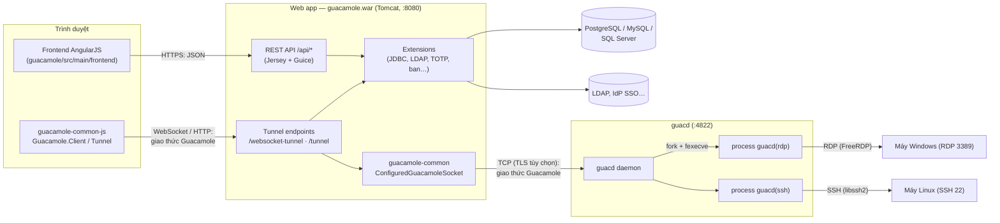
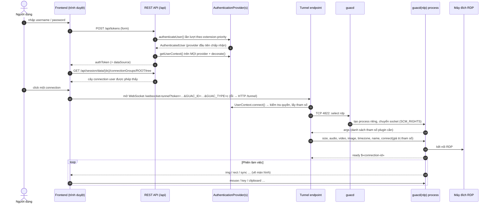

# 02 · Kiến trúc tổng thể

> Ai đọc: dev và người vận hành muốn hiểu các phần nói chuyện với nhau thế nào.
> Đọc xong biết một cú click "mở kết nối" đi qua những lớp nào, lỗi ở lớp nào thì
> tìm ở đâu.
>
> Trước: [01-tong-quan.md](01-tong-quan.md) · Tiếp: [03-guacamole-server/](03-guacamole-server/README.md)
> hoặc [04-guacamole-client/](04-guacamole-client/README.md)

## Sơ đồ thành phần

Ranh giới cần nhớ:

| Ranh giới | Quy tắc | Vì sao |
| --- | --- | --- |
| Trình duyệt ↔ guacd | Trình duyệt **không bao giờ** nói chuyện trực tiếp với guacd; luôn qua web app. | guacd **không có xác thực** (README `src/guacd-docker/README.md`): ai tới được cổng 4822 là mở được kết nối tới bất kỳ đâu guacd tới được. Web app mới là nơi kiểm tra quyền. |
| Web app ↔ máy đích | Web app không mở RDP/VNC/SSH; nó chỉ gửi **tham số kết nối** cho guacd. | Toàn bộ code giao thức nhị phân nằm ở C (FreeRDP, libvncclient, libssh2). |
| Lõi web app ↔ nguồn dữ liệu | Lõi không biết user/connection lưu ở đâu; mọi thứ đi qua `AuthenticationProvider` / `UserContext` của extension. | Cho phép ghép nhiều nguồn (DB + LDAP + TOTP) mà không sửa lõi. |
| guacd ↔ từng kết nối | Mỗi kết nối chạy trong **một process riêng** `guacd(<giao thức>)`. | Plugin crash không kéo theo các phiên khác; user join chung phiên được chuyển vào đúng process. |

## Luồng chính: đăng nhập → mở kết nối

Vị trí code từng bước (đường dẫn so với `guacamole-client/`, trừ khi ghi khác):

| Bước | Code |
| --- | --- |
| 2 | `guacamole/src/main/frontend/src/app/auth/service/authenticationService.js` → `guacamole/src/main/java/org/apache/guacamole/rest/auth/TokenRESTService.java` |
| 3–5 | `guacamole/src/main/java/org/apache/guacamole/rest/auth/AuthenticationService.java` (`authenticateUser`, `getUserContexts`), `extension/AuthenticationProviderFacade.java`, `rest/auth/HashTokenSessionMap.java` |
| 7 | `frontend/src/app/rest/services/connectionGroupService.js` → `rest/session/UserContextResource` |
| 9 | `frontend/src/app/client/types/ManagedClient.js` (tạo `ChainedTunnel(WebSocketTunnel, HTTPTunnel)`) → `tunnel/websocket/RestrictedGuacamoleWebSocketTunnelEndpoint` / `tunnel/http/RestrictedGuacamoleHTTPTunnelServlet` |
| 10 | `tunnel/TunnelRequestService.java` (`createTunnel`) → `Connection.connect()` của extension, ví dụ `guacamole-ext/.../net/auth/simple/SimpleConnection.java`, `extensions/guacamole-auth-jdbc/.../tunnel/AbstractGuacamoleTunnelService.java` |
| 11–16 | `guacamole-common/src/main/java/org/apache/guacamole/protocol/ConfiguredGuacamoleSocket.java` ↔ `guacamole-server/src/guacd/connection.c`, `proc.c`, `src/libguac/user-handshake.c` |

Chi tiết từng phía: [04-guacamole-client/02-webapp-rest-va-tunnel.md](04-guacamole-client/02-webapp-rest-va-tunnel.md),
[03-guacamole-server/02-guacd.md](03-guacamole-server/02-guacd.md),
[03-guacamole-server/03-libguac-va-giao-thuc.md](03-guacamole-server/03-libguac-va-giao-thuc.md).

## Muốn làm X → sửa ở đâu

| Muốn | Sửa ở | Đọc |
| --- | --- | --- |
| Thêm / sửa tham số một giao thức (vd. tùy chọn RDP mới) | `guacamole-server/src/protocols/
/settings.c` **và** khai báo form ở `guacamole-client/guacamole-ext/src/main/resources/org/apache/guacamole/protocols/
.json` + bản dịch `guacamole/src/main/frontend/src/translations/*.json` | [03/04](03-guacamole-server/04-plugin-giao-thuc.md) |
| Thêm giao thức mới | Plugin mới `src/protocols/
/` (export `guac_client_init`) + `configure.ac` + `Makefile.am` + file `.json` ở client | [03/04](03-guacamole-server/04-plugin-giao-thuc.md) |
| Đổi cách guacd nhận / chia process | `guacamole-server/src/guacd/` | [03/02](03-guacamole-server/02-guacd.md) |
| Thêm nguồn đăng nhập (SSO, DB khác…) | Extension mới implement `AuthenticationProvider` | [04/04](04-guacamole-client/04-extension.md) |
| Đổi giao diện / logo / chữ | Extension branding (không sửa webapp) — mẫu `guacamole-client/doc/guacamole-branding-example/` | [04/04](04-guacamole-client/04-extension.md) |
| Sửa màn hình web | `guacamole-client/guacamole/src/main/frontend/src/app/<module>/` | [04/03](04-guacamole-client/03-frontend.md) |
| Thêm REST endpoint | `guacamole-client/guacamole/src/main/java/org/apache/guacamole/rest/` hoặc qua extension: `AuthenticationProvider.getResource()` → `/api/ext/{id}`, `UserContext.getResource()` → `/api/session/ext/{ds}` | [04/02](04-guacamole-client/02-webapp-rest-va-tunnel.md) |
| Nhúng Guacamole vào app riêng (không dùng webapp chuẩn) | Dùng `guacamole-common` + `guacamole-common-js` — mẫu `guacamole-client/doc/guacamole-example/` | [04/01](04-guacamole-client/01-cau-truc-maven.md) |
| Đổi cấu hình triển khai (DB, proxy, biến) | `docs/06-van-hanh/` — không sửa code | [06](06-van-hanh/README.md) |

## Ràng buộc cứng

- **guacd chỉ được nghe trong mạng nội bộ** (trong Docker: không publish cổng 4822). Lý do: không xác thực — xem bảng ranh giới ở trên.
- **Tham số kết nối là "hợp đồng" giữa 2 repo**: tên tham số trong `settings.c` (C) phải trùng tên trong file `protocols/
.json` (Java). Tên không khớp → web app gửi giá trị nhưng guacd bỏ qua (không có lỗi rõ ràng).
- **Phiên bản giao thức**: libguac hiện quảng bá `VERSION_1_5_0` (`src/libguac/guacamole/protocol-constants.h:41`), `guacamole-common` có `GuacamoleProtocolVersion` để thương lượng. Nên chạy web app và guacd **cùng phiên bản phát hành** (vd. cả hai `1.6.0`).
- **Session nằm trong RAM của web app** (`HashTokenSessionMap`): restart container `guacamole` = mọi người bị đăng xuất; không chạy nhiều bản web app sau load balancer mà không có sticky session (suy luận từ code, chưa kiểm chứng).
