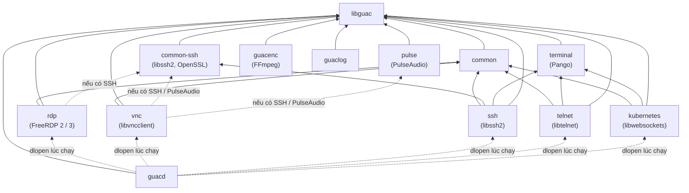

# 03/01 · Cấu trúc mã nguồn guacamole-server

> Ai đọc: dev mới vào phần C. Đọc xong biết mỗi thư mục làm gì và cái gì phụ
> thuộc cái gì. Đường dẫn trong file này tính từ `guacamole-server/`.
>
> Trước: [README](README.md) · Tiếp: [02-guacd.md](02-guacd.md)

## Bản đồ thư mục

| Đường dẫn | Sản phẩm build | Vai trò |
| --- | --- | --- |
| `src/libguac/` | `libguac.la` (cài header vào `$(includedir)/guacamole`) | Thư viện lõi: client, user, socket, parser, protocol, display, stream, recording, thread… Mọi phần khác đều link vào đây. |
| `src/libguac/guacamole/` | — | **Header public** của libguac (API cho plugin). |
| `src/common/` | thư viện nội bộ | Tiện ích dùng chung: clipboard, con trỏ chuột mẫu, iconv, json, list, rect, string, surface. |
| `src/common-ssh/` | thư viện nội bộ | SSH / SFTP dùng chung (`ssh.c`, `sftp.c`, `key.c`, `user.c`). Chỉ build khi có libssh2 + OpenSSL. Dùng bởi plugin SSH và tính năng SFTP của RDP / VNC. |
| `src/terminal/` | `libguac-terminal` | Trình giả lập terminal (vẽ chữ bằng Pango, scrollback, chọn chữ, typescript). Dùng bởi SSH, Telnet, Kubernetes. |
| `src/pulse/` | thư viện nội bộ | Thu âm thanh PulseAudio — cho VNC có âm thanh. |
| `src/protocols/{rdp,vnc,ssh,telnet,kubernetes}/` | `libguac-client-
.la` | Plugin giao thức, guacd nạp bằng `dlopen`. Xem [04](04-plugin-giao-thuc.md). |
| `src/guacd/` | `guacd` | Daemon. Xem [02](02-guacd.md). Có man page `man/guacd.8.in`, `man/guacd.conf.5.in`, file dịch vụ `systemd/`, `init.d/`. |
| `src/guacd-docker/` | — | `README.md` của image, `bin/autobuild.sh` (clone + build thư viện ngoài), `bin/entrypoint.sh`, `bin/list-dependencies.sh`. |
| `src/guacenc/` | `guacenc` | Chuyển file recording → video `.m4v` (cần FFmpeg). |
| `src/guaclog/` | `guaclog` | Chuyển phím gõ trong recording → file text. |
| `bin/` | — | `guacctl` (script điều khiển terminal Guacamole từ trong phiên SSH) và `guacget` (symlink tới `guacctl`). |
| `util/generate-test-runner.pl` | — | Sinh file chạy test CUnit từ tên hàm `test_<suite>__<tên>()`. |
| `doc/libguac/`, `doc/libguac-terminal/` | — | Chỉ có `Doxyfile.in` (cấu hình Doxygen sinh API docs). |
| `configure.ac`, `Makefile.am`, `m4/` | — | Hệ build GNU Autotools. Xem [05](05-build-va-test.md). |
| `Dockerfile` | image `guacamole/guacd` | Build nhiều stage trên Alpine. Xem [05](05-build-va-test.md#docker-image). |
| `.github/workflows/pr-build.yml` | — | CI: chỉ chạy `docker build` khi có pull request. |

## Phụ thuộc giữa các phần

- Mũi tên liền = luôn link lúc build (theo `*_LIBADD` trong
  `src/protocols/
/Makefile.am`). Mũi tên chấm từ rdp / vnc = chỉ link khi
  `./configure` tìm thấy thư viện (SFTP cho RDP/VNC, âm thanh cho VNC).
- Mũi tên chấm từ guacd = guacd **không link** plugin, chỉ nạp file `libguac-client-
.so` lúc có kết nối (`src/libguac/client.c`, hàm
  `guac_client_load_plugin`). Thiếu plugin → guacd log
  `Support for protocol "
" is not installed`.
- Phần nào được build phụ thuộc thư viện tìm thấy lúc `./configure` (mỗi
  `SUBDIRS += …` trong `Makefile.am` nằm dưới một điều kiện `ENABLE_*`). Ví dụ
  thiếu `libtelnet` → không có plugin Telnet, **không báo lỗi**, chỉ hiện trong
  bảng tóm tắt cuối `./configure`.

## Đọc code bắt đầu từ đâu

| Muốn hiểu | Mở file |
| --- | --- |
| guacd nhận kết nối | `src/guacd/daemon.c` (`main`) → `connection.c` (`guacd_route_connection`) |
| Process mỗi kết nối | `src/guacd/proc.c` (`guacd_create_proc`, `guacd_exec_proc`), `proc-child.c` |
| Parse lệnh giao thức | `src/libguac/parser.c`, `src/libguac/guacamole/parser.h` |
| Handshake | `src/libguac/user-handshake.c`, `user-handlers.c` |
| Gửi lệnh vẽ | `src/libguac/protocol.c` (`guac_protocol_send_*`), `display*.c` |
| Một plugin đơn giản để học | `src/protocols/telnet/` (ít file nhất có terminal) hoặc `src/protocols/vnc/` (đồ họa) |

Phong cách code: header có comment Javadoc-style (`/** … @param … */`) cho mọi
hàm public — đọc header trước file `.c`. Quy ước chi tiết: [05-quy-uoc-va-dong-gop.md](../05-quy-uoc-va-dong-gop.md).
