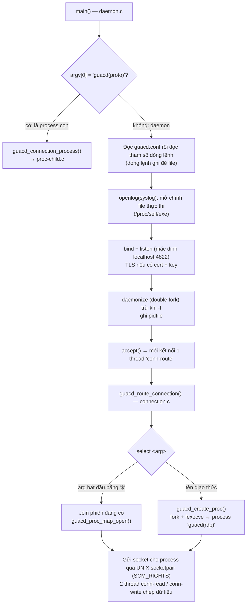

# 03/02 · guacd — proxy daemon

> Ai đọc: dev sửa guacd, người vận hành cần hiểu cấu hình / log của guacd. Đường
> dẫn tính từ `guacamole-server/src/guacd/` trừ khi ghi khác.
>
> Trước: [01-cau-truc-ma-nguon.md](01-cau-truc-ma-nguon.md) · Tiếp: [03-libguac-va-giao-thuc.md](03-libguac-va-giao-thuc.md)

## Vòng đời



Các bước chính trong `daemon.c` `main()` (dòng ~377 trở đi):

1. Nếu tên process có dạng `guacd(<proto>)` → đây là **process con của một kết nối**, nhảy sang `guacd_connection_process()`.
2. Kiểm tra fd 0–4 đang mở, đọc cấu hình: `guacd_conf_load()` (file) rồi `guacd_conf_parse_args()` (dòng lệnh).
3. Mở log syslog `openlog("guacd", LOG_PID, LOG_DAEMON)`; mở fd tới chính file thực thi (`guacd_open_exe()`: `/proc/self/exe`, sysctl trên FreeBSD, hoặc `realpath`).
4. `getaddrinfo` + bind địa chỉ đầu tiên dùng được (`SO_REUSEADDR`). Có cert + key → tạo `SSL_CTX` (OpenSSL, `TLS_server_method`).
5. Daemonize (trừ `-f`), ghi pidfile, bỏ qua SIGPIPE, xử lý SIGINT/SIGTERM.
6. `listen(fd, 5)`; mỗi kết nối: bật `TCP_NODELAY`, timeout gửi/nhận 15 giây, tạo thread tách rời.
7. Khi tắt: dừng mọi process con, chờ tối đa `GUACD_CLEANUP_TIMEOUT` (5000 ms) rồi SIGKILL từng process group.

## Mô hình process — vì sao mỗi kết nối một process

`proc.c` `guacd_create_proc()`:

1. Tạo `socketpair(AF_UNIX, SOCK_DGRAM)` (để chuyển fd của user) và một pipe cấu hình.
2. `fork()`. Process con: `setpgid(0,0)`, đặt socket vào fd 3, pipe vào fd 4 (`GUACD_PROC_SOCKET_FD`, `GUACD_PROC_CONFIG_FD` trong `proc-child.h`), rồi **`fexecve()` chạy lại chính binary guacd** với `argv[0] = "guacd(<proto>)"`.
3. Process cha ghi struct `guacd_proc_config` (log level, pid cha, connection ID, hạn khởi động) vào pipe và chờ con đóng pipe; quá hạn → giết con.
4. Process con (`proc-child.c`): đặt hạn khởi động bằng SIGALRM, `PR_SET_PDEATHSIG` (Linux) để tự chết khi cha chết, rồi `guacd_exec_proc()`:
   - nạp plugin `libguac-client-<proto>.so` (`guac_client_load_plugin`),
   - vòng lặp `guacd_recv_fd()`: fd đầu tiên là **owner** (người mở phiên), các fd sau là **user join** (chia sẻ phiên),
   - mỗi user một thread `user-conn` chạy `guac_user_handle_connection()` (handshake + vòng lặp lệnh, xem [03](03-libguac-va-giao-thuc.md)).

Hệ quả cần biết:

| Hệ quả | Giải thích |
| --- | --- |
| Plugin crash chỉ chết một phiên | Process riêng, cùng process group riêng. |
| Chia sẻ phiên / join | Web app gửi `select $<connection-id>`; guacd tìm process trong `proc-map.c` (hash map, tối đa `GUACD_CLIENT_MAX_CONNECTIONS` = 65536) và chuyển socket sang đó. Không thấy → lỗi `No such connection.` |
| `ps` thấy tên `guacd(rdp)` | `proc-title.c` đổi title process, kèm thông tin kết nối (username bị che một phần bằng `****`). |
| `fexecve` thay vì chỉ `fork` | Process con có không gian bộ nhớ sạch (mới trên `main`, chưa có ở 1.6.0 — commit `c6884bcc` "GUACAMOLE-2118: Migrate to re-exec after fork()…"). Hệ quả: binary guacd phải còn tồn tại / mở được khi tạo kết nối (lý do `guacd_open_exe()` mở fd từ đầu). |
| Timeout handshake | guacd chờ lệnh `select` tối đa `GUACD_USEC_TIMEOUT` = 15 giây (`proc.h`). |

## Cấu hình

Thứ tự ưu tiên: **giá trị mặc định → file `guacd.conf` → tham số dòng lệnh** (dòng
lệnh parse sau nên thắng).

### Tham số dòng lệnh (`conf-args.c`, getopt `"l:b:p:L:C:K:fv"`)

| Cờ | Ý nghĩa | Mặc định |
| --- | --- | --- |
| `-b HOST` | Địa chỉ lắng nghe | `localhost` (`conf.h`) |
| `-l PORT` | Cổng | `4822` |
| `-p FILE` | Ghi PID ra file | không ghi |
| `-L LEVEL` | Mức log: `trace`, `debug`, `info`, `warning`, `error` | `info` |
| `-C FILE` | Chứng chỉ TLS (chỉ khi build có OpenSSL) | — |
| `-K FILE` | Khóa TLS | — |
| `-f` | Chạy foreground (log ra cả stderr) | daemonize |
| `-v` | In phiên bản rồi thoát | — |

### File cấu hình (`conf-file.c`)

Đường dẫn: macro `GUACD_CONF_FILE`, mặc định `/etc/guacamole/guacd.conf` (đổi bằng
`./configure --with-guacd-conf=…`). Không có file → dùng mặc định. **Khóa / mục
không biết → lỗi parse, guacd không chạy.**

```ini
[server]
bind_host = 0.0.0.0
bind_port = 4822

[daemon]
pid_file  = /var/run/guacd.pid
log_level = info

[ssl]
server_certificate = /etc/ssl/certs/guacd.crt
server_key         = /etc/ssl/private/guacd.key
```

Man page: `man/guacd.8.in`, `man/guacd.conf.5.in`.

### Trong Docker

Image `guacamole/guacd` chạy `src/guacd-docker/bin/entrypoint.sh`:

```sh
exec /opt/guacamole/sbin/guacd -f -b 0.0.0.0 -L "${LOG_LEVEL:-${GUACD_LOG_LEVEL:-info}}" "$@"
```

→ chỉ cấu hình được mức log qua biến `LOG_LEVEL` (`GUACD_LOG_LEVEL` là tên cũ, còn
dùng được nhưng in cảnh báo); tham số khác thêm vào sau tên image (`"$@"`). Bảng biến
đầy đủ: [06-van-hanh/05-bien-moi-truong.md](../06-van-hanh/05-bien-moi-truong.md).

## Log

- `log.c`: ghi syslog và (khi `-f`) stderr theo dạng `guacd[<pid>]: <LEVEL>:\t<thông điệp>`.
- Process con dùng log level nhận từ cha qua `guacd_proc_config`.
- Dòng hay gặp khi gỡ lỗi:

| Dòng log | Nghĩa |
| --- | --- |
| `Guacamole proxy daemon (guacd) version … started` | Daemon đã lên (chuỗi chính xác xem `daemon.c`). |
| `Creating new client for protocol "rdp"` | Có kết nối mới, sắp tạo process. |
| `Support for protocol "…" is not installed` | Thiếu file plugin `.so` (build thiếu thư viện). |
| `Connection "$…" removed.` | Phiên kết thúc. |

## Dịch vụ hệ thống (khi cài từ source)

| File | Cài khi | Nội dung |
| --- | --- | --- |
| `systemd/guacd.service.in` | `./configure --with-systemd-dir=…` | `User=@systemduser@` (mặc định `daemon`, đổi bằng `--with-systemd-user`), `ExecStart=@sbindir@/guacd -f`, `Restart=on-abnormal` |
| `init.d/guacd.in` | `./configure --with-init-dir=/etc/init.d` | start/stop/status/restart…, pidfile `/var/run/guacd.pid` |

## Bảo mật

- **Không có xác thực ở guacd.** Bất kỳ ai kết nối tới cổng 4822 đều có thể yêu cầu
  mở RDP/SSH/VNC tới bất kỳ máy nào guacd tới được (và đọc / ghi file ở đường dẫn
  drive / recording guacd có quyền). Chỉ bind vào mạng nội bộ / Docker network.
- TLS (`-C`/`-K`) chỉ mã hóa đường web app ↔ guacd; bật phía web app bằng
  `guacd-ssl: true`. Cần khi guacd ở máy khác web app.

Kiểm tra guacd có đang nghe không (từ máy chạy web app): `nc -z <host-guacd> 4822`
→ exit code 0. Image Docker dùng đúng lệnh này làm `HEALTHCHECK`.
