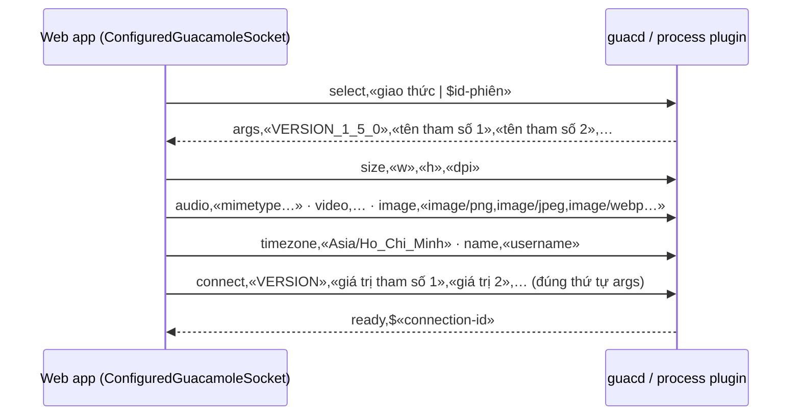

# 03/03 · libguac và giao thức Guacamole

> Ai đọc: dev muốn hiểu dữ liệu chạy qua tunnel, viết / sửa plugin, hoặc gỡ lỗi
> bằng cách đọc lưu lượng. Đường dẫn tính từ `guacamole-server/src/libguac/`.
>
> Trước: [02-guacd.md](02-guacd.md) · Tiếp: [04-plugin-giao-thuc.md](04-plugin-giao-thuc.md)

Đặc tả đầy đủ: manual chính thức, chương "The Guacamole protocol" và "Protocol
reference" (<https://guacamole.apache.org/doc/gug/>). File này chỉ ghi phần gắn với code.

## Định dạng lệnh (instruction)

Mỗi lệnh là danh sách phần tử, mỗi phần tử viết `ĐỘ-DÀI.GIÁ-TRỊ`, phân cách bằng `,`,
kết thúc bằng `;`. Phần tử đầu là **opcode**.

```text
4.size,1.0,4.1024,3.768;
└─┬──┘ └┬┘ └──┬─┘ └─┬─┘
opcode  layer width height
```

- Độ dài tính bằng **số ký tự Unicode** (code point), không phải byte — nên chuỗi
  tiếng Việt `3.Việ` hợp lệ dù nhiều byte UTF-8 (xử lý trong `parser.c`, `unicode.c`).
- Giới hạn (`guacamole/parser-constants.h`): một lệnh tối đa `8192` byte,
  độ dài tối đa `5` chữ số, tối đa `128` phần tử.
- Dữ liệu nhị phân (ảnh, file, âm thanh) đi qua **stream**: `img`/`file`/`audio` mở
  stream → nhiều lệnh `blob` (base64) → `end`. Bên nhận trả `ack` để điều tiết.

Code parse: `parser.c` (`guac_parser_read`, `guac_parser_expect`). Phía Java:
`guacamole-client/guacamole-common/.../protocol/GuacamoleParser.java`; phía JS:
`guacamole-common-js/src/main/webapp/modules/Parser.js`.

## Handshake



- Phía server: `user-handshake.c` (`guac_user_handle_connection`); các lệnh trong
  pha handshake được map ở `user-handlers.c` (bảng thứ hai: `size`, `audio`,
  `video`, `image`, `timezone`, `name`).
- `args` = phiên bản giao thức + `client->args` mà plugin khai báo (xem [04](04-plugin-giao-thuc.md)).
  `connect` phải có **đúng số phần tử = số args + 1**; sai → handshake thất bại.
- Phiên bản: libguac quảng bá `VERSION_1_5_0` (`guacamole/protocol-constants.h:41`).
- `ready` trả **connection ID** dạng `$<uuid>` — chính là ID dùng để join / chia sẻ
  phiên và hiển thị trong "Active sessions".

## Lệnh trong phiên

**Client → server** (`user-handlers.c`, bảng `__guac_instruction_handler_map`):

| Nhóm | Opcode |
| --- | --- |
| Nhập liệu | `mouse`, `key`, `touch`, `size` (đổi kích thước cửa sổ) |
| Clipboard, file, stream | `clipboard`, `file`, `pipe`, `blob`, `end`, `ack`, `get`, `put`, `audio` (micro) |
| Điều khiển | `sync` (xác nhận đã vẽ xong frame — dùng đo độ trễ), `argv` (đổi tham số lúc đang chạy), `nop`, `disconnect` |
| USB | `usbconnect`, `usbdata`, `usbdisconnect` |

**Server → client** (`guacamole/protocol.h`, hàm `guac_protocol_send_<opcode>`):

| Nhóm | Opcode |
| --- | --- |
| Vẽ | `img`, `rect`, `cfill`, `copy`, `transfer`, `arc`, `curve`, `line`, `cstroke`, `lfill`, `lstroke`, `clip`, `push`, `pop`, `reset`, `transform`, `identity`, `start`, `close` |
| Layer | `size`, `move`, `shade`, `distort`, `dispose`, `cursor` |
| Stream | `blob`, `end`, `ack`, `audio`, `video`, `file`, `pipe`, `body`, `filesystem`, `undefine` |
| Khác | `sync`, `clipboard`, `name`, `msg`, `required` (yêu cầu thêm thông tin, vd. mật khẩu), `argv`, `set`, `nest`, `error`, `log`, `disconnect`, `nop` |

## Các khối API chính của libguac

Header public trong `guacamole/` (đọc comment trong header là tài liệu API):

| Khối | Header | Dùng để |
| --- | --- | --- |
| Client | `client.h`, `client-types.h`, `client-fntypes.h`, `client-constants.h` | `guac_client` = **một phiên kết nối** (một process plugin). Chứa `args`, `data` (dữ liệu riêng plugin), handler `join_handler`, `join_pending_handler`, `leave_handler`, `free_handler`; gửi lệnh tới mọi user (`client->socket` là broadcast). |
| User | `user.h`, `user-*.h` | `guac_user` = **một người** trong phiên (owner hoặc người join). Handler `mouse_handler`, `key_handler`, `clipboard_handler`, `file_handler`, `size_handler`, `argv_handler`…; `guac_user_parse_args_string/int/boolean…` để đọc tham số. |
| Socket | `socket.h`, `socket-ssl.h`, `socket-wsa.h` | Trừu tượng hóa đọc/ghi: fd, SSL, broadcast (`socket-broadcast.c`), tee (`socket-tee.c` — dùng cho recording), nest. |
| Parser / protocol | `parser.h`, `protocol.h`, `protocol-types.h` | Đọc lệnh, gửi lệnh. |
| Display | `display.h`, `layer.h` | `guac_display` (mới ở 1.6): plugin vẽ vào layer, libguac tự tính phần thay đổi, chọn mã hóa (PNG / JPEG / WebP) và gửi theo frame (`display-plan*.c`, `display-render-thread.c`, `guac_display_end_frame`). |
| Stream / object | `stream.h`, `object.h` | Stream dữ liệu, object filesystem (duyệt file trong panel). |
| Âm thanh | `audio.h` | Gửi âm thanh (PCM). |
| Recording | `recording.h` | `guac_recording_create(...)`: ghi mọi lệnh ra file (`.guac`); chọn có ghi output / chuột / phím / touch / clipboard. |
| Plugin | `plugin.h`, `plugin-constants.h` | Quy ước tên `libguac-client-<p>.so` + symbol `guac_client_init`. |
| Tiện ích | `mem.h`, `string.h`, `thread.h`, `rwlock.h`, `flag.h`, `pool.h`, `fifo.h`, `hash.h`, `tcp.h`, `wol.h` (Wake-on-LAN), `timestamp.h`, `unicode.h`, `fips.h`, `error.h`, `argv.h` | Dùng `guac_mem_alloc` / `guac_mem_zalloc` / `guac_mem_free` thay `malloc`; `guac_thread_create(..., "tên")` thay `pthread_create`. |

## File recording

- Định dạng = chính các lệnh server → client (thêm lệnh nhập liệu nếu bật
  `include_mouse`/`include_keys`) ghi tuần tự, nên có thể phát lại bằng
  `Guacamole.SessionRecording` (JS) hoặc chuyển video bằng `guacenc` (xem [05](05-build-va-test.md#công-cụ-recording-guacenc-guaclog)).
- Quyền file: `0640` (`recording.c`: `S_IRUSR | S_IWUSR | S_IRGRP`); thư mục tự tạo
  có quyền `0750` (`file.c`). Tên trùng → thêm hậu tố số, tối đa 255.
- File đang ghi bị khóa ghi (`file.c`); `guacenc` từ chối file đang bị khóa trừ khi `-f`.

Hệ quả vận hành của quyền file (web app đọc recording cần cùng group): xem
[06-van-hanh/02-trien-khai-docker-compose.md](../06-van-hanh/02-trien-khai-docker-compose.md#bước-9--bật-ghi-phiên-tùy-chọn).
