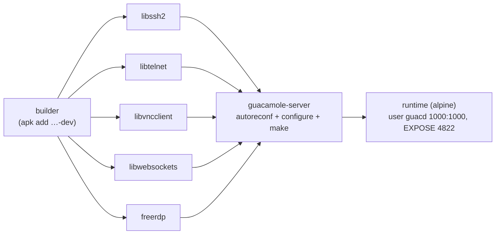

# 03/05 · Build, test và công cụ của guacamole-server

> Ai đọc: dev cần build guacd từ source, chạy test, build image Docker hoặc dùng
> `guacenc` / `guaclog`. Đường dẫn tính từ `guacamole-server/`.
>
> Trước: [04-plugin-giao-thuc.md](04-plugin-giao-thuc.md) · Tiếp: [04-guacamole-client/](../04-guacamole-client/README.md)

> **Chưa kiểm chứng.** Mọi lệnh build trong file này rút ra từ `configure.ac`,
> `Makefile.am`, `README`, `Dockerfile` và **chưa được chạy** (yêu cầu chỉ đọc code).
> Trước khi chạy, đọc [01-tong-quan § An toàn](../01-tong-quan.md#an-toàn-khi-làm-việc-với-mã-nguồn):
> build trong máy ảo / container dùng một lần.

## Môi trường build

- **Linux** là môi trường chính (guacd dùng `/proc/self/exe`, `prctl(PR_SET_PDEATHSIG)`;
  có nhánh dự phòng cho FreeBSD). macOS không phải mục tiêu chính — trên máy Mac nên
  build trong container / VM Linux.
- Cách ít rủi ro nhất để có một môi trường đúng: đọc stage `builder` trong `Dockerfile`
  (Alpine 3.18, danh sách gói `apk add` đầy đủ) — đó cũng chính là môi trường CI dùng.

## Dependency (`configure.ac`)

**Bắt buộc**: Cairo, libjpeg(-turbo), libpng, pthread, librt (`timer_create`), libdl
(nếu `dlopen` không có sẵn), thư viện UUID (libuuid **hoặc** OSSP uuid). Thiếu →
`./configure` dừng với lỗi.

**Tùy chọn** (mặc định "check" = có thì bật, không có thì bỏ, **không báo lỗi**):

| Tính năng | Thư viện | Cờ `configure` |
| --- | --- | --- |
| RDP | FreeRDP 2 (thử trước) hoặc 3 | `--with-rdp`, `--with-freerdp-plugin-dir`, `--enable-allow-freerdp-snapshots` |
| SSH | libssh2 (phải có `libssh2_userauth_publickey_frommemory`) + OpenSSL + Pango | `--with-ssh`, `--with-ssl`, `--with-pango`, `--enable-ssh-agent` |
| Telnet | libtelnet + Pango | `--with-telnet`, `--with-terminal` |
| VNC | libvncclient; âm thanh: PulseAudio | `--with-vnc`, `--with-pulse` |
| Kubernetes | libwebsockets + OpenSSL + Pango | `--with-websockets`, `--disable-kubernetes` |
| Nén ảnh WebP | libwebp | `--with-webp` |
| Âm thanh Ogg | libvorbis | `--with-vorbis` |
| `guacenc` | libavcodec, libavformat, libavutil, libswscale (FFmpeg) | `--with-libavcodec` …, `--disable-guacenc` |
| Không build guacd / guaclog | — | `--disable-guacd`, `--disable-guaclog` |
| Dịch vụ hệ thống | — | `--with-init-dir=…`, `--with-systemd-dir=…`, `--with-systemd-user=…` (mặc định `daemon`) |
| Vị trí `guacd.conf` | — | `--with-guacd-conf=…` (mặc định `/etc/guacamole/guacd.conf`) |
| Test | CUnit | (tự phát hiện; thiếu thì `make check` không có test) |

Tên gói theo distro: xem manual chương "Installing Guacamole natively" (danh sách
gói Debian / Ubuntu / Fedora); hoặc danh sách `apk add` trong `Dockerfile` cho Alpine.

## Build từ git

Repo git **không có sẵn** file `configure` (chỉ có `configure.ac`), nên phải sinh trước:

| Bước | Lệnh | Kết quả mong đợi | Nếu sai |
| --- | --- | --- | --- |
| 1 | `autoreconf -fi` | Sinh `configure`, `Makefile.in`, thư mục `build-aux/` | Thiếu `autoconf`/`automake`/`libtool` → cài. `m4/README` tồn tại để thư mục `m4/` không rỗng. |
| 2 | `./configure --with-systemd-dir=/etc/systemd/system` | Kết thúc bằng bảng **"Library status / Protocol support / Services / tools"** | Giao thức cần mà hiện `no` → thiếu thư viện tương ứng (bảng trên), cài rồi chạy lại bước 2. |
| 3 | `make -j"$(nproc)"` | Không lỗi. Code build với `-Werror -Wall -pedantic` (vd. `src/guacd/Makefile.am`) nên **mọi warning là lỗi**. | Lỗi deprecation từ thư viện mới (vd. OpenSSL, FreeRDP) → Dockerfile tự thêm `CPPFLAGS=-Wno-error=deprecated-declarations`; có thể làm tương tự. |
| 4 | `make check` | Các binary `test_*` chạy, output TAP `PASS` / `FAIL` | Thiếu CUnit → cài `cunit-dev` / `libcunit1-dev`. |
| 5 | `sudo make install && sudo ldconfig` | `guacd` ở `/usr/local/sbin/`, plugin `libguac-client-*.so` ở `/usr/local/lib/` | guacd báo `is not installed` khi kết nối → thiếu `ldconfig` hoặc plugin không được build (xem bước 2). |
| 6 | `guacd -f -L debug` | Log `Guacamole proxy daemon (guacd) version 1.6.1 started` và `Listening on host …, port 4822` | Cổng bị chiếm → `-l <cổng khác>`. |

Kiểm tra nhanh sau bước 6 (máy khác terminal): `nc -z 127.0.0.1 4822 && echo OK`.

## Test (CUnit)

Theo `README-unit-testing.md`:

- Mỗi test là hàm `void test_<SUITE>__<TÊN>(void)` (2 dấu gạch dưới) — **bắt buộc**,
  vì `util/generate-test-runner.pl` quét đúng mẫu tên này để sinh `_generated_runner.c`.
  Hàm không phải test **không được** đặt tên theo mẫu đó.
- Mỗi thư mục test có `Makefile.am` khai báo `check_PROGRAMS = test_<proj>`, `TESTS = $(check_PROGRAMS)`, driver TAP `build-aux/tap-driver.sh`.
- Ví dụ: `src/libguac/tests/parser/read.c` → `test_parser__read()`.

| Thư mục test | Binary | Phạm vi |
| --- | --- | --- |
| `src/libguac/tests/` | `test_libguac` | client, fifo, file, flag, id, mem, parser, pool, protocol, rect, socket, string, thread, unicode |
| `src/common/tests/` | `test_common` | tiện ích chung |
| `src/common-ssh/tests/` | | SSH / SFTP |
| `src/terminal/tests/` | | terminal |
| `src/protocols/rdp/tests/` | | RDP (keymap, …) |
| `src/protocols/kubernetes/tests/` | | URL, … |

Chạy test một thư mục: `make -C src/libguac/tests check`.

CI (`.github/workflows/pr-build.yml`) **không** chạy `make check` riêng; nó chỉ chạy
`docker build --pull --no-cache --force-rm .` khi có pull request.

## Docker image

`Dockerfile` build nhiều stage trên `alpine:${ALPINE_BASE_IMAGE}` (mặc định `3.18`,
vì còn gói `openssl1.1-compat-dev`):

| Mục | Giá trị |
| --- | --- |
| Thư viện ngoài | `src/guacd-docker/bin/autobuild.sh` **git clone** từ GitHub, checkout tag mới nhất khớp regex `WITH_<LIB>` (vd. `WITH_FREERDP="2(\.\d+)+"`); đặt `WITH_<LIB>=NO` để bỏ. → **build không tái lập được 100%** (tag mới ra thì build khác). |
| Build args | `FREERDP_VERSION=2`, `PREFIX_DIR=/opt/guacamole`, `BUILD_JOBS`, `BUILD_ARCHITECTURE`, `<LIB>_OPTS` / `_ARM_OPTS` / `_X86_OPTS`, `GUACAMOLE_SERVER_OPTS="--disable-guaclog CPPFLAGS=-Wno-error=deprecated-declarations"`, `UID=1000`, `GID=1000` |
| Runtime | `ENV LC_ALL=C.UTF-8`, `LD_LIBRARY_PATH=/opt/guacamole/lib`; gói runtime lấy từ `/opt/guacamole/DEPENDENCIES` (do `list-dependencies.sh` sinh) + font (DejaVu, Liberation, Terminus), ghostscript (in RDP), netcat |
| Healthcheck | `nc -z 127.0.0.1 4822` mỗi 5 phút, timeout 5 s, start-period 15 s |
| Chạy | `USER guacd`, `ENTRYPOINT /opt/guacamole/entrypoint.sh` → `guacd -f -b 0.0.0.0 -L "${LOG_LEVEL:-info}"` |
| Không có | `guaclog` (bị `--disable-guaclog`) |

Lệnh build (chưa kiểm chứng; tải mã từ GitHub): `docker build -t guacd-local:dev .`
Muốn dùng FreeRDP 3: `--build-arg FREERDP_VERSION=3`.

Vận hành không cần build — dùng image chính thức, xem [06-van-hanh/](../06-van-hanh/README.md).

## Công cụ recording: guacenc, guaclog

| Công cụ | Cú pháp | Đầu vào → đầu ra | Ghi chú |
| --- | --- | --- | --- |
| `guacenc` | `guacenc [-s WxH] [-r BITRATE] [-f] FILE…` | file recording → `FILE.m4v` (codec `mpeg4`) | Mặc định 640x480, 2 000 000 bps (`src/guacenc/guacenc.h`). Không ghi đè file có sẵn. Từ chối file đang ghi (bị khóa) trừ khi `-f`. Cần đủ 4 thư viện FFmpeg lúc build. **Có thể không có trong image `guacamole/guacd`**: stage `builder` của `Dockerfile` không cài `ffmpeg-dev` (chỉ có thể có nếu gói khác kéo theo — chưa kiểm chứng). |
| `guaclog` | `guaclog [-f] FILE…` | file recording (cần ghi kèm phím) → `FILE.txt` | Chỉ đọc sự kiện phím; phím đặc biệt / tổ hợp hiện dạng `<Ctrl+a>`. Không có trong image Docker. |

Kiểm tra image có `guacenc` không (trên VPS):
`docker compose exec guacd sh -c 'ls /opt/guacamole/bin /opt/guacamole/sbin'`.
Nếu có: `docker compose exec guacd /opt/guacamole/bin/guacenc -s 1280x720 /var/lib/guacamole/recordings/<file>`
(đường dẫn dựa trên `PREFIX_DIR=/opt/guacamole`, chưa kiểm chứng). Nếu không: không
cần video — web app phát lại recording trực tiếp (extension `history-recording-storage`).
