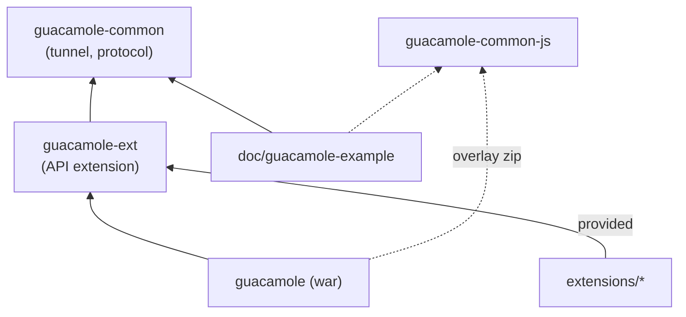

# 04/01 · Cấu trúc Maven và các thư viện

> Ai đọc: dev mới vào phần Java. Đọc xong biết module nào làm gì, phụ thuộc thế
> nào. Đường dẫn tính từ `guacamole-client/`.
>
> Trước: [README](README.md) · Tiếp: [02-webapp-rest-va-tunnel.md](02-webapp-rest-va-tunnel.md)

## Các module

`pom.xml` gốc (`org.apache.guacamole:guacamole-client`, packaging `pom`, phiên bản
`${revision}` = `1.6.1`) khai báo module theo thứ tự:

| Module | Packaging | Vai trò |
| --- | --- | --- |
| `guacamole` | `war` | **Web app**: REST API, tunnel endpoints, nạp extension, provider `user-mapping.xml`, frontend AngularJS. Sản phẩm: `guacamole/target/guacamole-1.6.1.war`. |
| `guacamole-common` | `jar` | **Thư viện tunnel Java**: nói giao thức Guacamole với guacd, servlet / WebSocket tunnel cơ bản. Không biết gì về user / quyền. |
| `guacamole-ext` | `jar` | **API extension**: `AuthenticationProvider`, `UserContext`, `Connection`, `Directory`, `Environment`, các kiểu property. Extension chỉ phụ thuộc module này (scope `provided`). |
| `guacamole-common-js` | `pom` (sản phẩm zip) | **Thư viện JS**: `Guacamole.Client`, các `Tunnel`, `Keyboard`, `Mouse`, `Display`… Được overlay vào war. |
| `extensions` | `pom` | 13 extension (+ `guacamole-auth-radius` chỉ khi bật profile `lgpl-extensions`). Xem [04](04-extension.md). |
| `doc/guacamole-example` | `war` | Ví dụ tối giản dùng `guacamole-common` + `guacamole-common-js` không cần webapp chuẩn. |
| `doc/guacamole-playback-example` | `war` | Ví dụ phát lại file recording bằng JS. |

`doc/guacamole-branding-example` **không** phải module Maven (chỉ có
`guac-manifest.json` + CSS / ảnh / bản dịch) — xem [04 § Branding](04-extension.md#branding-đổi-giao-diện-không-cần-code).

## guacamole-common (Java)

Gói `src/main/java/org/apache/guacamole/`:

| Gói | Lớp chính | Dùng để |
| --- | --- | --- |
| `net/` | `GuacamoleSocket`, `InetGuacamoleSocket`, `SSLGuacamoleSocket`, `GuacamoleTunnel`, `SimpleGuacamoleTunnel`, `AbstractGuacamoleTunnel`, `Delegating*` | Kết nối TCP / TLS tới guacd; tunnel = socket + UUID + khóa đọc/ghi. |
| `protocol/` | `ConfiguredGuacamoleSocket`, `GuacamoleConfiguration`, `GuacamoleClientInformation`, `GuacamoleInstruction`, `GuacamoleParser`, `GuacamoleProtocolVersion`, `GuacamoleStatus`, `FailoverGuacamoleSocket`, `Filtered*` | **Handshake** với guacd (`select` → `args` → `size/audio/video/image/timezone/name` → `connect` → `ready`), parse / lọc lệnh. |
| `io/` | `GuacamoleReader`, `GuacamoleWriter` | Đọc / ghi lệnh. |
| `servlet/` | `GuacamoleHTTPTunnelServlet`, `GuacamoleHTTPTunnelMap` | Tunnel HTTP (long-polling). |
| `websocket/` | `GuacamoleWebSocketTunnelEndpoint` (JSR-356) | Tunnel WebSocket. |
| (gốc) | `GuacamoleException` và các lớp con (`GuacamoleClientException`, `GuacamoleServerException`, `GuacamoleUnauthorizedException`…) | Lỗi mang mã `GuacamoleStatus`. |

## guacamole-common-js (JavaScript)

Thư mục `src/main/webapp/modules/` — mỗi file một lớp trong namespace `Guacamole`:

| File | Lớp | Vai trò |
| --- | --- | --- |
| `Client.js` | `Guacamole.Client` | Điều phối: nhận lệnh từ tunnel → vẽ `Display`, gửi chuột / phím. |
| `Tunnel.js` | `Guacamole.Tunnel`, `HTTPTunnel`, `WebSocketTunnel`, `ChainedTunnel`, `StaticHTTPTunnel` | Vận chuyển. `ChainedTunnel` thử lần lượt (webapp dùng WebSocket trước, HTTP sau). |
| `Display.js`, `Layer.js` | | Canvas, layer. |
| `Keyboard.js`, `Mouse.js`, `Touch.js`, `OnScreenKeyboard.js` | | Nhập liệu. |
| `Parser.js` | `Guacamole.Parser` | Parse lệnh. |
| `SessionRecording.js` | | Phát lại recording. |
| `AudioPlayer.js`, `AudioRecorder.js`, `VideoPlayer.js` | | Âm thanh / video. |
| `*Reader.js`, `*Writer.js`, `InputStream.js`, `OutputStream.js` | | Stream (file, clipboard…). |

Bản minify: plugin `minify-maven-plugin`. Test: Jasmine + Karma (xem [05](05-build-va-test.md)).

## guacamole-ext (API extension)

| Gói | Nội dung |
| --- | --- |
| `net/auth/` | `AuthenticationProvider`, `UserContext`, `AuthenticatedUser`, `Credentials`, `Connection`, `ConnectionGroup`, `User`, `UserGroup`, `SharingProfile`, `ActiveConnection`, `Directory`, `Permission*`; lớp nền `Abstract*`, `Delegating*`, `TokenInjecting*` |
| `net/auth/simple/` | `SimpleAuthenticationProvider`, `SimpleConnection`… — cách nhanh nhất viết provider chỉ-đọc |
| `net/event/`, `net/event/listener/` | Sự kiện (đăng nhập thành công / thất bại, mở / đóng tunnel…) và `Listener` |
| `environment/` | `Environment`, `LocalEnvironment` (đọc `GUACAMOLE_HOME`, `guacamole.properties`, `protocols/*.json`) |
| `properties/` | Kiểu property: `StringGuacamoleProperty`, `IntegerGuacamoleProperty`, `BooleanGuacamoleProperty`, `EnumGuacamoleProperty`, `FileGuacamoleProperty`, `URIGuacamoleProperty`, `StringListProperty`, `IPAddressListProperty`, `TimeZoneGuacamoleProperty`, `ByteArrayProperty`, `LongGuacamoleProperty` |
| `form/`, `language/`, `token/`, `protocols/` | Mô tả form, bản dịch, token `${GUAC_USERNAME}`…, `ProtocolInfo` |
| `src/main/resources/org/apache/guacamole/protocols/*.json` | Mô tả tham số từng giao thức (form trong trang quản trị). Xem [03/04](../03-guacamole-server/04-plugin-giao-thuc.md#thêm-một-tham-số-cho-giao-thức-có-sẵn). |

Chi tiết cách dùng: [04-extension.md](04-extension.md).

## Ví dụ trong `doc/`

| Ví dụ | Cho thấy |
| --- | --- |
| `doc/guacamole-example/` | `DummyGuacamoleTunnelServlet` kế thừa `GuacamoleHTTPTunnelServlet`, tạo `ConfiguredGuacamoleSocket(new InetGuacamoleSocket("localhost", 4822), config)` tới VNC `localhost:5901`; `index.html` dùng `guacamole-common-js`. Đây là **cách nhúng Guacamole vào app riêng**. Lưu ý: ví dụ không có xác thực — không đưa nguyên lên production. |
| `doc/guacamole-playback-example/` | Phát `recording.guac` bằng `Guacamole.SessionRecording` qua `Guacamole.StaticHTTPTunnel` (`playback.js`). |
| `doc/guacamole-branding-example/` | Extension chỉ có tài nguyên: CSS, font, logo, HTML patch (`html/warning.html`), `translations/en.json`. |

## Phiên bản công cụ & dependency chính (từ `pom.xml`)

| Mục | Giá trị |
| --- | --- |
| Java nguồn / đích | `1.8` (`maven-compiler-plugin`, `-Xlint:all`, `failOnWarning=true`) — code phải tương thích Java 8 và **không có warning** |
| JDK build trong Docker | Temurin 21 (`maven:3-eclipse-temurin-21`) |
| Servlet container chạy | Tomcat 9 (`tomcat:9-jdk21` trong Docker) — dùng `javax.servlet`, không phải `jakarta` |
| Guice / Jersey / Jackson | 5.1.0 / 2.48 / 2.22.3 |
| Logging | logback 1.3.16, slf4j 2.0.18 |
| Test | JUnit 4.13.2 (module lõi), JUnit 5.14.4 (managed, dùng ở `guacamole-auth-sso-cas`) |
| Node (frontend webapp) | v24.13.0 / npm 11.7.0 (`guacamole/pom.xml`, `frontend-maven-plugin` tự tải) |
| Node (test common-js) | v16.19.1 (`guacamole-common-js/pom.xml`) |
