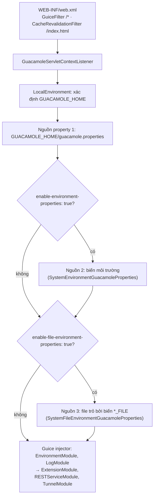

# 04/02 · Web app: khởi động, cấu hình, REST API và tunnel

> Ai đọc: dev sửa lõi web app hoặc cần hiểu request đi qua đâu; người vận hành
> muốn biết `guacamole.properties` được đọc thế nào. Đường dẫn Java tính từ
> `guacamole-client/guacamole/src/main/java/org/apache/guacamole/`.
>
> Trước: [01-cau-truc-maven.md](01-cau-truc-maven.md) · Tiếp: [03-frontend.md](03-frontend.md)

## Khởi động



### GUACAMOLE_HOME

Thứ tự tìm (`guacamole-ext/.../environment/LocalEnvironment.java`, quanh dòng 153–185):

1. System property Java `guacamole.home` (image Docker đặt qua `catalina.properties`);
2. Biến môi trường `GUACAMOLE_HOME`;
3. `~/.guacamole` của user chạy Tomcat;
4. `/etc/guacamole`.

Nội dung GUACAMOLE_HOME mà web app dùng:

| Đường dẫn | Dùng bởi | Ý nghĩa |
| --- | --- | --- |
| `guacamole.properties` | lõi + mọi extension | Cấu hình key: value |
| `extensions/*.jar` | `ExtensionModule` | Extension (phải có `guac-manifest.json`) |
| `lib/*.jar` | `ExtensionModule` | Thư viện dùng chung cho extension (vd. JDBC driver) |
| `protocols/*.json` | `LocalEnvironment` | Ghi đè / thêm mô tả giao thức |
| `user-mapping.xml` | `auth/file/FileAuthenticationProvider` | Xác thực đơn giản bằng file XML (chỉ dùng thử) |
| `logback.xml` | `log/LogModule` | Nếu có thì thay cấu hình log mặc định |

### Thuộc tính → biến môi trường

Khi bật `enable-environment-properties`, mỗi property đọc thêm từ biến môi trường
có tên = `TokenName.canonicalize(tên property)` (`guacamole-ext/.../token/TokenName.java`):
tách các nhóm chữ, viết hoa, nối bằng `_`.

| Property | Biến môi trường | Biến file (khi bật file-env) |
| --- | --- | --- |
| `guacd-hostname` | `GUACD_HOSTNAME` | `GUACD_HOSTNAME_FILE` |
| `postgresql-password` | `POSTGRESQL_PASSWORD` | `POSTGRESQL_PASSWORD_FILE` |
| `api-session-timeout` | `API_SESSION_TIMEOUT` | `API_SESSION_TIMEOUT_FILE` |

Thứ tự ưu tiên: `LocalEnvironment.getPropertyValue()` duyệt các nguồn **theo thứ tự
được thêm** và lấy giá trị khác null đầu tiên → **`guacamole.properties` thắng biến
môi trường, biến môi trường thắng `*_FILE`**. Hệ quả: một key đã ghi trong file thì đổi
biến môi trường không có tác dụng. Image Docker bật sẵn
cả hai cờ — xem [06-van-hanh/05-bien-moi-truong.md](../06-van-hanh/05-bien-moi-truong.md).

### Property của lõi web app

| Property | Định nghĩa | Mặc định | Ý nghĩa |
| --- | --- | --- | --- |
| `guacd-hostname` | `guacamole-ext/.../environment/Environment.java` | `localhost` | Host guacd |
| `guacd-port` | như trên | `4822` | Cổng guacd |
| `guacd-ssl` | như trên | `false` | Dùng TLS tới guacd |
| `case-sensitivity` | như trên | — | Phân biệt hoa thường username / group (chưa đọc kỹ giá trị hợp lệ) |
| `skip-if-unavailable` | `extension/ExtensionModule.java` | — | Danh sách ID provider: lỗi nội bộ (vd. DB / LDAP sập) thì **bỏ qua** provider đó thay vì chặn đăng nhập |
| `extension-priority` | `extension/ExtensionModule.java` | theo tên file | Thứ tự provider, phân cách `,`, `*` = "các provider còn lại" |
| `api-session-timeout` | `rest/auth/HashTokenSessionMap.java` | `60` (phút) | Phiên không hoạt động bị hủy |
| `api-max-request-size` | `rest/RequestSizeFilter.java` | — | Giới hạn kích thước request REST |
| `allowed-languages` | `extension/LanguageResourceService.java` | tất cả | Giới hạn ngôn ngữ giao diện |
| `log-level` | `log/LogModule.java` | `info` | Mức log |
| `enable-environment-properties`, `enable-file-environment-properties` | `GuacamoleServletContextListener.java` | `false` (Docker bật `true`) | Xem trên |

## Nạp extension (`extension/ExtensionModule.java`)

1. Nạp mọi `GUACAMOLE_HOME/lib/*.jar` bằng `DirectoryClassLoader` (classloader cha của extension).
2. Với mỗi `GUACAMOLE_HOME/extensions/*.jar`: đọc `guac-manifest.json` (`Extension.java`), kiểm tra `guacamoleVersion` tương thích, bọc mỗi `AuthenticationProvider` trong `AuthenticationProviderFacade` (bắt lỗi khởi tạo, áp `skip-if-unavailable`), đăng ký listener, gom CSS / JS / HTML patch / bản dịch.
3. **Luôn** thêm `FileAuthenticationProvider` (`user-mapping.xml`) **cuối cùng**, cùng `EventLoggingListener`.
4. Phục vụ tài nguyên đã gom: `/app.js`, `/app.css`, `/translations/{lang}.json`.

Thứ tự mặc định theo tên file; đổi bằng `extension-priority` (giá trị là `namespace`
trong manifest, vd. `postgresql, totp, *`).

## Xác thực và session

Chi tiết sequence: [02-kien-truc.md](../02-kien-truc.md#luồng-chính-đăng-nhập--mở-kết-nối).
Điểm cần nhớ khi sửa code (`rest/auth/AuthenticationService.java`):

- `authenticateUser`: thử từng provider theo thứ tự, lấy `AuthenticatedUser` **đầu
  tiên** khác null. Gặp `GuacamoleInsufficientCredentialsException` (vd. TOTP cần mã,
  SSO cần redirect) thì ưu tiên trả lỗi đó hơn `InvalidCredentials`.
- `getUserContexts`: gọi `getUserContext()` trên **mọi** provider (không chỉ provider
  đã xác thực), mỗi kết quả được các provider khác `decorate()` → nhờ vậy TOTP / ban /
  restrict "bọc" được dữ liệu của JDBC.
- `GuacamoleSession` lưu trong `HashTokenSessionMap` (RAM) theo `authToken`, hết hạn
  sau `api-session-timeout` phút không hoạt động.

## REST API (`/api/*`)

`RESTServiceModule` gắn Jersey `ServletContainer` vào `/api/*`. Mọi request (trừ
đăng nhập) gửi token qua header `Guacamole-Token` hoặc query `token`; có cả hai thì
header thắng (`rest/auth/AuthenticationService.java`, `TOKEN_HEADER_NAME`).

| Endpoint | File | Ghi chú |
| --- | --- | --- |
| `POST /api/tokens` | `rest/auth/TokenRESTService.java` | Form `username`, `password` (+ tham số khác như `guac-totp`) → `{authToken, username, dataSource, availableDataSources}` |
| `DELETE /api/tokens/{token}` | như trên | Đăng xuất |
| `/api/session/data/{dataSource}/…` | `rest/session/UserContextResource.java` | `self`, `connections`, `connectionGroups` (+ `{id}/tree`), `sharingProfiles`, `users`, `userGroups`, `activeConnections`, `history`, `schema` (`protocols`, `userAttributes`…) |
| `/api/session/ext/{dataSource}` | `rest/session/SessionResource.java` | `UserContext.getResource()` của extension |
| `/api/session/tunnels/{tunnel}/…` | `rest/tunnel/TunnelResource.java` | `activeConnection`, `protocol`, `streams/{index}/{filename}` (tải file từ phiên) |
| `/api/ext/{identifier}` | `rest/extension/ExtensionRESTService.java` | `AuthenticationProvider.getResource()` (vd. callback SSO) |
| `/api/languages`, `/api/patches` | `rest/language/`, `rest/patch/` | Danh sách ngôn ngữ, HTML patch |

`dataSource` = ID provider (vd. `postgresql`, `default` cho `user-mapping.xml`). Sửa
dữ liệu theo lô dùng JSON Patch (`rest/jsonpatch/`, `rest/directory/DirectoryResource.java`).

Thử nhanh (chưa kiểm chứng, thay host / mật khẩu):

```bash
TOKEN=$(curl -s -X POST https://<host>/api/tokens \
  -d 'username=<user>' --data-urlencode 'password=<mật-khẩu>' | jq -r .authToken)
curl -s -H "Guacamole-Token: $TOKEN" \
  https://<host>/api/session/data/postgresql/connectionGroups/ROOT/tree | jq .
```

## Tunnel

| Endpoint | Lớp | Ghi chú |
| --- | --- | --- |
| `/websocket-tunnel` | `tunnel/websocket/WebSocketTunnelModule.java` → `RestrictedGuacamoleWebSocketTunnelEndpoint` (JSR-356) | Ưu tiên. `TunnelModule` còn thử nạp bản riêng cho Jetty 8 / Jetty 9 / Tomcat bằng reflection. |
| `/tunnel` | `tunnel/TunnelModule.java` → `tunnel/http/RestrictedGuacamoleHTTPTunnelServlet` | HTTP long-polling, dự phòng khi WebSocket bị chặn. |

Tham số khi mở tunnel (`tunnel/TunnelRequest.java`): `token`, `GUAC_DATA_SOURCE`,
`GUAC_ID`, `GUAC_TYPE` (`c` = connection, `g` = connection group — `TunnelRequestType.java`),
`GUAC_WIDTH`, `GUAC_HEIGHT`, `GUAC_DPI`, `GUAC_AUDIO`, `GUAC_VIDEO`, `GUAC_IMAGE`,
`GUAC_TIMEZONE`.

`tunnel/TunnelRequestService.java` `createTunnel()`:

1. Tìm session theo token → `UserContext` của `GUAC_DATA_SOURCE`.
2. Lấy `Connection` / `ConnectionGroup` theo `GUAC_ID` (không có quyền → 404 / 403).
3. `connectable.connect(info, tokens)` với `StandardTokenMap` (token `${GUAC_USERNAME}`, `${GUAC_DATE}`… thay vào tham số).
4. Phát sự kiện tunnel-connect (listener có thể **từ chối**, vd. extension `restrict`), bọc kết quả thành `UserTunnel`; `StreamInterceptingTunnel` chặn stream tải file để phục vụ qua REST.

Phía extension, `connect()` tạo `ConfiguredGuacamoleSocket(new InetGuacamoleSocket(guacd-hostname, guacd-port), config, info)`
(hoặc `SSLGuacamoleSocket` khi `guacd-ssl: true`) — vd. `guacamole-ext/.../net/auth/simple/SimpleConnection.java`,
`extensions/guacamole-auth-jdbc/modules/guacamole-auth-jdbc-base/.../tunnel/AbstractGuacamoleTunnelService.java`.

## Muốn sửa X

| Muốn | Sửa |
| --- | --- |
| Thêm property cho lõi | Khai báo hằng `*GuacamoleProperty` cạnh nơi dùng, đọc bằng `environment.getProperty(...)`; ghi vào docs vận hành bảng biến |
| Thêm REST endpoint lõi | Lớp resource trong `rest/<khối>/`, đăng ký trong `rest/RESTServiceModule.java` |
| Đổi cách tạo tunnel | `tunnel/TunnelRequestService.java` |
| Chặn / ghi log khi mở kết nối | Không sửa lõi — viết `Listener` trong extension (xem [04](04-extension.md)) |
