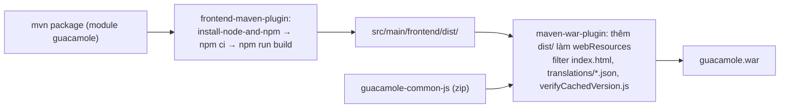

# 04/03 · Frontend (AngularJS + webpack)

> Ai đọc: dev sửa giao diện web. Đường dẫn tính từ
> `guacamole-client/guacamole/src/main/frontend/`.
>
> Trước: [02-webapp-rest-va-tunnel.md](02-webapp-rest-va-tunnel.md) · Tiếp: [04-extension.md](04-extension.md)

## Công nghệ

| Mục | Giá trị (từ `package.json`, `webpack.config.js`) |
| --- | --- |
| Framework | **AngularJS 1.8** (`angular`, `angular-route`) — không phải Angular 2+ |
| Bản dịch | `angular-translate` + `messageformat` + `loader-static-files` |
| Thư viện | jQuery 3, lodash, d3-shape / d3-path, fuzzysort, csv-parse, yaml, file-saver, `@simonwep/pickr`, jstz, polyfill (blob, datalist) |
| Build | webpack 5 (`npm run build` = `webpack --progress`), terser, css-minimizer, `angular-templatecache-webpack5-plugin` (gom template HTML thành `templates.js`), plugin tự viết `plugins/dependency-list-plugin.js` (liệt kê dependency cho LICENSE) |
| Entry → output | `src/app/index/indexModule.js` → `dist/guacamole.[contenthash].js` + `.css` |
| Node | v24.13.0 / npm 11.7.0, do Maven tự tải (`frontend-maven-plugin` trong `guacamole/pom.xml`) |
| Test | **Không có** test frontend trong thư mục này |

## Cấu trúc `src/`

| Đường dẫn | Nội dung |
| --- | --- |
| `index.html` | Trang gốc (được Maven filter — chèn phiên bản / build ID) |
| `app/<module>/` | Mỗi thư mục là một module AngularJS, có `<module>Module.js` và các thư mục con `controllers/`, `directives/`, `services/`, `types/`, `templates/`, `styles/` |
| `translations/*.json` | Bản dịch: ca, cs, de, **en** (nguồn chuẩn), es, fr, it, ja, ko, nl, no, pl, pt, ru, tr, zh — **chưa có `vi`** |
| `layouts/`, `fonts/`, `images/` | Tài nguyên tĩnh |
| `verifyCachedVersion.js`, `relocateParameters.js` | Script nhỏ chạy trước app (kiểm tra cache phiên bản, chuyển tham số URL) |

Các module trong `app/`:

| Module | Vai trò |
| --- | --- |
| `index` | Module gốc, khai báo route (`index/config/indexRouteConfig.js`), phụ thuộc mọi module dưới |
| `auth` | Đăng nhập / token (`auth/service/authenticationService.js`) |
| `login` | Màn hình đăng nhập (kể cả trường thêm như mã TOTP) |
| `home` | Trang chủ: danh sách connection, phiên gần đây |
| `client` | **Màn hình kết nối**: `types/ManagedClient.js` (tạo tunnel + `Guacamole.Client`), `directives/guacClient.js`, file transfer, zoom, nhiều phiên dạng ô (`guacTiledClients`) |
| `manage` | Trang quản trị connection / user / group / sharing profile |
| `settings` | Cài đặt: phiên đang chạy, lịch sử, user, preferences, xem recording |
| `import` | Nhập connection từ CSV / JSON / YAML |
| `player` | Phát lại recording |
| `rest` | Service gọi REST API (`rest/services/*.js`) |
| `form`, `list`, `groupList`, `element`, `navigation`, `notification`, `locale`, `storage`, `history` | Thành phần dùng chung |
| `osk`, `textInput`, `touch`, `clipboard` | Bàn phím ảo, nhập văn bản, cử chỉ chạm, clipboard |

## Route chính (`index/config/indexRouteConfig.js`)

| Route | Màn hình |
| --- | --- |
| `/` | Trang chủ |
| `/client/:id` | Phiên kết nối (`id` mã hóa connection + loại + dataSource) |
| `/manage/:dataSource/{connections,connectionGroups,sharingProfiles,users,userGroups}/:id` | Sửa đối tượng |
| `/settings/:dataSource?/:tab` | Các tab cài đặt |
| `/settings/:dataSource/recording/:identifier/:name` | Xem recording |
| `/import/:dataSource/connection` | Nhập connection |

## Frontend được đóng gói thế nào

Extension có thể thêm JS / CSS / HTML patch / bản dịch mà **không** sửa frontend
này; lõi gom chúng thành `/app.js`, `/app.css`, `/translations/{lang}.json` lúc chạy
(xem [04-extension.md](04-extension.md)).

## Làm việc với frontend

- **Đổi chữ trên giao diện**: sửa `translations/en.json` (và ngôn ngữ khác). Muốn
  thêm tiếng Việt mà không sửa upstream → extension chỉ có `translations/vi.json`
  (cách làm giống mẫu branding; danh sách ngôn ngữ có thể giới hạn bằng `allowed-languages`).
- **Đổi giao diện / logo**: dùng extension branding, không sửa ở đây.
- **Sửa logic**: tìm controller / directive trong module tương ứng; service REST ở
  `rest/services/`. Lớp kiểu dữ liệu (`types/`) dùng pattern factory của AngularJS.
- Vòng sửa nhanh (chưa kiểm chứng): `npm ci && npm run build` trong thư mục này rồi
  copy `dist/` vào webapp đang chạy, hoặc build lại war (`mvn -pl guacamole package`).
