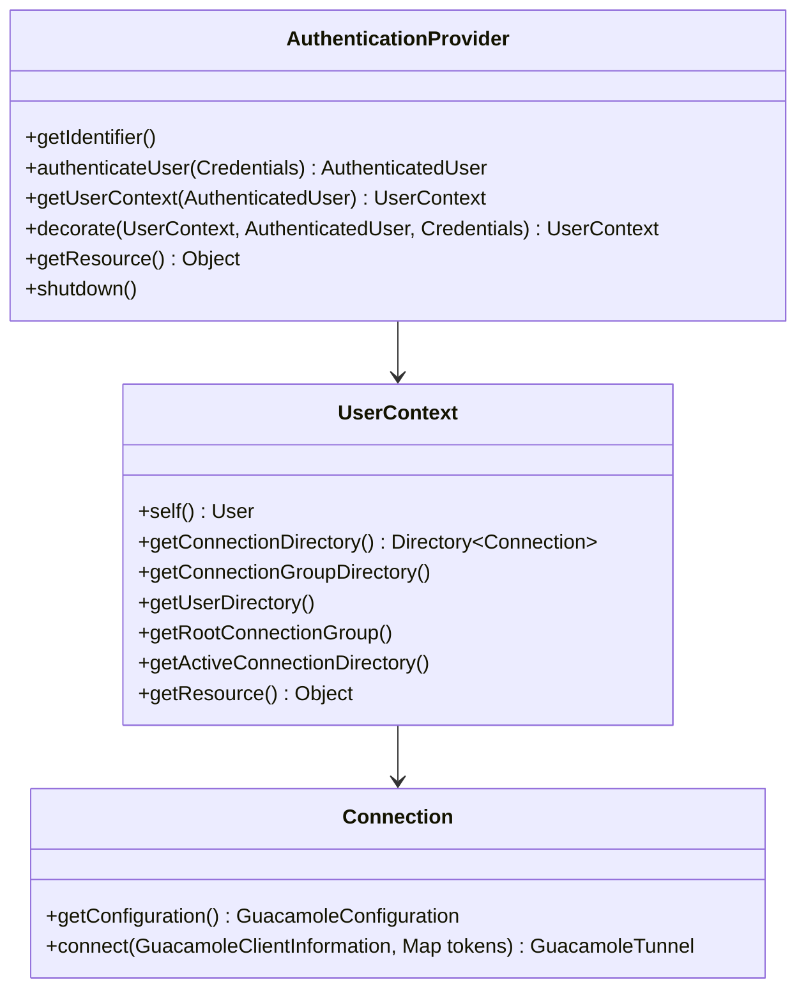

# 04/04 · Extension: API, danh sách có sẵn, cách viết

> Ai đọc: dev muốn thêm nguồn đăng nhập, ghi log / chặn kết nối, đổi giao diện;
> người vận hành muốn biết extension nào làm gì. Đường dẫn tính từ `guacamole-client/`.
>
> Trước: [03-frontend.md](03-frontend.md) · Tiếp: [05-build-va-test.md](05-build-va-test.md)

## Extension là gì

Một file `.jar` đặt trong `GUACAMOLE_HOME/extensions/`, có `guac-manifest.json` ở
gốc. Web app nạp lúc khởi động (cơ chế: [02 § Nạp extension](02-webapp-rest-va-tunnel.md#nạp-extension-extensionextensionmodulejava)).
Đổi extension → **restart web app** (không có hot reload).

### `guac-manifest.json`

Trường hợp lệ (`guacamole/src/main/java/org/apache/guacamole/extension/ExtensionManifest.java`):

| Trường | Bắt buộc | Ý nghĩa |
| --- | --- | --- |
| `guacamoleVersion` | có | Phiên bản Guacamole tương thích; `*` = mọi bản (dùng cho extension chỉ có tài nguyên). Extension upstream dùng `${project.version}` (Maven filter, file nằm trong `src/main/resource-templates/`). |
| `name`, `namespace` | có | Tên hiển thị; namespace là ID dùng trong `extension-priority` và đường dẫn tài nguyên. |
| `authProviders` | | Tên lớp implement `AuthenticationProvider` |
| `listeners` | | Tên lớp implement `org.apache.guacamole.net.event.listener.Listener` |
| `js`, `css`, `html` | | JS / CSS gộp vào `/app.js` / `/app.css`; HTML patch chèn / thay phần tử trang (dùng meta `<meta name="before|after|replace…" content="selector">`, xem `doc/guacamole-branding-example/html/warning.html`) |
| `translations` | | File bản dịch gộp vào `/translations/{lang}.json` |
| `resources` | | Map đường dẫn → MIME type cho ảnh / font phục vụ tĩnh |
| `smallIcon`, `largeIcon` | | Icon / favicon |

## API chính (`guacamole-ext`)



| Muốn | Kế thừa / implement | Ví dụ trong repo |
| --- | --- | --- |
| Provider chỉ-đọc đơn giản: user → danh sách cấu hình | `net/auth/simple/SimpleAuthenticationProvider` (chỉ cần `getAuthorizedConfigurations(Credentials)`) | `guacamole/.../auth/file/FileAuthenticationProvider` (dạng tương tự) |
| Chỉ xác thực, dữ liệu lấy từ provider khác (vd. LDAP xác thực, JDBC lưu connection) | `AbstractAuthenticationProvider`, trả `AuthenticatedUser`, `getUserContext()` trả `null` | `extensions/guacamole-auth-header` |
| Bọc / sửa dữ liệu của provider khác (thêm bước 2FA, lọc kết nối) | override `decorate()` / `redecorate()`, dùng `DelegatingUserContext`, `DelegatingConnection` | `extensions/guacamole-auth-totp`, `guacamole-auth-restrict` |
| Thay giá trị bí mật vào tham số | `TokenInjectingUserContext` | `extensions/guacamole-vault` |
| Phản ứng sự kiện (đăng nhập sai, mở tunnel…) | `Listener` + các lớp trong `net/event/` | `extensions/guacamole-auth-ban` (`BanningAuthenticationListener`) |
| Đọc cấu hình | Hằng `StringGuacamoleProperty` … + `environment.getProperty()` / `getRequiredProperty()` | `ConfigurationService.java` ở hầu hết extension |

## Extension có sẵn (`extensions/`)

Tên biến Docker = tiền tố bật extension đó trong image chính thức
(`guacamole-docker/build.d/010-map-guacamole-extensions.sh`); bảng biến đầy đủ ở
[06-van-hanh/05-bien-moi-truong.md](../06-van-hanh/05-bien-moi-truong.md).

| Thư mục | Namespace | Vai trò | Property chính | Tiền tố Docker |
| --- | --- | --- | --- | --- |
| `guacamole-auth-ban` | `ban` | Chặn IP đăng nhập sai nhiều lần | `ban-max-invalid-attempts` (5), `ban-address-duration` (300 s), `ban-max-addresses` | `BAN_` (**bật mặc định** trong Docker: `BAN_ENABLED=true`) |
| `guacamole-auth-jdbc` (`modules/…-mysql`, `-postgresql`, `-sqlserver`, `-base`, `-dist`) | `mysql` / `postgresql` / `sqlserver` | Lưu user, group, connection, quyền, lịch sử trong DB (MyBatis) | `<db>-hostname`, `-port`, `-database`, `-username`, `-password`, `-auto-create-accounts`, `-user-password-*`, `-default-max-connections`, `-ssl-mode` | `MYSQL_`, `POSTGRESQL_`, `SQLSERVER_` |
| `guacamole-auth-ldap` | `ldap` | Đăng nhập LDAP / AD, có thể lưu connection trong LDAP | `ldap-hostname`, `ldap-port`, `ldap-encryption-method`, `ldap-user-base-dn`, `ldap-username-attribute`, `ldap-search-bind-dn`, `ldap-group-base-dn` | `LDAP_` |
| `guacamole-auth-totp` | `totp` | 2FA bằng mã TOTP (Google Authenticator…) | `totp-issuer`, `totp-digits`, `totp-period`, `totp-mode`, `totp-bypass-hosts`, `totp-enforce-hosts` | `TOTP_` |
| `guacamole-auth-duo` | `duo` | 2FA Duo | `duo-api-hostname`, `duo-client-id`, `duo-client-secret`, `duo-redirect-uri` | `DUO_` |
| `guacamole-auth-sso` (`openid`, `saml`, `cas`, `ssl`) | `openid`, `saml`, `cas`, `ssl` | SSO: OpenID Connect, SAML, CAS, chứng chỉ client | `openid-authorization-endpoint`, `openid-jwks-endpoint`, `openid-issuer`, `openid-client-id`, `openid-redirect-uri`; `saml-idp-metadata-url`, `saml-entity-id`, `saml-callback-url`; `cas-authorization-endpoint`; `ssl-auth-uri` … | `OPENID_`, `SAML_`, `CAS_`, `SSL_AUTH_` |
| `guacamole-auth-header` | `header` | Tin username trong HTTP header (SSO do reverse proxy làm) — **nguy hiểm nếu web app truy cập được không qua proxy** | `http-auth-header` | `HTTP_AUTH_` |
| `guacamole-auth-json` | `json` | Ứng dụng khác cấp quyền bằng JSON ký + mã hóa | `json-secret-key`, `json-trusted-networks` | `JSON_` |
| `guacamole-auth-quickconnect` | `quickconnect` | Ô nhập URI (`rdp://user@host`) tạo kết nối tức thì | `quickconnect-allowed-parameters`, `quickconnect-denied-parameters` | `QUICKCONNECT_` |
| `guacamole-auth-radius` | `radius` | RADIUS — **chỉ build với `-P lgpl-extensions`** (phụ thuộc LGPL), không có trong image chính thức mặc định | `radius-hostname`, `radius-auth-port`, `radius-shared-secret`, `radius-auth-protocol` | `RADIUS_` |
| `guacamole-auth-restrict` | `restrict` | Giới hạn đăng nhập / kết nối theo giờ và theo host, cấu hình bằng thuộc tính trên user / group / connection (`guac-restrict-time-allowed`, `-time-denied`, `-hosts-allowed`, `-hosts-denied`…) | `restrict-admin-accounts` | `RESTRICT_` |
| `guacamole-history-recording-storage` | `recording-storage` | Hiện recording trong lịch sử để xem lại trên web | `recording-search-path` (mặc định `/var/lib/guacamole/recordings`) | `RECORDING_` |
| `guacamole-vault` (`ksm`) | `keeper-secrets-manager` | Lấy secret từ Keeper Secrets Manager thay vào tham số | `ksm-config`, `ksm-allow-user-config`, `ksm-api-call-interval` | `KSM_` |
| `guacamole-display-statistics` | `display-stats` | Thanh thống kê hiển thị (FPS, độ trễ) — chỉ có JS / CSS | — | `DISPLAY_STATISTICS_` |

Schema DB của JDBC: `extensions/guacamole-auth-jdbc/modules/guacamole-auth-jdbc-<db>/schema/`
(`001-create-schema.sql`, `002-create-admin-user.sql`, `upgrade/upgrade-pre-<phiên-bản>.sql`).
`002-create-admin-user.sql` tạo user **`guacadmin` / mật khẩu `guacadmin`** — phải đổi
ngay sau khi cài (xem [06-van-hanh/02](../06-van-hanh/02-trien-khai-docker-compose.md)).

## Viết một extension

1. **Khung Maven**: copy cấu trúc một extension nhỏ (vd. `extensions/guacamole-auth-header/`):
   `pom.xml` phụ thuộc `org.apache.guacamole:guacamole-ext` scope **`provided`**
   (web app đã có sẵn — đóng gói kèm sẽ xung đột classloader).
2. **Lớp provider**: kế thừa `AbstractAuthenticationProvider`; `getIdentifier()` trả
   chuỗi cố định (thành `dataSource`). Đọc cấu hình bằng property riêng có tiền tố tên
   extension (vd. `myext-api-url`).
3. **Manifest** `src/main/resources/guac-manifest.json`:

   ```json
   {
       "guacamoleVersion" : "1.6.0",
       "name"             : "My Extension",
       "namespace"        : "myext",
       "authProviders"    : [ "com.example.guacamole.MyAuthenticationProvider" ],
       "translations"     : [ "translations/en.json" ]
   }
   ```

   `guacamoleVersion` phải khớp phiên bản web app đang chạy (vd. `1.6.0` cho image
   chính thức hiện tại) — không khớp thì web app từ chối nạp (log ghi rõ).
4. **Đóng gói**: `mvn package` → `target/myext-<ver>.jar`; dependency riêng phải
   shade vào jar hoặc đặt ở `GUACAMOLE_HOME/lib/`.
5. **Cài**: copy jar vào `GUACAMOLE_HOME/extensions/`, restart web app. Trong Docker
   chính thức: mount thư mục chứa `extensions/` làm `GUACAMOLE_HOME` template (xem
   [06-van-hanh/05](../06-van-hanh/05-bien-moi-truong.md#guacamole_home-tùy-biến-trong-docker)).
6. **Kiểm tra**: log web app có dòng `Extension "My Extension" (myext) loaded.`
   (`ExtensionModule.java:578`); lỗi thì có `Extension "…" could not be loaded: <lý do>`; đăng nhập thử, `GET /api/tokens` trả
   `availableDataSources` chứa `myext`.

## Branding: đổi giao diện không cần code

Mẫu `doc/guacamole-branding-example/`: manifest với `"guacamoleVersion": "*"`, chỉ có
`css`, `html`, `resources`, `translations`. Đóng gói bằng zip:

```bash
cd doc/guacamole-branding-example
zip -r ../../my-branding.jar guac-manifest.json css html resources translations
```

(Đúng các thư mục có trong mẫu; `README`, `licenses/` không cần.) Đặt jar vào
`GUACAMOLE_HOME/extensions/` rồi restart. Đổi tên ứng dụng / chữ trên màn hình đăng
nhập: ghi đè khóa dịch (vd. `APP.NAME`) trong `translations/en.json` của extension.
