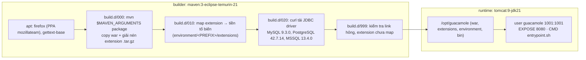

# 04/05 · Build và test guacamole-client

> Ai đọc: dev cần build war / extension, chạy test, hoặc build image Docker của web
> app. Đường dẫn tính từ `guacamole-client/`.
>
> Trước: [04-extension.md](04-extension.md) · Tiếp: [05-quy-uoc-va-dong-gop.md](../05-quy-uoc-va-dong-gop.md)

> **Chưa kiểm chứng.** Các lệnh dưới rút ra từ `pom.xml`, `Dockerfile`,
> `guacamole-docker/` và **chưa được chạy**. `mvn package` tự chạy plugin, script
> shell và `npm ci` (tải Node + gói npm) — làm trong máy ảo / container dùng một lần
> (xem [01-tong-quan § An toàn](../01-tong-quan.md#an-toàn-khi-làm-việc-với-mã-nguồn)).

## Yêu cầu

| Công cụ | Phiên bản | Kiểm tra | Ghi chú |
| --- | --- | --- | --- |
| JDK | 8 trở lên để biên dịch (`source/target 1.8`); Docker build dùng **Temurin 21** | `java -version` | Chọn JDK 11/17/21 cho an toàn; JDK quá mới có thể sinh warning mới → `failOnWarning=true` làm hỏng build (suy luận). |
| Maven | 3.x | `mvn -v` | Docker dùng `maven:3-…` |
| Node / npm | **Không cần cài** | — | `frontend-maven-plugin` tự tải Node v24.13.0 (webapp) và v16.19.1 (test common-js) |
| `envsubst` (gói `gettext-base`) | | `command -v envsubst` | Script sinh LICENSE `doc/licenses/generate-license-files.sh` cần (Dockerfile cài riêng) |
| Firefox | | | Chỉ khi chạy test JS (`-DskipTests=false`) |

## Lệnh build

| Mục đích | Lệnh | Kết quả mong đợi |
| --- | --- | --- |
| Build tất cả | `mvn package` | `guacamole/target/guacamole-1.6.1.war`; mỗi extension có `target/*.jar` và gói `target/*.tar.gz` |
| Build kèm RADIUS | `mvn package -P lgpl-extensions` | Thêm `extensions/guacamole-auth-radius/target/*.jar` |
| Chỉ webapp (và module nó cần) | `mvn -pl guacamole -am package` | war |
| Chỉ một extension | `mvn -pl extensions/guacamole-auth-totp -am package` | jar TOTP |
| Bỏ kiểm tra license header | `mvn package -DignoreLicenseErrors=true` | Bỏ qua `apache-rat-plugin` (chỉ để thử nghiệm local; upstream không chấp nhận file thiếu header) |
| Kiểm tra dependency | `mvn package -DcheckDependencies=true` | Bật profile `check-dependencies` |

Các bước Maven tự làm cần biết khi build lỗi:

| Plugin | Làm gì | Lỗi hay gặp |
| --- | --- | --- |
| `apache-rat-plugin` (phase validate) | Mọi file nguồn phải có header Apache License (ngoại lệ ở `.ratignore`) | File mới thiếu header → build dừng ngay từ đầu |
| `maven-enforcer-plugin` | `dependencyConvergence`, `requireUpperBoundDeps` | Thêm dependency kéo phiên bản lệch → lỗi enforcer |
| `maven-compiler-plugin` | `-Xlint:all`, `failOnWarning=true` | Một warning (unchecked, deprecation…) = build hỏng |
| `frontend-maven-plugin` | `install-node-and-npm` → `npm ci` → `npm run build` | Không có mạng / registry npm → lỗi; `package-lock.json` lệch → `npm ci` lỗi |
| `exec-maven-plugin` | Chạy `doc/licenses/generate-license-files.sh` | Thiếu `envsubst` |

## Test

| Phần | Framework | Vị trí | Chạy |
| --- | --- | --- | --- |
| Java lõi | JUnit 4.13.2 | `guacamole-common/src/test` (7 file: parser, instruction, protocol version, status, reader/writer…), `guacamole-ext/src/test` (6), `guacamole/src/test` (1: `GuacamoleVersionTest`) | chạy cùng `mvn package` |
| Extension | JUnit 4 / 5 (SSO-CAS dùng JUnit 5) | auth-json, auth-quickconnect, auth-sso-cas, auth-totp, vault-base (mỗi cái 1 file) | như trên |
| JS (`guacamole-common-js`) | Jasmine + Karma + Firefox | `guacamole-common-js/src/test/javascript/{EventSpec,ParserSpec,SessionRecordingSpec}.js`, cấu hình `karma-ci.conf.js` | **Mặc định bị bỏ qua** (`skipTests=true` trong `guacamole-common-js/pom.xml`); bật: `mvn package -DskipTests=false` |
| Frontend webapp | — | Không có test | — |

CI (`.github/workflows/pr-build.yml`): khi có pull request chỉ chạy
`docker build --pull --no-cache --force-rm .` — tức Maven build + test (kể cả JS, vì
Dockerfile mặc định `MAVEN_ARGUMENTS="-DskipTests=false"`) chạy **bên trong** stage builder.

## Docker image

| Build arg | Mặc định | Ý nghĩa |
| --- | --- | --- |
| `TOMCAT_VERSION` / `TOMCAT_JRE` | `9` / `jdk21` | Image runtime `tomcat:9-jdk21` |
| `MAVEN_ARGUMENTS` | `-DskipTests=false` | Tham số `mvn`, vd. `"-P lgpl-extensions -DskipTests=false"` để có RADIUS |
| `MYSQL_JDBC_VERSION`, `PGSQL_JDBC_VERSION`, `MSSQL_JDBC_VERSION` | `9.3.0`, `42.7.14`, `13.4.0` (trên `main`; tag 1.6.0 là `8.3.0`, `42.7.2`, `9.4.1`) | Driver tải bằng `curl` |
| `UID` / `GID` | `1001` / `1001` | User `guacamole` trong container |

Lệnh build (chưa kiểm chứng; tải mã từ Maven Central, npm, PPA Firefox, trang JDBC):
`docker build -t guacamole-local:dev .`. Lúc chạy, entrypoint làm gì: xem
[06-van-hanh/05-bien-moi-truong.md](../06-van-hanh/05-bien-moi-truong.md#entrypoint-của-image-guacamole-làm-gì).
