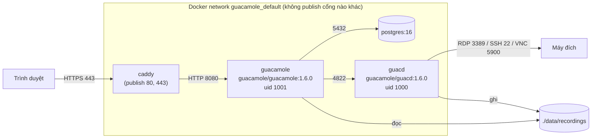
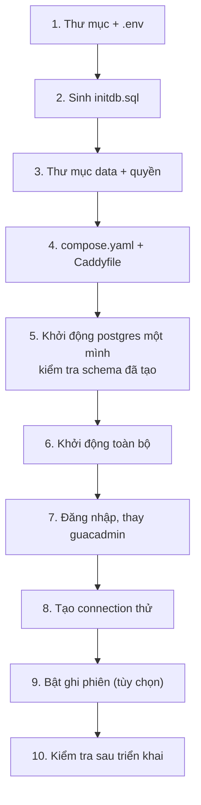

# 06/02 · Triển khai bằng Docker Compose (guacd + guacamole + PostgreSQL + Caddy)

> Ai đọc: người dựng hệ thống lần đầu, đang SSH vào VPS. Làm theo thứ tự; mỗi bước
> có kết quả mong đợi và cách kiểm tra.
>
> Trước: [01-chuan-bi-vps.md](01-chuan-bi-vps.md) · Tiếp: [03-van-hanh-hang-ngay.md](03-van-hanh-hang-ngay.md)

> **Trạng thái: phương án chuẩn, chưa kiểm chứng trên hệ thống thật** (2026-10-31 chưa
> có VPS). File cấu hình dưới đây dựng từ việc đọc entrypoint của image (`guacamole-client/guacamole-docker/`,
> `guacamole-server/src/guacd-docker/`) và tài liệu image `postgres`, `caddy`. Khi dựng
> xong lần đầu, điền bảng hiện trạng ở [README](README.md#hiện-trạng) và sửa chỗ sai.

## Kiến trúc



Thứ tự triển khai và lý do:



- **initdb.sql phải có trước lần đầu khởi động postgres**: image `postgres` chỉ chạy
  `/docker-entrypoint-initdb.d/*.sql` khi thư mục data **rỗng**. Khởi động trước rồi mới
  thêm SQL → schema không bao giờ được tạo (phải xóa data hoặc chạy SQL tay — xem [04](04-sao-luu-va-xu-ly-su-co.md)).
- **Quyền thư mục recording phải đặt trước khi guacd ghi**: guacd chạy uid 1000, web app
  uid 1001; file recording quyền `0640` (đọc từ code `guacamole-server/src/libguac/recording.c`).
- **Thay `guacadmin` ngay sau lần đăng nhập đầu**: schema tạo sẵn `guacadmin` / `guacadmin`.

## Bước 1 — Thư mục và `.env`

```bash
sudo mkdir -p /opt/guacamole && sudo chown "$USER": /opt/guacamole
cd /opt/guacamole
umask 077
cat > .env <<'EOF'
# Biến của compose — ý nghĩa: docs/06-van-hanh/05-bien-moi-truong.md
GUAC_DOMAIN=
GUACAMOLE_VERSION=1.6.0
POSTGRES_PASSWORD=
GUACD_LOG_LEVEL_VALUE=info
GUACAMOLE_LOG_LEVEL=info
EOF
```

Điền `GUAC_DOMAIN` (vd. `remote.example.com`) và `POSTGRES_PASSWORD`
(sinh: `openssl rand -base64 32 | tr -d '/+='`). Bảng ý nghĩa:
[05 § File .env](05-bien-moi-truong.md#file-env-trên-vps-optguacamoleenv).

Kiểm tra: `ls -l .env` → `-rw-------`; `grep -c '=$' .env` → `0` (không còn biến bắt buộc trống).

## Bước 2 — Sinh script khởi tạo DB

Dùng script có sẵn trong **image chính thức** (không chạy code từ repo clone):

```bash
mkdir -p init
docker run --rm "guacamole/guacamole:1.6.0" /opt/guacamole/bin/initdb.sh --postgresql > init/initdb.sql
```

Kết quả mong đợi: `grep -c '^CREATE TABLE' init/initdb.sql` → `23`;
`grep -c guacadmin init/initdb.sql` → lớn hơn 0.
Nếu file rỗng / có chữ `Bad database type` → sai tham số (phải `--postgresql`).

(Cách khác, không cần Docker: nối `001-create-schema.sql` và `002-create-admin-user.sql`
từ `guacamole-client/extensions/guacamole-auth-jdbc/modules/guacamole-auth-jdbc-postgresql/schema/`
ở **tag `1.6.0`** — `git -C guacamole-client show 1.6.0:<đường-dẫn>`. Schema PostgreSQL
không đổi giữa `1.6.0` và `main`, kiểm tra 2026-10-31.)

## Bước 3 — Thư mục dữ liệu và quyền

```bash
mkdir -p data/postgres data/recordings data/drive
sudo chown 1000:1000 data/recordings data/drive
sudo chmod 2750 data/recordings
sudo chmod 2770 data/drive
```

| Thư mục | Ai ghi | Ai đọc | Vì sao quyền như vậy |
| --- | --- | --- | --- |
| `data/postgres` | container postgres (tự chown) | | Không tự chown — image postgres tự làm khi khởi tạo |
| `data/recordings` | guacd (uid/gid 1000) | guacamole (uid 1001, thêm group 1000 qua `group_add`) | File `0640` → chỉ owner + group đọc được; setgid (`2…`) giữ group 1000 cho file mới |
| `data/drive` | guacd | | Ổ đĩa ảo RDP (`drive-path`), tùy chọn |

Kiểm tra: `stat -c '%u:%g %a' data/recordings` → `1000:1000 2750`.

## Bước 4 — `compose.yaml` và `Caddyfile`

`/opt/guacamole/compose.yaml`:

```yaml
name: guacamole

services:
  guacd:
    image: guacamole/guacd:${GUACAMOLE_VERSION:-1.6.0}
    restart: unless-stopped
    environment:
      LOG_LEVEL: ${GUACD_LOG_LEVEL_VALUE:-info}
    volumes:
      - ./data/recordings:/var/lib/guacamole/recordings
      - ./data/drive:/var/lib/guacamole/drive
    # KHÔNG có "ports:" — guacd không có xác thực, chỉ nghe trong network nội bộ

  postgres:
    image: postgres:16
    restart: unless-stopped
    environment:
      POSTGRES_DB: guacamole_db
      POSTGRES_USER: guacamole_user
      POSTGRES_PASSWORD: ${POSTGRES_PASSWORD:?chưa điền POSTGRES_PASSWORD trong .env}
    volumes:
      - ./data/postgres:/var/lib/postgresql/data
      - ./init:/docker-entrypoint-initdb.d:ro
    healthcheck:
      test: ["CMD-SHELL", "pg_isready -U guacamole_user -d guacamole_db"]
      interval: 10s
      timeout: 5s
      retries: 5

  guacamole:
    image: guacamole/guacamole:${GUACAMOLE_VERSION:-1.6.0}
    restart: unless-stopped
    depends_on:
      guacd:
        condition: service_started
      postgres:
        condition: service_healthy
    group_add:
      - "1000"            # đọc được recording do guacd (gid 1000) ghi
    environment:
      GUACD_HOSTNAME: guacd
      POSTGRESQL_HOSTNAME: postgres
      POSTGRESQL_DATABASE: guacamole_db
      POSTGRESQL_USERNAME: guacamole_user
      POSTGRESQL_PASSWORD: ${POSTGRES_PASSWORD:?chưa điền POSTGRES_PASSWORD trong .env}
      POSTGRESQL_USER_PASSWORD_MIN_LENGTH: "12"
      WEBAPP_CONTEXT: ROOT
      REMOTE_IP_VALVE_ENABLED: "true"
      RECORDING_SEARCH_PATH: /var/lib/guacamole/recordings
      LOG_LEVEL: ${GUACAMOLE_LOG_LEVEL:-info}
    volumes:
      - ./data/recordings:/var/lib/guacamole/recordings:ro

  caddy:
    image: caddy:2
    restart: unless-stopped
    depends_on:
      - guacamole
    ports:
      - "80:80"
      - "443:443"
      - "443:443/udp"
    environment:
      GUAC_DOMAIN: ${GUAC_DOMAIN:?chưa điền GUAC_DOMAIN trong .env}
    volumes:
      - ./Caddyfile:/etc/caddy/Caddyfile:ro
      - caddy_data:/data
      - caddy_config:/config

volumes:
  caddy_data:
  caddy_config:
```

`/opt/guacamole/Caddyfile`:

```caddyfile
{$GUAC_DOMAIN} {
	# Web app không tự đặt header chống clickjacking / MIME sniffing
	# (grep X-Frame-Options / Content-Security-Policy trong guacamole-client: không có)
	header {
		Content-Security-Policy "frame-ancestors 'self'"
		X-Content-Type-Options "nosniff"
		-Server
	}
	reverse_proxy guacamole:8080 {
		# Đẩy dữ liệu ngay, không gom — cần cho tunnel HTTP long-polling
		flush_interval -1
	}
}
```

Giải thích các lựa chọn (biến chi tiết ở [05](05-bien-moi-truong.md)):

| Dòng | Vì sao |
| --- | --- |
| `postgres:16` (không dùng `latest`) | Từ bản 18, image postgres đổi vị trí thư mục data (`/var/lib/postgresql/<bản>/docker`) — mount `…/data` như trên chỉ đúng cho ≤ 17 (theo ghi chú phát hành image postgres, chưa kiểm chứng). Ghim bản để nâng cấp có chủ đích. |
| `WEBAPP_CONTEXT: ROOT` | Guacamole ở `https://<domain>/` thay vì `/guacamole/` — Caddyfile đơn giản. |
| `REMOTE_IP_VALVE_ENABLED` | Bắt buộc vì extension ban bật sẵn — xem [05 § ban](05-bien-moi-truong.md#nhóm-chặn-brute-force-extension-guacamole-auth-ban-tiền-tố-ban_). |
| `RECORDING_SEARCH_PATH` | Bật extension xem recording trên web; bỏ dòng này nếu không ghi phiên. |
| `${…:?…}` | Compose dừng với thông báo rõ nếu biến bắt buộc chưa điền. |
| Không publish cổng 8080 / 4822 / 5432 | Chỉ Caddy ra Internet. Docker publish cổng **vượt qua ufw**, nên "không publish" là cách đóng cổng duy nhất chắc chắn. |

Kiểm tra cú pháp: `docker compose config --quiet && echo OK` → `OK` (lỗi `chưa điền …` → quay lại bước 1).

## Bước 5 — Khởi động PostgreSQL trước

**Chỉ khi** `init/initdb.sql` đã đúng (bước 2) và `data/postgres` đang rỗng:

```bash
docker compose up -d postgres
sleep 15   # lần đầu postgres còn chạy initdb + SQL
docker compose logs postgres | grep -E 'initdb.sql|ready to accept'
```

Kết quả mong đợi: có dòng `running /docker-entrypoint-initdb.d/initdb.sql` và
`database system is ready to accept connections`.

Kiểm tra schema:

```bash
docker compose exec postgres psql -U guacamole_user -d guacamole_db -c '\dt' | grep -c guacamole_
```

→ `23`. Ra `0` hoặc `relation … does not exist` → script init không chạy (data không
rỗng lúc khởi động) → xem [04 § DB chưa có schema](04-sao-luu-va-xu-ly-su-co.md#bảng-sự-cố).

## Bước 6 — Khởi động toàn bộ

```bash
docker compose up -d
docker compose ps
```

Kết quả mong đợi: 4 service `running`; `postgres` `healthy`. `guacd` có thể hiện
`health: starting` vài phút (healthcheck image chạy mỗi 5 phút) — **không phải lỗi**.

Log web app:

```bash
docker compose logs guacamole | grep -E 'loaded|GUACAMOLE_HOME|ERROR'
```

Mong đợi: `Extension "PostgreSQL Authentication" (postgresql) loaded.` (tên lấy từ
`guac-manifest.json` của extension), dòng tương tự cho ban, recording-storage; **không có** `ERROR`. Caddy:
`docker compose logs caddy | grep -i 'certificate obtained'` → có dòng xin chứng chỉ thành
công (chuỗi chính xác tùy phiên bản Caddy). Không có → DNS chưa trỏ / cổng 80 bị chặn
(xem [01](01-chuan-bi-vps.md)).

## Bước 7 — Đăng nhập lần đầu và thay `guacadmin`

1. Mở `https://<GUAC_DOMAIN>/` → trang đăng nhập Guacamole, ổ khóa hợp lệ.
2. Đăng nhập `guacadmin` / `guacadmin`.
3. **Settings → Users → New User**: tạo user quản trị của bạn, mật khẩu ≥ 12 ký tự,
   tick toàn bộ quyền ở mục *Permissions* (Administer system, Create users…).
   (Tên menu theo giao diện tiếng Anh 1.6.0; có thể khác chút theo phiên bản.)
4. Đăng xuất, đăng nhập bằng user mới.
5. **Settings → Users → guacadmin → Delete** (hoặc đổi mật khẩu dài + tick *Disabled*).

Kiểm tra: đăng nhập `guacadmin`/`guacadmin` → bị từ chối. Đăng nhập sai 5 lần liên tiếp
từ một máy → máy đó bị chặn ~5 phút, **máy khác vẫn đăng nhập được** (chứng minh
`REMOTE_IP_VALVE` hoạt động). Nếu máy khác cũng bị chặn → [04 § Mọi người bị chặn đăng nhập](04-sao-luu-va-xu-ly-su-co.md#bảng-sự-cố).

## Bước 8 — Tạo connection thử

Thử SSH tới chính một máy Linux guacd tới được:

1. **Settings → Connections → New Connection**: Name `test-ssh`, Protocol `SSH`,
   *Network*: Hostname `<IP-máy-đích>`, Port `22`; *Authentication*: Username / Password.
2. Kiểm tra trước từ guacd: `docker compose exec guacd nc -zv <IP-máy-đích> 22` → `open`.
3. Về Home → click `test-ssh` → terminal hiện dấu nhắc lệnh.

Không vào được: `docker compose logs --tail 50 guacd` — xem bảng sự cố [04](04-sao-luu-va-xu-ly-su-co.md#bảng-sự-cố).

Quy tắc khi tạo connection thật (tham số do guacd thực thi với quyền của container guacd):

| Tham số | Quy tắc | Vì sao |
| --- | --- | --- |
| RDP `enable-drive` | Chỉ bật khi cần, luôn đặt `drive-path` riêng dưới `/var/lib/guacamole/drive/…` | Đường dẫn do người tạo connection chọn — đặt sai là chia sẻ thư mục khác của container |
| `recording-path`, `typescript-path` | Chỉ dưới `/var/lib/guacamole/recordings` | Như trên |
| `ignore-cert` (RDP), để trống `host-key` (SSH) | Tránh ở production; SSH đặt `host-key` (`ssh-keyscan <host>`) | Không xác minh máy đích → dễ bị giả mạo |
| `enable-printing` | Tắt nếu không dùng | Thêm bề mặt xử lý dữ liệu từ máy đích (ghostscript) |
| Quyền tạo / sửa connection | Chỉ admin | Ai sửa được connection là đặt được mọi tham số trên |

## Bước 9 — Bật ghi phiên (tùy chọn)

Trong connection, mục *Screen Recording*:

| Ô | Giá trị |
| --- | --- |
| Recording path | `${HISTORY_PATH}/${HISTORY_UUID}` |
| Automatically create recording path | tick |

`${HISTORY_PATH}` = `recording-search-path` của extension recording
(`/var/lib/guacamole/recordings`), `${HISTORY_UUID}` = ID bản ghi lịch sử — cách đặt
theo manual chương "Viewing session recordings in-browser". Hai token này có trong code
(`HistoryUserContext.java` — `HISTORY_PATH`; JDBC `AbstractGuacamoleTunnelService.java` — `HISTORY_UUID`). Kiểm tra: mở phiên, đóng, vào **Settings → History** → dòng phiên có nút xem
lại. Không có → `ls -l data/recordings/` (file có chưa, group là `1000` chưa).

## Bước 10 — Kiểm tra sau triển khai

| Kiểm tra | Lệnh (từ máy bạn, trừ khi ghi "trên VPS") | Mong đợi |
| --- | --- | --- |
| HTTPS hoạt động | `curl -sI https://<GUAC_DOMAIN>/ \| head -1` | `HTTP/2 200` |
| Chứng chỉ | `openssl s_client -connect <GUAC_DOMAIN>:443 -servername <GUAC_DOMAIN> </dev/null 2>/dev/null \| openssl x509 -noout -issuer -enddate` | Issuer Let's Encrypt (hoặc ZeroSSL), hạn ~90 ngày |
| REST API sống | `curl -s https://<GUAC_DOMAIN>/api/languages \| head -c 80` | JSON `{"ca":…` |
| Header bảo mật | `curl -sI https://<GUAC_DOMAIN>/ \| grep -iE 'content-security-policy\|x-content-type-options'` | 2 dòng, có `frame-ancestors 'self'` và `nosniff` |
| guacd **không** lộ ra ngoài | `nc -zv -w 5 <IP-VPS> 4822` | timeout / refused |
| Tomcat, Postgres không lộ | `nc -zv -w 5 <IP-VPS> 8080`, `… 5432` | timeout / refused |
| Trên VPS: chỉ 80/443 được publish | `docker compose ps --format '{{.Service}} {{.Ports}}'` | Chỉ dòng `caddy` có `0.0.0.0:80->80`, `:443->443` |
| Backup đã lên lịch | xem [04](04-sao-luu-va-xu-ly-su-co.md#sao-lưu) | |
