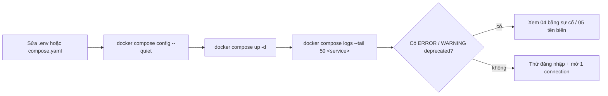

# 06/03 · Vận hành hằng ngày

> Ai đọc: người vận hành sau khi hệ thống đã chạy: xem log, đổi cấu hình, nâng cấp
> phiên bản, quản lý user, việc định kỳ. Mọi lệnh chạy **trên VPS** trong `/opt/guacamole`.
>
> Trước: [02-trien-khai-docker-compose.md](02-trien-khai-docker-compose.md) · Tiếp: [04-sao-luu-va-xu-ly-su-co.md](04-sao-luu-va-xu-ly-su-co.md)

## Lệnh hay dùng

| Việc | Lệnh | Ghi chú |
| --- | --- | --- |
| Trạng thái | `docker compose ps` | `guacd` hiện `health: starting` vài phút sau khởi động là bình thường |
| Log web app | `docker compose logs -f --tail 100 guacamole` | Đăng nhập, extension, lỗi DB |
| Log guacd | `docker compose logs -f --tail 100 guacd` | Lỗi kết nối tới máy đích |
| Log Caddy | `docker compose logs --tail 100 caddy` | Chứng chỉ, 502 |
| Áp dụng thay đổi `.env` / `compose.yaml` | `docker compose up -d` | **Không dùng `restart`** — `restart` giữ biến cũ |
| Khởi động lại web app (đăng xuất mọi người) | `docker compose up -d --force-recreate guacamole` | Session nằm trong RAM |
| Tài nguyên | `docker stats --no-stream` | |
| Dung lượng recording | `du -sh data/recordings` | |

## Đổi cấu hình



- Mọi biến là runtime; không cần build lại image. Ý nghĩa từng biến: [05](05-bien-moi-truong.md).
- Đổi biến nhưng không có tác dụng → (1) đã dùng `restart` thay vì `up -d`, hoặc (2) key
  đã nằm trong `guacamole.properties` template (file thắng biến).
- Bật thêm extension (vd. TOTP): thêm `TOTP_ENABLED: "true"` vào `environment` của
  `guacamole`, `docker compose up -d`. Lần đăng nhập sau, mỗi user phải quét mã QR.
  **Bật TOTP trước khi mọi admin có app Authenticator** → admin vẫn đăng nhập được
  (TOTP yêu cầu đăng ký ở lần đầu), nhưng nên thử bằng một user phụ trước.

### Đổi mật khẩu DB

`POSTGRES_PASSWORD` của image postgres chỉ dùng **lúc khởi tạo**; đổi trong `.env` không đổi
mật khẩu trong DB (web app sẽ báo lỗi xác thực DB). Đổi đúng thứ tự:

1. `docker compose exec postgres psql -U guacamole_user -d guacamole_db -c "ALTER USER guacamole_user WITH PASSWORD '<mật-khẩu-mới>';"`
2. Sửa `POSTGRES_PASSWORD` trong `.env` thành cùng giá trị.
3. `docker compose up -d guacamole`.
4. Kiểm tra: đăng nhập web được; log không có `password authentication failed`.

## Nâng cấp phiên bản Guacamole

Nguyên tắc: **guacd và guacamole luôn cùng tag**; **nâng cấp schema DB là việc tay** —
image postgres không chạy lại script init, image guacamole không tự migrate.

1. Đọc release notes bản mới: <https://guacamole.apache.org/releases/> (mục "Upgrading"
   / "Deprecation / compatibility notes").
2. Kiểm tra có script nâng cấp schema không: trong repo clone,
   `git -C guacamole-client fetch --tags && git -C guacamole-client ls-tree --name-only <tag-mới> extensions/guacamole-auth-jdbc/modules/guacamole-auth-jdbc-postgresql/schema/upgrade/`
   → có file `upgrade-pre-<bản-mới>.sql` (vd. từ 1.5.x lên 1.6.0 cần `upgrade-pre-1.6.0.sql`)
   thì phải chạy. Hoặc lấy từ image mới: `docker run --rm guacamole/guacamole:<tag-mới> ls /opt/guacamole/extensions/guacamole-auth-jdbc/postgresql/schema/upgrade/`.
3. **Backup DB** ([04 § Sao lưu](04-sao-luu-va-xu-ly-su-co.md#sao-lưu)) — bắt buộc trước bước 4.
4. Nếu có script ở bước 2, **chỉ khi backup xong**:

   ```bash
   docker run --rm guacamole/guacamole:<tag-mới> cat /opt/guacamole/extensions/guacamole-auth-jdbc/postgresql/schema/upgrade/upgrade-pre-<tag-mới>.sql > init/upgrade-<tag-mới>.sql
   docker compose exec -T postgres psql -U guacamole_user -d guacamole_db -v ON_ERROR_STOP=1 < init/upgrade-<tag-mới>.sql
   ```

   (Đường dẫn trong image suy từ `guacamole-docker/bin/initdb.sh`; nhảy nhiều bản thì chạy
   lần lượt từng script theo thứ tự phiên bản.) Lưu ý: file trong `init/` chỉ chạy lúc DB
   rỗng nên để ở đây không gây chạy lại; có thể xóa sau khi nâng cấp xong.
5. Đổi `GUACAMOLE_VERSION=<tag-mới>` trong `.env` → `docker compose pull && docker compose up -d`.
6. Kiểm tra: đăng nhập, mở một connection mỗi giao thức đang dùng, xem log không `ERROR`.

**Rollback**: đặt lại `GUACAMOLE_VERSION` cũ → `docker compose up -d`. Nếu đã chạy script
nâng cấp schema, bản cũ có thể không đọc được schema mới → khôi phục DB từ backup ở bước 3
([04 § Khôi phục](04-sao-luu-va-xu-ly-su-co.md#khôi-phục)).

Nâng cấp **PostgreSQL** (16 → 17…) là việc riêng, khác nâng cấp Guacamole: dump bằng bản cũ,
tạo data mới bằng bản mới, restore. Không chỉ đổi tag image (data không tương thích giữa bản chính).

## Quản lý người dùng

| Việc | Ở đâu (giao diện 1.6.0, tiếng Anh) |
| --- | --- |
| Tạo user / group, gán quyền connection | Settings → Users / Groups |
| Xem ai đang kết nối, ngắt phiên | Settings → Active Sessions |
| Lịch sử đăng nhập / kết nối, xem lại recording | Settings → History |
| Giới hạn số phiên đồng thời mỗi connection | Connection → *Concurrency Limits* |
| Giới hạn theo giờ / IP (extension restrict) | Bật `RESTRICT_ENABLED: "true"` → thuộc tính mới trên user / connection |

Nguyên tắc: không dùng chung tài khoản; quyền *Administer system* chỉ cho người quản trị;
mật khẩu máy đích lưu trong connection **không được mã hóa** — tham số connection nằm ở
cột `parameter_value varchar(4096)` của bảng `guacamole_connection_parameter` (đọc từ
`001-create-schema.sql`). Bảo vệ DB và file backup như kho mật khẩu; hoặc không lưu mật
khẩu, để trống cho người dùng nhập lúc kết nối, hoặc dùng token `${GUAC_PASSWORD}`.

## Việc định kỳ

| Tần suất | Việc | Lệnh / cách kiểm tra |
| --- | --- | --- |
| Hằng ngày (tự động) | Backup DB | cron, xem [04](04-sao-luu-va-xu-ly-su-co.md#sao-lưu); kiểm tra file mới nhất `ls -lt backups/ \| head -3` |
| Hằng tuần | Xem log lỗi | `docker compose logs --since 168h guacamole guacd \| grep -E 'ERROR\|WARN' \| tail -50` |
| Hằng tháng | Cập nhật image cùng tag (vá bảo mật OS trong image) | `docker compose pull && docker compose up -d` |
| Hằng tháng | Dung lượng ổ đĩa, xóa recording cũ theo chính sách | `df -h /`, `find data/recordings -mtime +90 -type f` (xem trước khi xóa) |
| Hằng quý | **Khôi phục thử backup** | [04 § Khôi phục thử](04-sao-luu-va-xu-ly-su-co.md#khôi-phục-thử-định-kỳ) |
| Hằng quý | Rà user không dùng, quyền admin | Settings → Users |
| Theo phát hành | Kiểm tra bản Guacamole mới | <https://guacamole.apache.org/releases/> |
| Tự động | Gia hạn chứng chỉ | Caddy tự làm; kiểm tra hạn bằng lệnh `openssl` ở [02 § Bước 10](02-trien-khai-docker-compose.md#bước-10--kiểm-tra-sau-triển-khai) |
