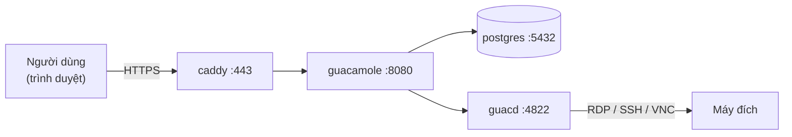
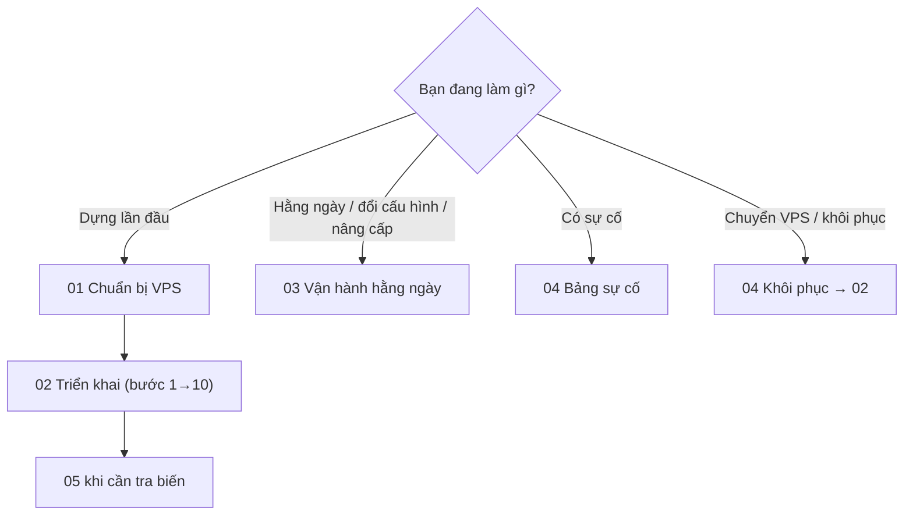

# 06 · Triển khai & vận hành

> Mục lục docs vận hành. Ai đọc: người dựng và vận hành Guacamole trên VPS. Không cần
> đọc docs dev (03, 04) để làm theo phần này.
>
> Trước: [05-quy-uoc-va-dong-gop.md](../05-quy-uoc-va-dong-gop.md) · Tiếp: [01-chuan-bi-vps.md](01-chuan-bi-vps.md)

## Phương án chuẩn

**Docker Compose trên một VPS Ubuntu**, gồm 4 container: `caddy` (HTTPS, cổng 80/443
duy nhất ra Internet) → `guacamole` (web app, image chính thức `guacamole/guacamole:1.6.0`)
→ `guacd` (`guacamole/guacd:1.6.0`) + `postgres:16`. Lý do chọn: [ADR-002](../07-quyet-dinh/ADR-002-dung-image-chinh-thuc-ghim-phien-ban.md),
[ADR-003](../07-quyet-dinh/ADR-003-phuong-an-trien-khai-compose-postgresql-caddy.md).

Chưa có phương án riêng (CDN trước VPS, VPN tới LAN, Dokploy / Coolify…). Khi áp dụng,
thêm file `06-<ten-phuong-an>.md` kèm bảng "docs chuẩn ghi X → ở đây là Y" và cập nhật bản đồ đọc.

## Mục lục

| #   | File                                                                   | Nội dung                                                         |
| --- | ---------------------------------------------------------------------- | ---------------------------------------------------------------- |
| 01  | [01-chuan-bi-vps.md](01-chuan-bi-vps.md)                               | Máy đích có tới được không, cấu hình VPS, SSH / ufw, Docker, DNS |
| 02  | [02-trien-khai-docker-compose.md](02-trien-khai-docker-compose.md)     | `.env`, initdb, quyền thư mục, `compose.yaml`, `Caddyfile`, khởi động, thay `guacadmin`, kiểm tra |
| 03  | [03-van-hanh-hang-ngay.md](03-van-hanh-hang-ngay.md)                   | Log, đổi cấu hình, nâng cấp phiên bản + schema, user, việc định kỳ |
| 04  | [04-sao-luu-va-xu-ly-su-co.md](04-sao-luu-va-xu-ly-su-co.md)           | `pg_dump`, khôi phục, khôi phục thử, **bảng sự cố**              |
| 05  | [05-bien-moi-truong.md](05-bien-moi-truong.md)                         | **Nguồn duy nhất** của mọi biến: cơ chế, `.env`, từng container  |

## Bản đồ đọc

## Hiện trạng

Kiểm tra 2026-10-31: **chưa có hệ thống nào đang chạy** (chưa có VPS, tên miền, backup).
Toàn bộ 01–05 là phương án chuẩn **chưa kiểm chứng trên hệ thống thật**. Sau lần dựng đầu,
điền bảng dưới (ghi ngày kiểm tra cạnh mỗi dòng) và sửa docs chỗ nào thực tế khác.

| Mục | Giá trị | Kiểm tra bằng | Ngày kiểm tra |
| --- | --- | --- | --- |
| Nhà cung cấp VPS / IP | _chưa có_ | `curl -s ifconfig.me` trên VPS | |
| OS | _chưa có_ | `lsb_release -ds` | |
| Tên miền (`GUAC_DOMAIN`) | _chưa có_ | `dig +short A <domain>` | |
| Nhà cung cấp DNS, có proxy / CDN không | _chưa có_ | `dig +short NS <domain>`; `curl -sI https://<domain>` xem header `server` / `cf-ray` | |
| Phiên bản image đang chạy | _chưa có_ | `docker compose images` | |
| Backup ra ngoài VPS (công cụ, nơi lưu) | _chưa có_ | | |
| Lần khôi phục thử gần nhất | _chưa có_ | [04 § Khôi phục thử](04-sao-luu-va-xu-ly-su-co.md#khôi-phục-thử-định-kỳ) | |
| Tài nguyên thực tế (RAM / CPU khi N phiên) | _chưa có_ | `docker stats --no-stream` | |
