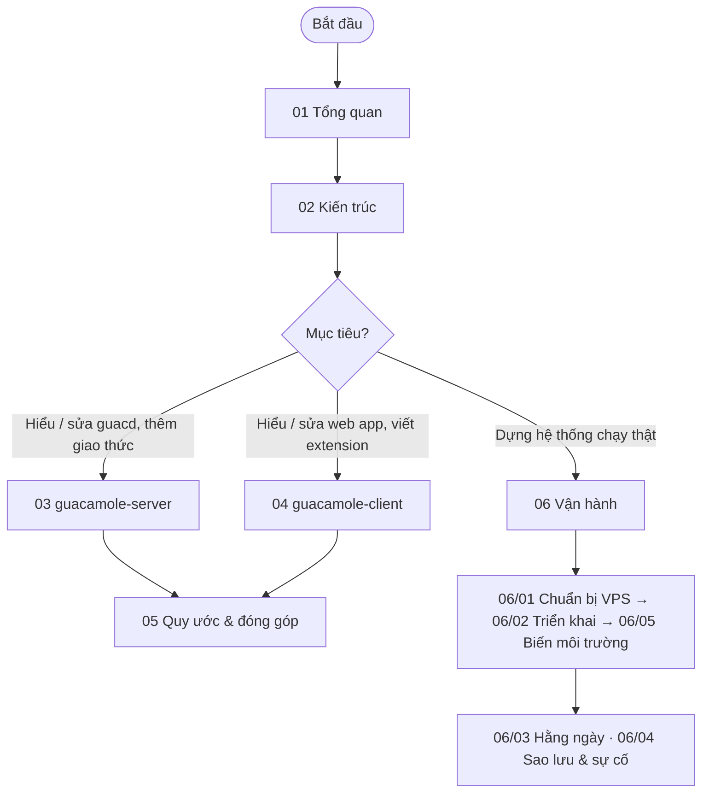

# Docs Apache Guacamole (bản học tập)

> Mục lục và bản đồ đọc cho toàn bộ docs. Ai đọc: người muốn hiểu code
> Guacamole (dev) và người muốn triển khai / vận hành Guacamole trên VPS.

Thư mục gốc `/Users/phecode/HOCTAP/guacamole/` chứa **hai repo upstream độc lập**
của Apache Guacamole và bộ docs này (docs nằm ngoài 2 repo để `git pull` upstream
không bị conflict — xem [ADR-001](07-quyet-dinh/ADR-001-dat-docs-o-thu-muc-goc.md)).

| Thư mục            | Là gì                                                   | Ngôn ngữ / build       |
| ------------------ | ------------------------------------------------------- | ---------------------- |
| `guacamole-server/` | `guacd` (proxy daemon), `libguac`, plugin RDP/VNC/SSH… | C, GNU Autotools       |
| `guacamole-client/` | Web app Java + frontend AngularJS + các extension      | Java, Maven, webpack   |
| `docs/`            | Bộ docs này                                            | Markdown, Mermaid      |

> **Lưu ý an toàn.** Code trong 2 repo coi như **chưa tin cậy** và khi viết docs này
> **không có lệnh build / chạy nào được thực thi** — mọi mô tả rút ra từ việc
> đọc mã nguồn. Các lệnh build ghi trong docs đánh dấu "chưa kiểm chứng". Xem
> [01-tong-quan § An toàn](01-tong-quan.md#an-toàn-khi-làm-việc-với-mã-nguồn).

## Mục lục

| #   | File / thư mục                                               | Nội dung                                                           |
| --- | ------------------------------------------------------------ | ------------------------------------------------------------------ |
| 01  | [01-tong-quan.md](01-tong-quan.md)                           | Guacamole là gì, 2 phần, phiên bản, an toàn, thuật ngữ             |
| 02  | [02-kien-truc.md](02-kien-truc.md)                           | Sơ đồ thành phần, luồng đăng nhập → kết nối, giao thức Guacamole   |
| 03  | [03-guacamole-server/](03-guacamole-server/README.md)        | Đọc code phần C: cấu trúc, guacd, libguac, plugin, build & test    |
| 04  | [04-guacamole-client/](04-guacamole-client/README.md)        | Đọc code phần Java/JS: Maven, webapp, REST, frontend, extension    |
| 05  | [05-quy-uoc-va-dong-gop.md](05-quy-uoc-va-dong-gop.md)       | Quy ước code, license header, commit, quy trình đóng góp upstream  |
| 06  | [06-van-hanh/](06-van-hanh/README.md)                        | Triển khai Docker Compose + PostgreSQL + Caddy trên VPS, vận hành  |
| 07  | [07-quyet-dinh/](07-quyet-dinh/README.md)                    | ADR — các quyết định đã chốt                                       |

## Bản đồ đọc

- **Người mới, muốn hiểu toàn cảnh**: 01 → 02 (đủ để giải thích Guacamole hoạt động ra sao).
- **Muốn đọc code**: 01 → 02 → 03 hoặc 04 theo thứ tự số → 05.
- **Muốn dựng hệ thống**: 01 → [06-van-hanh/README.md](06-van-hanh/README.md) (không cần đọc 03, 04).
- **Đang có sự cố production**: thẳng tới [06-van-hanh/04-sao-luu-va-xu-ly-su-co.md](06-van-hanh/04-sao-luu-va-xu-ly-su-co.md).

## Tài liệu liên quan trong workspace

- Báo cáo review mã nguồn: [../review-source/00-MUC-LUC.md](../review-source/00-MUC-LUC.md)
  và kế hoạch việc cần làm [../CHECKLIST.md](../CHECKLIST.md) — do một phiên làm việc khác
  tạo ngày 2026-10-31. Docs này viết độc lập từ việc đọc code; các mục cấu hình bảo mật
  khi triển khai (header proxy, quickconnect, tham số connection) đã được **tự kiểm chứng
  lại trong code** trước khi đưa vào [06-van-hanh/](06-van-hanh/README.md).

## Tài liệu ngoài

- Manual chính thức (Guacamole User Guide): <https://guacamole.apache.org/doc/gug/>
- Trang phát hành: <https://guacamole.apache.org/releases/>
- JIRA (báo lỗi upstream): <https://issues.apache.org/jira/browse/GUACAMOLE/>

Docs này **không chép lại** manual; chỉ ghi những gì gắn với code trong repo và
phương án triển khai đã chốt, kèm link sang manual khi cần.
