# 02 — Kiến trúc hệ thống và luồng kỹ thuật

> Phạm vi: `guacamole-client` @ `31d2a6f6a` (1.6.1) và `guacamole-server` @ `5f9bb3b4` (1.6.1).
> Ký hiệu đường dẫn dùng trong file:
>
> | Viết tắt | Đường dẫn thật |
> |---|---|
> | `S/` | `guacamole-server/src/` |
> | `C/` | `guacamole-client/guacamole-common/src/main/java/org/apache/guacamole/` |
> | `E/` | `guacamole-client/guacamole-ext/src/main/java/org/apache/guacamole/` |
> | `W/` | `guacamole-client/guacamole/src/main/java/org/apache/guacamole/` |
> | `CJ/` | `guacamole-client/guacamole-common-js/src/main/webapp/modules/` |
> | `FE/` | `guacamole-client/guacamole/src/main/frontend/src/app/` |
> | `J/` | `guacamole-client/extensions/guacamole-auth-jdbc/modules/guacamole-auth-jdbc-base/src/main/java/org/apache/guacamole/auth/jdbc/` |

Mục lục:
1. [Bức tranh tổng thể (C4 context)](#1-bức-tranh-tổng-thể-c4--context)
2. [Container và hợp đồng giữa các thành phần](#2-container-và-hợp-đồng-giữa-các-thành-phần)
3. [Cấu trúc repo và phụ thuộc module](#3-cấu-trúc-repo-và-phụ-thuộc-module)
4. [Giao thức Guacamole — "ngôn ngữ chung" của cả hệ thống](#4-giao-thức-guacamole--ngôn-ngữ-chung-của-cả-hệ-thống)
5. [Luồng F1 — Khởi động web app và nạp extension](#5-luồng-f1--khởi-động-web-app-và-nạp-extension)
6. [Luồng F2 — Đăng nhập, MFA và vòng đời auth token](#6-luồng-f2--đăng-nhập-mfa-và-vòng-đời-auth-token)
7. [Luồng F3 — Phân quyền REST](#7-luồng-f3--phân-quyền-rest)
8. [Luồng F4 — Mở một phiên remote desktop end-to-end](#8-luồng-f4--mở-một-phiên-remote-desktop-end-to-end)
9. [Luồng F5 — Mô hình process của guacd](#9-luồng-f5--mô-hình-process-của-guacd)
10. [Luồng F6 — Trong phiên: vẽ màn hình, sync/backpressure, input](#10-luồng-f6--trong-phiên-vẽ-màn-hình-syncbackpressure-input)
11. [Luồng F7 — Chia sẻ phiên và join](#11-luồng-f7--chia-sẻ-phiên-và-join)
12. [Luồng F8 — Truyền file, clipboard, in ấn](#12-luồng-f8--truyền-file-clipboard-in-ấn)
13. [Luồng F9 — Ghi phiên và phát lại](#13-luồng-f9--ghi-phiên-và-phát-lại)
14. [Luồng F10 — Kết thúc phiên và dọn dẹp](#14-luồng-f10--kết-thúc-phiên-và-dọn-dẹp)
15. [API extension (class diagram)](#15-api-extension-class-diagram)
16. [Đánh giá kiến trúc](#16-đánh-giá-kiến-trúc)
17. [ADR đề xuất](#17-adr-đề-xuất)

---

## 1. Bức tranh tổng thể (C4 — context)

Apache Guacamole là **remote desktop gateway "clientless"**: người dùng chỉ cần trình duyệt HTML5. Họ điều khiển máy RDP/VNC/SSH/Telnet/Kubernetes nằm sau gateway mà không cần cài client.

Ý tưởng cốt lõi là **dịch giao thức**:
- JavaScript không xử lý hiệu quả các giao thức nhị phân như RDP/VNC. Vì vậy dự án tự định nghĩa một giao thức text đơn giản là *Guacamole protocol*.
- `guacd` là proxy dịch từ RDP/VNC/SSH… sang Guacamole protocol. Theo chiều ngược lại, nó dịch lệnh vẽ thành instruction gửi về trình duyệt.

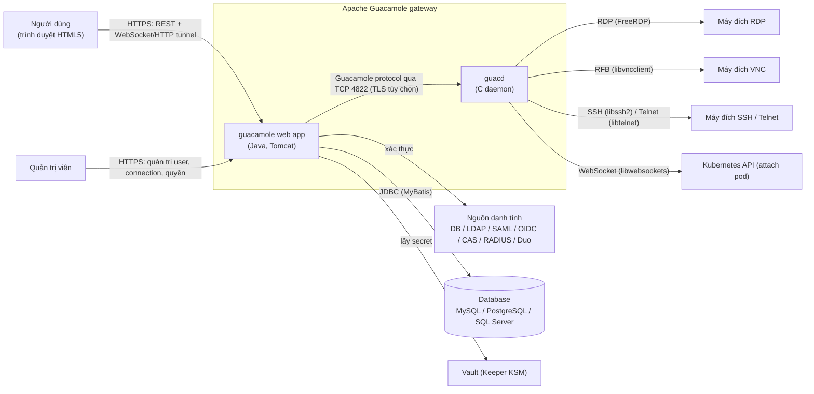

| Actor | Vai trò | Ghi chú |
|---|---|---|
| Người dùng cuối | Mở connection được cấp quyền, upload/download file, clipboard, chia sẻ phiên | Có thể chỉ là người giữ share link (user ẩn danh) |
| Quản trị viên | Quản lý user, group, connection, quyền; xem history, recording | Quyền hệ thống `ADMINISTER` |
| Auditor | Xem toàn bộ history | Quyền hệ thống `AUDIT` |
| Máy đích | Server RDP/VNC/SSH… | **Có thể độc hại.** Dữ liệu từ máy đích đi vào parser C của guacd (xem `04-BAO-MAT.md`) |
| IdP và vault | Xác thực, cấp secret | Cấu hình qua extension |

---

## 2. Container và hợp đồng giữa các thành phần

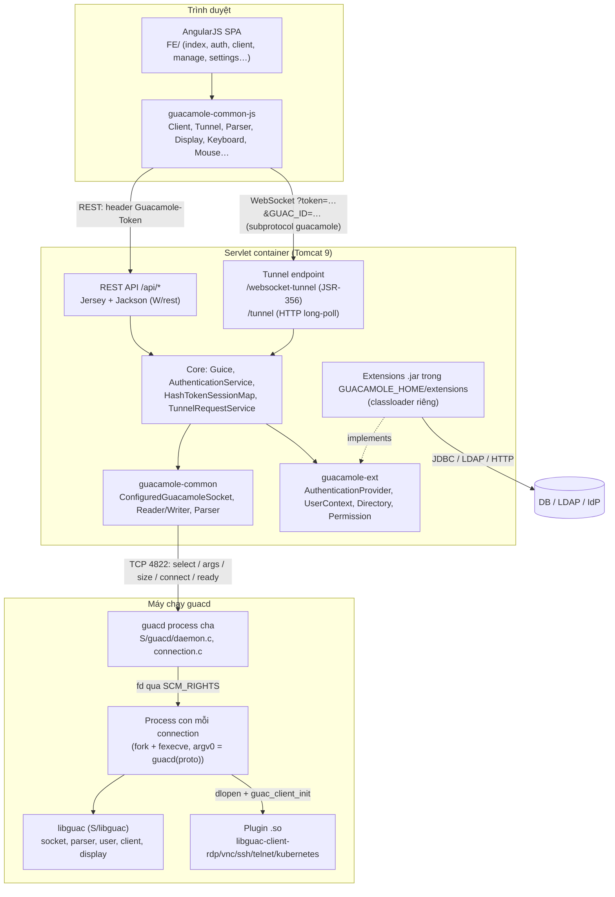

**Hợp đồng giữa các container:**

| Ranh giới | Giao thức / định dạng | Xác thực | Nơi định nghĩa |
|---|---|---|---|
| Browser ↔ REST | JSON qua HTTPS | Header `Guacamole-Token` (fallback query `?token=`) | `W/rest/auth/AuthenticationService.java:533-548` |
| Browser ↔ Tunnel | Guacamole protocol qua WebSocket hoặc HTTP | `token` trong query string (WebSocket không đặt được header) | `FE/client/types/ManagedClient.js:329-370`, `W/tunnel/TunnelRequest.java:36-100` |
| Web app ↔ guacd | Guacamole protocol qua TCP, TLS tùy chọn (`guacd-ssl`) | **Không có xác thực.** guacd tin bất kỳ ai kết nối tới | `C/protocol/ConfiguredGuacamoleSocket.java:203-318`, `S/guacd/connection.c:291-439` |
| guacd cha ↔ con | Unix socketpair, truyền fd bằng `SCM_RIGHTS`, config qua pipe | Cùng máy, cùng UID | `S/guacd/move-fd.c:35-139`, `S/guacd/proc.c:551-766` |
| guacd ↔ máy đích | RDP/RFB/SSH/Telnet/WebSocket | Theo tham số connection (mật khẩu, key, cert) | `S/protocols/*/settings.c` |
| Web app ↔ extension | Java interface `guacamole-ext` | Cùng JVM, cùng toàn quyền | `E/net/auth/*` |

---

## 3. Cấu trúc repo và phụ thuộc module

Thư mục review chứa **hai repo git độc lập**, đều thuộc Apache. Chúng giao tiếp qua mạng, không import mã của nhau. Theo `monorepo.md`, đây là cấu trúc **cấp C (nhóm app)** tách repo, phù hợp với quy mô: hai ngôn ngữ, hai chu kỳ build, có thể triển khai độc lập.

```text
guacamole/                      ← thư mục chứa (không phải git repo)
├── guacamole-client/           ← Maven multi-module, Java 8 target + JS
│   ├── guacamole-common/       ← thư viện Java: protocol, tunnel servlet/websocket
│   ├── guacamole-common-js/    ← thư viện JS: Client, Tunnel, Display… (đóng gói .war/.js)
│   ├── guacamole-ext/          ← API cho extension (AuthenticationProvider…)
│   ├── guacamole/              ← web app (.war): Java REST/tunnel + frontend AngularJS (webpack)
│   ├── extensions/             ← 14 extension chính thức (jdbc, ldap, sso, totp, duo, header, json, ban,
│   │                              restrict, quickconnect, radius, vault, history-recording-storage, display-statistics)
│   ├── guacamole-docker/       ← script build/entrypoint cho image guacamole/guacamole
│   ├── doc/                    ← ví dụ (example, branding, playback) + license bundle
│   └── Dockerfile, pom.xml
└── guacamole-server/           ← Autotools, C99
    ├── src/libguac/            ← thư viện lõi: socket, parser, protocol, user, client, display, recording
    ├── src/guacd/              ← daemon: accept, route, process model, watchdog
    ├── src/protocols/{rdp,vnc,ssh,telnet,kubernetes}/  ← plugin .so
    ├── src/common/, common-ssh/, terminal/, pulse/     ← code dùng chung giữa plugin
    ├── src/guacenc/, guaclog/  ← công cụ chuyển recording sang video / log phím
    ├── src/guacd-docker/       ← autobuild.sh, entrypoint.sh
    └── Dockerfile, configure.ac
```

**Hướng phụ thuộc** (mũi tên = "phụ thuộc vào"):

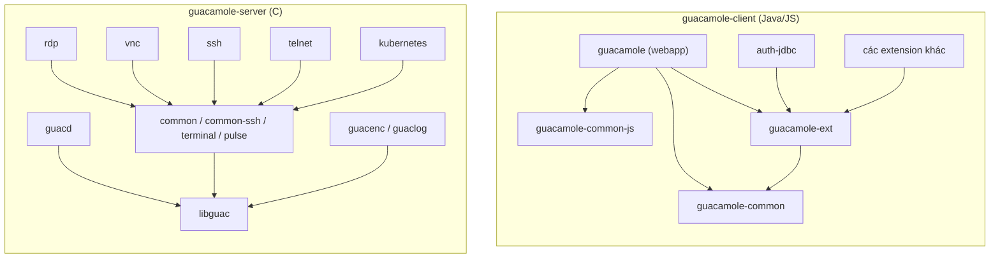

Kết luận về hướng phụ thuộc: **một chiều, không có vòng.** Extension chỉ phụ thuộc `guacamole-ext`, không phụ thuộc webapp. Plugin C chỉ phụ thuộc `libguac` và `common*`. guacd không biết tới plugin cụ thể nào, chỉ `dlopen` theo tên (`S/libguac/client.c:656-714`).

---

## 4. Giao thức Guacamole — "ngôn ngữ chung" của cả hệ thống

Mọi thành phần (JS, Java, C) đều nói cùng một giao thức text. Hiểu giao thức này là hiểu được toàn bộ luồng dữ liệu.

**Định dạng instruction:** `LEN.VALUE,LEN.VALUE,...;`
- Phần tử đầu tiên là **opcode**.
- `LEN` là số **ký tự Unicode** (code point) của `VALUE`, không phải số byte.
- `,` ngăn cách các phần tử, `;` kết thúc instruction.

Ví dụ: `4.size,4.1024,3.768,2.96;` nghĩa là `size(1024, 768, 96)`.

Vì độ dài đứng trước nội dung, giá trị có chứa `,` hay `;` vẫn không phá được cấu trúc. Đây là cơ chế chống "injection" của giao thức. Điều kiện tiên quyết: **mọi bên phải đếm độ dài giống nhau.** Xem `SEC-02` để thấy chuyện gì xảy ra khi guacd và Java đếm khác nhau với chuỗi UTF-8 lỗi.

| Bộ parse | File | Giới hạn |
|---|---|---|
| C (guacd) | `S/libguac/parser.c:57-163`, `S/libguac/guacamole/parser-constants.h:32-42` | phần tử ≤ 8192 ký tự, ≤ 128 phần tử, buffer 32 KiB |
| Java | `C/protocol/GuacamoleParser.java:38-48, 271-306` | 8192 ký tự, 5 chữ số, 128 phần tử |
| JS | `CJ/Parser.js:127-252` | không giới hạn độ dài (xem `PERF-01`) |

**Nhóm opcode chính:**

| Nhóm | Hướng | Opcode tiêu biểu |
|---|---|---|
| Handshake | web app → guacd | `select`, `size`, `audio`, `video`, `image`, `timezone`, `name`, `connect` |
| Handshake | guacd → web app | `args` (danh sách tham số + version), `ready <connection-id>` |
| Vẽ | guacd → browser | `img`, `png`/`jpeg`, `blob`, `end`, `copy`, `rect`, `cfill`, `cursor`, `size`, `move`, `shade`, `dispose`, `transfer` |
| Đồng bộ | hai chiều | `sync <timestamp>` (dùng cho backpressure), `nop` (keep-alive) |
| Input | browser → guacd | `key <keysym> <pressed>`, `mouse <x> <y> <mask>`, `touch`, `size` (resize) |
| Stream | hai chiều | `clipboard`, `file`, `pipe`, `audio`, `video`, `blob`, `ack`, `end`, `filesystem`, `get`, `put`, `body` |
| Điều khiển | hai chiều | `error <msg> <status>`, `disconnect`, `argv`, `required`, `nest` |
| Nội bộ tunnel | tunnel ↔ browser | opcode rỗng `""` (UUID tunnel, `ping`). Web app chặn opcode này từ browser ở WebSocket (`C/websocket/GuacamoleWebSocketTunnelEndpoint.java:316`) |

---

## 5. Luồng F1 — Khởi động web app và nạp extension

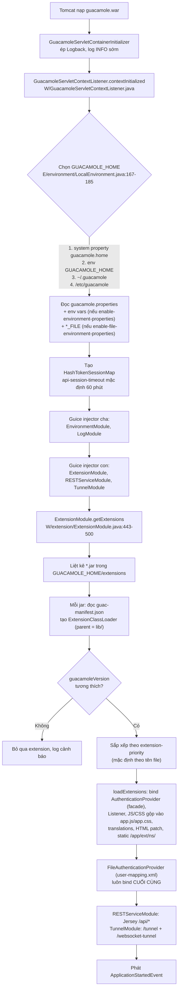

Điểm cần nhớ:
- **Thứ tự extension chính là thứ tự xác thực.** Provider đứng trước có quyền trả kết quả trước. Đổi tên file `.jar` là đổi thứ tự (`ARCH`/`DOC-01`).
- **GUACAMOLE_HOME là ranh giới tin cậy.** Mọi `.jar` trong đó chạy với toàn quyền JVM và có thể chèn JS vào UI (`W/extension/ExtensionModule.java:451-476, 550-575`).

---

## 6. Luồng F2 — Đăng nhập, MFA và vòng đời auth token

### 6.1 Đăng nhập thường (ví dụ JDBC + TOTP)

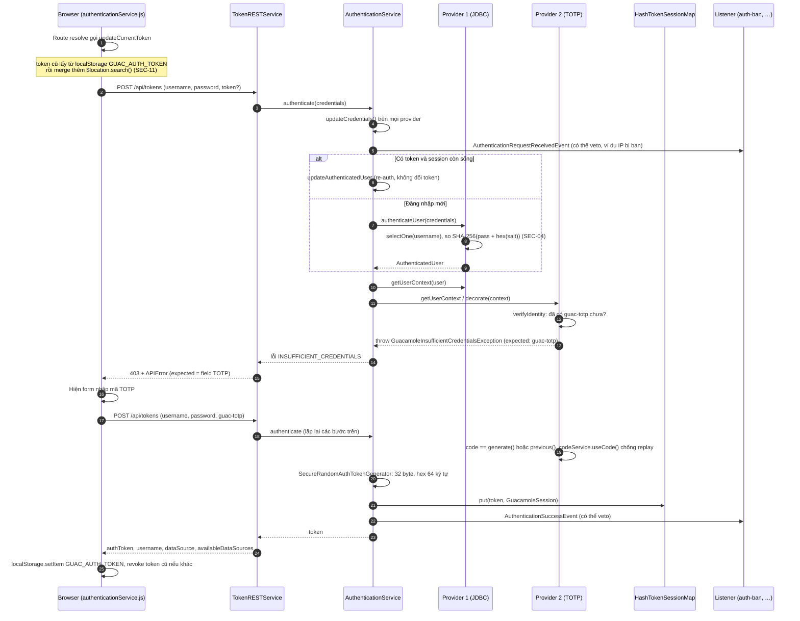

Ghi chú theo bước:
- **Bước 1–2:** `FE/auth/service/authenticationService.js:294-310`.
- **Bước 4–7:** `W/rest/auth/AuthenticationService.java:357-449`.
- Nhánh re-auth: `:183-203`. Lựa chọn provider: `:121-163`. Ưu tiên `InsufficientCredentials`: `:138-151`.
- `getUserContexts` và decorate chéo: `:264-333`. Sinh token: `W/rest/auth/SecureRandomAuthTokenGenerator.java:33-40`.
- **TOTP:** `extensions/guacamole-auth-totp/.../user/UserVerificationService.java:363-406`. Chống replay trong 2 chu kỳ: `CodeUsageTrackingService.java:220-251`.

### 6.2 SSO (OpenID Connect, SAML)

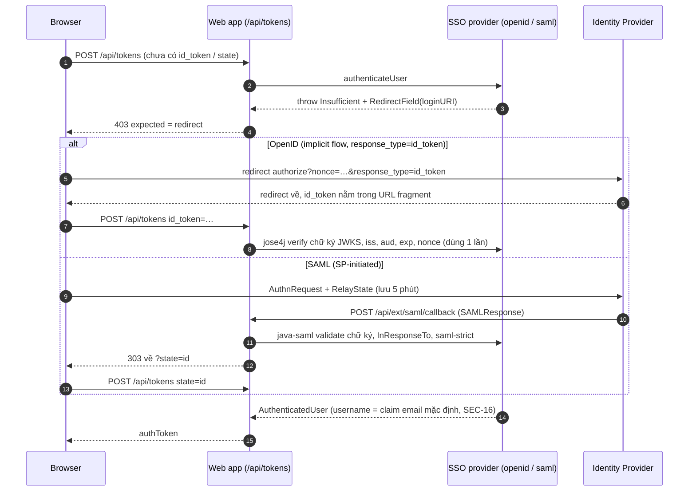

### 6.3 Vòng đời token

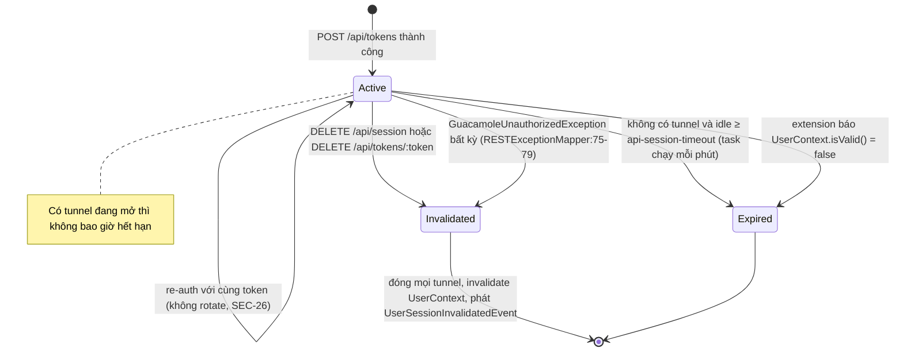

Token chỉ nằm trong `ConcurrentHashMap` của từng JVM (`W/rest/auth/HashTokenSessionMap.java:55, 124-178`): restart là mất phiên, và nhiều node không chia sẻ được (`ARCH-03`).

---

## 7. Luồng F3 — Phân quyền REST

Core REST **không tự quyết định quyền**. Nó ủy cho `Directory` của từng provider. Riêng provider JDBC lọc quyền READ ngay trong SQL.

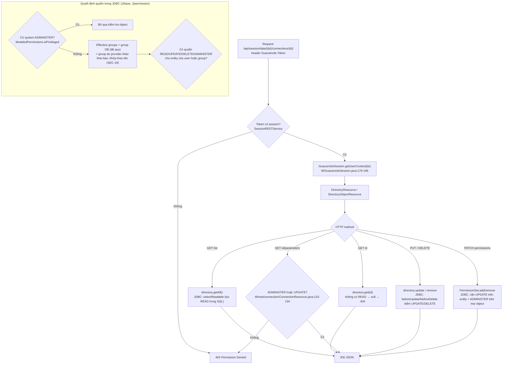

Chi tiết mô hình quyền và ER diagram ở `08-DATABASE.md`.

---

## 8. Luồng F4 — Mở một phiên remote desktop end-to-end

Đây là luồng quan trọng nhất. Một click "mở connection" đi qua 6 thành phần.

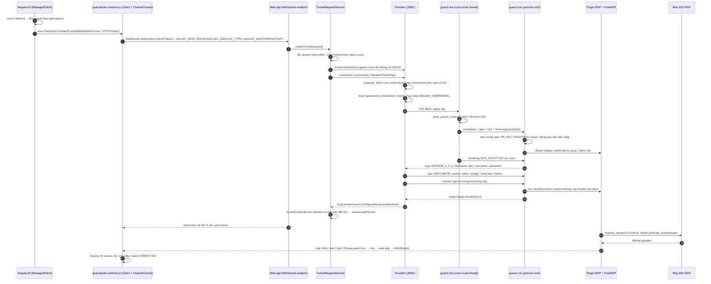

Các giai đoạn và vị trí code:

| Giai đoạn | Vị trí |
|---|---|
| Dựng connect string | `FE/client/types/ManagedClient.js:329-370` |
| ChainedTunnel và fallback | `CJ/Tunnel.js:1108-1222` |
| WebSocket handshake lưu request | `W/tunnel/websocket/RestrictedGuacamoleWebSocketTunnelEndpoint.java:80-91` |
| Tạo tunnel | `W/tunnel/TunnelRequestService.java:330-375` |
| Kiểm concurrency | `J/tunnel/RestrictedGuacamoleTunnelService.java:113-240` |
| Ghi history và thay token | `J/tunnel/AbstractGuacamoleTunnelService.java:474-569` |
| Handshake phía Java | `C/protocol/ConfiguredGuacamoleSocket.java:203-318` |
| Route phía guacd cha | `S/guacd/connection.c:291-439` |
| Tạo process | `S/guacd/proc.c:551-766` |
| Process con khởi động | `S/guacd/proc-child.c:157-323` |
| Handshake phía libguac | `S/libguac/user-handshake.c:257-402` |
| Plugin RDP | `S/protocols/rdp/client.c:145`, `user.c:46`, `rdp.c:804-958` |

**Ba lớp kiểm soát quyền trong luồng này:**
1. **Web app:** token phải hợp lệ, provider phải trả về connection (READ).
2. **Provider:** giới hạn số phiên, cửa sổ thời gian (`auth-restrict`), veto qua listener.
3. **guacd:** không kiểm quyền gì. Nó thực thi đúng tham số được gửi tới. Vì vậy mọi tham số nguy hiểm (`drive-path`, `recording-path`, `hostname`…) phải bị chặn từ web app (`SEC-06`).

---

## 9. Luồng F5 — Mô hình process của guacd

Từ bản 1.6.x, guacd không chỉ `fork` mà còn **`fexecve` lại chính binary** (mở sẵn qua `/proc/self/exe` lúc khởi động). Nhờ vậy mỗi connection có một address space sạch.

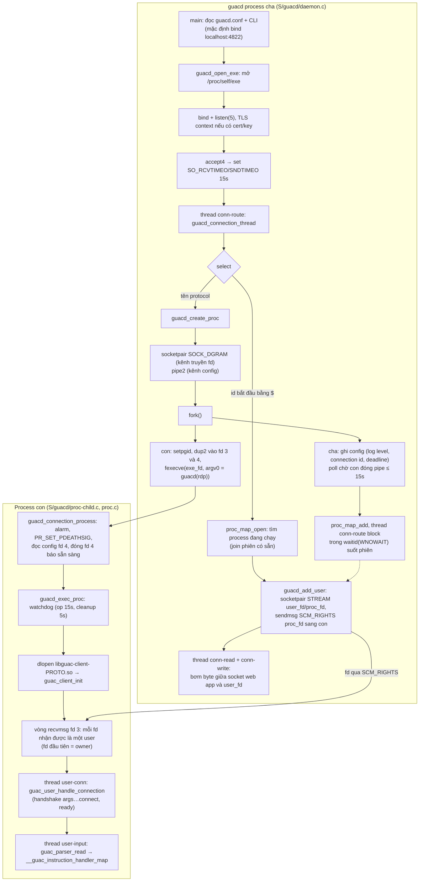

**Các thread trong một connection RDP:**

| Process | Thread | Vai trò |
|---|---|---|
| cha | `conn-route` | Parse `select`, tạo hoặc join process, chờ process con thoát |
| cha | `conn-read`, `conn-write` | Bơm dữ liệu hai chiều giữa web app và process con |
| con | main | Vòng nhận fd user mới |
| con | `teardown-watch`, watchdog | Theo dõi timeout của từng thao tác và của giai đoạn dọn dẹp |
| con | `user-conn`, `user-input` (mỗi user) | Handshake, đọc lệnh từ user |
| con | `user-promote` | Chuyển user pending sang active sau `join_pending_handler` |
| con | `rdp-client` | Vòng sự kiện FreeRDP |
| con | render thread | Flush `guac_display` thành instruction vẽ |

**Vì sao thiết kế này tốt:**
- **Cô lập lỗi:** plugin crash, kể cả do máy đích độc hại, chỉ chết một phiên.
- **Bề mặt tấn công nhỏ ở process cha:** process cha chỉ parse đúng một lệnh `select`.
- **Không cần cơ chế tái sử dụng PID:** `waitid(WNOWAIT)` cùng process group riêng giúp kill sạch toàn bộ cây process.
- Mọi fd đều `CLOEXEC`.

**Điểm yếu:** process cha không giới hạn số kết nối đồng thời, và timeout 15 giây chỉ áp cho từng lần read (`SEC-12`).

---

## 10. Luồng F6 — Trong phiên: vẽ màn hình, sync/backpressure, input

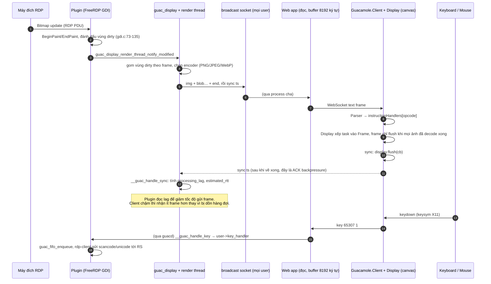

Ghi chú:
- **Backpressure:**
  - Phía JS: `CJ/Client.js:1672-1697`, `CJ/Display.js:195-224, 404-413`.
  - Phía C: `S/libguac/user-handlers.c:107-164`, `S/libguac/client.c:781`.
- **Keep-alive:**
  - WebSocket gửi ping mỗi 500 ms (`CJ/Tunnel.js:868-911`).
  - Client gửi `nop` mỗi 5 giây (`CJ/Client.js:49, 1795-1832`).
  - guacd gửi `nop` khi im lặng quá 5 giây (`S/libguac/socket.c:46-83`).
  - Sau 15 giây không nhận gì thì báo `UPSTREAM_TIMEOUT`. Mất tín hiệu quá 1,5 giây thì vào trạng thái `UNSTABLE` (`CJ/Tunnel.js:116-127`).
- **Rủi ro:** nếu decode ảnh lỗi, frame bị kẹt mãi, client không gửi `sync`, phiên đứng hình (`ERR-03`).

---

## 11. Luồng F7 — Chia sẻ phiên và join

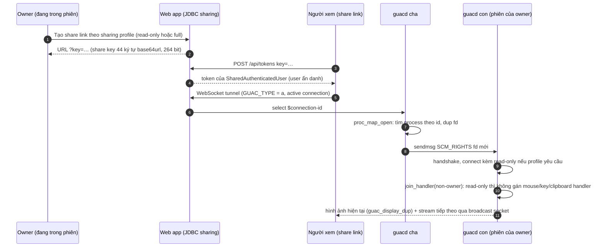

Lưu ý bảo mật:
- **Ai tới được guacd trực tiếp và biết `$connection-id` là join được phiên đó,** với cờ `read-only` do chính họ tự khai báo (`SEC-08`). Connection ID được log ở mức INFO (`SEC-24`).
- **Người xem read-only vẫn gửi được lệnh `size` (kể cả DPI=0) và các lệnh không kiểm `argc`** (`VAL-01`, `SEC-01`). Kết quả có thể làm sập process, tức đánh sập phiên của owner.

---

## 12. Luồng F8 — Truyền file, clipboard, in ấn

### 12.1 RDP drive redirection và SFTP

```mermaid
flowchart TD
    subgraph Upload["Upload từ trình duyệt"]
        U1["ManagedClient.uploadFile → instruction file"] --> U2["guacd: user->file_handler"]
        U2 --> U3{"Protocol?"}
        U3 -->|RDP drive| U4["upload.c:73 thay / và \ bằng _<br/>→ guac_rdp_fs_open FILE_OVERWRITE_IF"]
        U3 -->|SFTP| U5["common-ssh/sftp.c:373 kiểm disable_upload<br/>append_filename chặn . .. /<br/>libssh2_sftp_open 0600"]
        U1 --> U6["Dữ liệu: XHR POST chunk 4 MB tới<br/>/api/session/tunnels/uuid/streams/idx/name?token=… (SEC-09)"]
    end

    subgraph RDPDR["Máy đích RDP truy cập ổ ảo"]
        R1["IRP_MJ_CREATE từ server"] --> R2["rdpdr-fs-messages.c:49-85<br/>kiểm path_length, UTF-16 → UTF-8 (off-by-one, SEC-07)"]
        R2 --> R3["guac_rdp_fs_open (fs.c:214)"]
        R3 --> R4["normalize_path: xử lý .., chặn :, độ sâu ≤ 64"]
        R4 --> R5["translate_path: drive_path + đường dẫn ảo<br/>(drive_path rỗng → '/', SEC-22)"]
        R5 --> R6["open(…, 0600), cấp file_id từ pool"]
        R7["IRP READ/WRITE/CLOSE với FileId"] --> R8["guac_rdp_fs_get_file: chỉ kiểm khoảng giá trị,<br/>không kiểm slot đang mở (SEC-03)"]
        R9["Liệt kê thư mục"] --> R10["dir-info: buffer 256 byte nhưng ghi length*2 (SEC-07)"]
    end

    subgraph Download["Download về trình duyệt"]
        D1["RDP: server ghi file vào \\Download\\ → guac_rdp_download_to_user"] --> D3
        D2["SSH: remote in OSC escape → terminal-handlers.c:1342 → sftp.c:525<br/>(không đi qua root_path, SEC-28)"] --> D3
        D3["instruction file + blob…"] --> D4["Web app StreamInterceptingTunnel<br/>REST GET …/streams/idx/name?token=…"]
        D4 --> D5["Content-Type octet-stream + Content-Disposition attachment<br/>(W/rest/tunnel/StreamResource.java:107-111)"]
    end
```

### 12.2 Clipboard

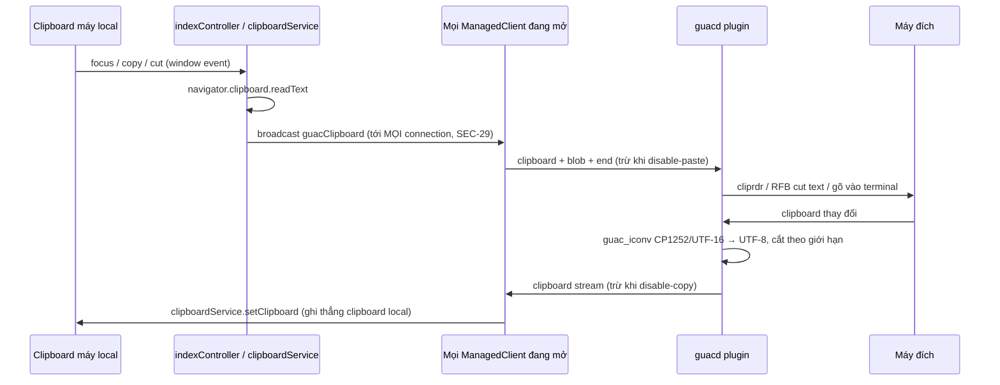

### 12.3 In ấn RDP

Luồng: máy đích in tới máy in ảo → `rdpdr-printer.c` → `print-job.c:330-366`: `fork` rồi `execvp("gs", "-dSAFER", "-sDEVICE=pdfwrite", …)` → PDF được stream về trình duyệt của owner. Ghostscript chạy trên **PostScript do máy đích gửi** và kế thừa toàn bộ fd (`SEC-21`).

---

## 13. Luồng F9 — Ghi phiên và phát lại

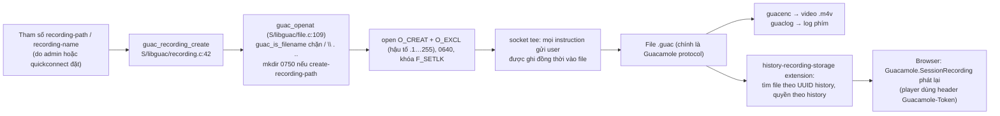

Typescript (SSH/Telnet) dùng cùng cơ chế, kèm thêm file `.timing`. File `.timing` được mở **không có `O_EXCL`** (`SEC-27`).

---

## 14. Luồng F10 — Kết thúc phiên và dọn dẹp

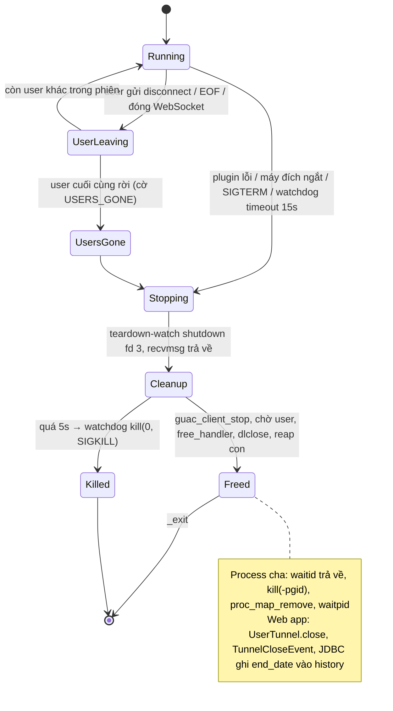

Phía Java, `ConnectionCleanupTask` chạy đúng một lần (`AtomicBoolean`): nó trả lại "ghế" concurrency rồi cập nhật `end_date` (`J/tunnel/AbstractGuacamoleTunnelService.java:397-438`). Nếu JVM crash, record history nằm lại với `end_date IS NULL` (`DB-03`).

---

## 15. API extension (class diagram)

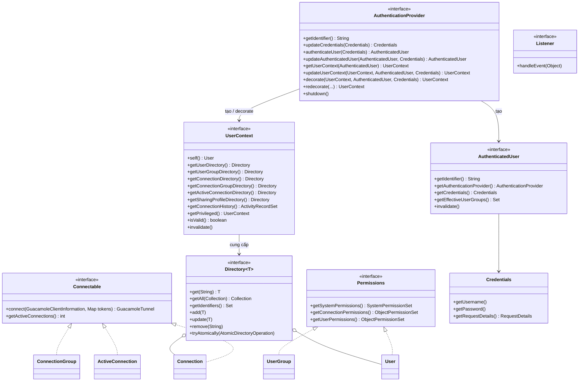

Đây là một **plugin API đúng nghĩa**:
- Web app không biết DB, LDAP hay SAML là gì. Mọi thứ đi qua `AuthenticationProvider` và `UserContext`.
- Extension có thể *decorate* context của nhau. Ví dụ TOTP bọc JDBC, vault bọc mọi provider để chèn secret.

Các lớp hỗ trợ: `AbstractAuthenticationProvider`, `DelegatingUserContext`, `TokenInjectingUserContext`, `Simple*` (`E/net/auth/`).

---

## 16. Đánh giá kiến trúc

| Tiêu chí (`architecture-modular.md`) | Hiện trạng | Đánh giá |
|---|---|---|
| Module theo nghiệp vụ | Java: `rest/{auth,connection,user,permission,tunnel…}`, `tunnel/`, `extension/`. C: plugin theo protocol, `common*` dùng chung | Tốt |
| Hướng phụ thuộc | Một chiều, không vòng (mục 3) | Tốt |
| Ngân sách trừu tượng | Interface `Directory`/`UserContext` có **nhiều implementation thật** (JDBC, LDAP, JSON, file, quickconnect…), nên DI bằng Guice là hợp lý, không thừa | Tốt |
| Thiếu tổ chức | Một số file lớn: `DirectoryResource.patchObjects` có ba nhánh gần như trùng nhau; `rdp/settings.c` 2023 dòng; `terminal.c` 3250 dòng (`ARCH-04`) | Chấp nhận được |
| Lặp code | Parse settings recording/SFTP/WOL chép tay ở 5 plugin; mapper SQL lặp ở 3 DB, giống nhau 74–86% (`ARCH-01`, `ARCH-02`) | Cần cải thiện |
| Trạng thái phân tán | Session, concurrency limit, ban, TOTP replay, nonce SSO, denylist JSON đều nằm trong RAM của từng JVM (`ARCH-03`) | Giới hạn mở rộng ngang |
| Cô lập lỗi | Process cho mỗi connection, classloader cho mỗi extension, `skip-if-unavailable` | Rất tốt |
| Điểm lỗi đơn (SPOF) | guacd cha (crash là mất mọi phiên), web app (token trong RAM), DB | Phải chạy HA bằng sticky session. Chưa có HA thật |

**Cây thư mục đích:** không đề xuất tái cấu trúc lớn, vì cấu trúc hiện tại đã theo module thật và hợp với quy mô. Chỉ đề xuất gom phần lặp lại.

```text
guacamole-server/src/common/
├── settings-recording.c/.h     ← MỚI: parse recording-path/name/exclude-*/include-keys (thay 5 bản chép)
├── settings-sftp.c/.h          ← MỚI: parse sftp-* dùng chung RDP/VNC
├── settings-wol.c/.h           ← MỚI: parse wol-* dùng chung
└── (giữ nguyên các file hiện có)

guacamole-client/extensions/guacamole-auth-jdbc/modules/
├── guacamole-auth-jdbc-base/src/main/resources/…/common/   ← MỚI (tùy chọn): fragment SQL dùng chung
│                                                             qua <include>/<sql>, chỉ giữ phần khác cú pháp ở từng DB
└── guacamole-auth-jdbc-{mysql,postgresql,sqlserver}/       ← giữ nguyên
```

---

## 17. ADR đề xuất

Các quyết định kiến trúc còn bỏ ngỏ, nên chốt thành ADR (Architecture Decision Record):

| ADR | Câu hỏi | Lựa chọn khuyến nghị | Liên quan |
|---|---|---|---|
| ADR-01 | guacd có cần xác thực web app không? | Hỗ trợ mTLS tùy chọn (CA của client), giữ mặc định bind localhost; Docker docs không publish cổng 4822 | `SEC-08` |
| ADR-02 | Thuật toán hash mật khẩu JDBC | PBKDF2-HMAC-SHA256 (có sẵn trong JDK, không thêm dependency) hoặc Argon2id; thêm cột `password_hash_algorithm`; rehash khi đăng nhập | `SEC-04` |
| ADR-03 | Token trong URL | Ticket một lần cho WebSocket và stream, đổi bằng REST có header | `SEC-09` |
| ADR-04 | Chiến lược chạy nhiều node | (a) chính thức chỉ hỗ trợ single-node, hoặc (b) store chung cho session/limit/ban | `ARCH-03` |
| ADR-05 | Thay thế AngularJS 1.x (đã EOL) | Lộ trình chuyển dần sang Angular 2+ hoặc Web Components, giữ `guacamole-common-js` độc lập framework; trước mắt dùng CSP | `OPS-01`, `SEC-10` |
| ADR-06 | Allow-list tham số connection ở tầng web | Danh sách tham số "nguy hiểm" (path, host, cert) mặc định deny cho mọi nguồn do user định nghĩa (quickconnect, JSON) | `SEC-06` |
