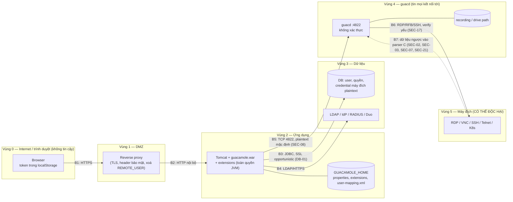

# 04 — Bảo mật: threat model, bề mặt tấn công, OWASP

> Bổ sung cho `03-VAN-DE-VA-RUI-RO.md`. File này không lặp lại bằng chứng, chỉ tham chiếu mã vấn đề.

## 1. Tài sản cần bảo vệ

| Tài sản | Ở đâu | Vì sao giá trị cao |
|---|---|---|
| **Credential của máy đích** (mật khẩu RDP/SSH, private key, passphrase) | `guacamole_connection_parameter` (plaintext, `SEC-14`), vault, bộ nhớ guacd | Một gateway giữ chìa khóa vào **hàng trăm máy**. Đây là tài sản số 1 |
| **Phiên đang chạy** (màn hình, bàn phím, clipboard) | guacd process, tunnel | Chiếm được phiên là điều khiển được máy đích với quyền của nạn nhân, thường là admin |
| **Quyền ADMINISTER của gateway** | `guacamole_system_permission` | Admin tạo được connection tới bất kỳ đâu, đọc được mọi tham số |
| **Auth token** | `localStorage`, URL, log (`SEC-09`, `SEC-10`) | Tương đương phiên đăng nhập |
| **Hash mật khẩu user, TOTP secret** | DB (`SEC-04`, `SEC-14`) | Crack được là đăng nhập lại được và vượt MFA |
| **Recording và typescript** | Thư mục `recording-path` | Chứa mọi thứ đã hiển thị và gõ, có thể gồm cả mật khẩu |
| **Máy chạy guacd** | Filesystem, mạng nội bộ | Là điểm pivot vào vùng mạng chứa các máy đích |

## 2. Actor (tác nhân đe dọa)

| Actor | Khả năng ban đầu |
|---|---|
| A1 — Khách ẩn danh trên Internet | Gọi được `/api/tokens`, `/api/ext/*/callback`, trang login |
| A2 — Người giữ share link | Token ẩn danh, xem hoặc điều khiển một phiên |
| A3 — User thường đã đăng nhập | Connection được cấp, REST self, tunnel |
| A4 — Admin hoặc người được ủy quyền một phần | Quyền UPDATE/ADMINISTER trên một phần object |
| A5 — **Máy đích độc hại hoặc bị chiếm** | Gửi dữ liệu tùy ý vào parser C của guacd (RDP PDU, RFB, output terminal) |
| A6 — Kẻ ở mạng nội bộ / container cùng network | Tới được cổng 4822, DB, LDAP |
| A7 — Người đọc được log hoặc backup | Access log của proxy, dump DB |
| A8 — Người có quyền ghi `GUACAMOLE_HOME` hoặc chuỗi build | Extension `.jar`, `user-mapping.xml`, image Docker |

## 3. Điểm vào (entry point)

| Điểm vào | Actor | Vấn đề liên quan |
|---|---|---|
| `POST /api/tokens` (login, SSO callback, MFA) | A1 | `SEC-04`, `SEC-05`, `SEC-13`, `SEC-15`, `SEC-16`, `SEC-18`, `SEC-20` |
| `/api/ext/saml/callback`, redirect OIDC/CAS | A1 | `SEC-16`, `ARCH-03` (pendingSessions) |
| REST `/api/session/**` | A3, A4 | `SEC-19`, `SEC-20`, `VAL-02`, `VAL-03`, `OPS-03` |
| `/websocket-tunnel`, `/tunnel` | A2, A3 | `SEC-01`, `SEC-09`, `SEC-26`, `VAL-01` |
| Stream upload/download `/api/session/tunnels/**` | A2, A3 | `SEC-09`, `SEC-28` |
| Quickconnect URI | A3 | `SEC-06` |
| Cổng guacd 4822 | A6 | `SEC-08`, `SEC-12`, `SEC-01` |
| Dữ liệu từ máy đích (RDPDR, cliprdr, rdpsnd, RFB, OSC/CSI, print PostScript) | A5 | `SEC-02`, `SEC-03`, `SEC-07`, `SEC-21`, `SEC-28`, `ERR-04` |
| Log, backup DB | A7 | `SEC-09`, `SEC-14`, `SEC-24`, `DB-01` |
| `GUACAMOLE_HOME/extensions`, `lib/`, build Docker | A8 | `MAL-01`, `SEC-23` |

## 4. Ranh giới tin cậy

| Ranh giới | Giả định của dự án | Điều thực tế cần bảo đảm |
|---|---|---|
| B1/B2 | Có reverse proxy làm TLS | Tomcat không lộ thẳng ra ngoài (`SEC-18`); proxy thêm CSP/XFO (`SEC-10`); che `token=` trong log (`SEC-09`) |
| B5 | guacd nằm trong mạng tin cậy | Không publish 4822, firewall chỉ cho web app (`SEC-08`) |
| B6/B7 | — | **Máy đích là nguồn dữ liệu không tin cậy.** Đây là ranh giới yếu nhất trong code C (`SEC-03`, `SEC-07`) |
| HOME | Chỉ admin ghi được | Quyền thư mục `root:tomcat 750`, chỉ root ghi được |

## 5. STRIDE

| STRIDE | Câu hỏi | Kết luận | Mã liên quan |
|---|---|---|---|
| **S**poofing | Giả mạo danh tính được không? | Có trong một số cấu hình: header auth không kiểm proxy; CAS chấp nhận mọi proxy; OIDC dùng claim email; group trùng tên; admin mặc định | `SEC-05`, `SEC-16`, `SEC-18`, `SEC-19`, `SEC-11` |
| **T**ampering | Sửa dữ liệu hay lệnh không được phép? | Chèn instruction qua UTF-8 lỗi; quickconnect tự đặt tham số; ghi file qua `recording-path`/`drive-path` | `SEC-02`, `SEC-06`, `SEC-22`, `SEC-27` |
| **R**epudiation | Có audit cho thao tác quan trọng không? | Có history kết nối và đăng nhập; **không** có audit cho thay đổi quyền/membership; đổi mật khẩu không phát event | `OPS-03`, `SEC-20` |
| **I**nformation disclosure | Lộ dữ liệu qua log, lỗi, bộ nhớ? | Token trong URL/log; credential plaintext trong DB; đọc vượt stack gửi cho máy đích; clipboard lan sang connection khác | `SEC-07`, `SEC-09`, `SEC-14`, `SEC-24`, `SEC-29`, `DB-01` |
| **D**enial of service | Thiếu limit, crash? | DPI=0, argc thiếu, CSI overflow, SFTP NULL đều làm sập phiên; guacd không giới hạn kết nối; ban theo IP có thể khoá mọi người | `SEC-01`, `SEC-12`, `VAL-01`, `ERR-01`, `ERR-04`, `SEC-20` |
| **E**levation of privilege | Leo quyền? | Từ user thường lên đọc/ghi file máy guacd (quickconnect, drive "/"); từ máy đích độc hại lên ghi bộ nhớ guacd (UAF RDPDR) | `SEC-03`, `SEC-06`, `SEC-22`, `SEC-21` |

## 6. Ánh xạ OWASP

| OWASP Top 10 (2021) / API Top 10 (2023) | Mã vấn đề |
|---|---|
| A01 Broken Access Control / API1, API5 | `SEC-06`, `SEC-19`, `SEC-22`, `VAL-02` |
| A02 Cryptographic Failures | `SEC-04`, `SEC-14`, `SEC-15`, `DB-01`, `SEC-08` (plaintext tới guacd) |
| A03 Injection | `SEC-02` (chèn instruction). **Không thấy SQL injection** (mọi `${}` trong mapper đều tĩnh) hay LDAP injection |
| A04 Insecure Design | `SEC-11`, `SEC-28`, `SEC-29`, `ARCH-03` |
| A05 Security Misconfiguration | `SEC-05`, `SEC-08`, `SEC-10`, `SEC-17`, `SEC-18`, `SEC-23` |
| A06 Vulnerable & Outdated Components | `OPS-01` (AngularJS, Alpine, OpenSSL 1.1, Node 16) |
| A07 Identification & Authentication Failures | `SEC-13`, `SEC-16`, `SEC-20`, `SEC-26` |
| A08 Software & Data Integrity Failures | `MAL-01`, `ARCH` extension trust (GUACAMOLE_HOME) |
| A09 Security Logging & Monitoring Failures | `OPS-03`, `SEC-24`, `SEC-09` (token trong log) |
| A10 SSRF | `SEC-06` (guacd làm pivot), `SEC-08` |
| API4 Unrestricted Resource Consumption | `SEC-12`, `PERF-01`, `ARCH-03` (pendingSessions) |
| *(Ngoài web)* Memory safety (CWE-119/416/476/369) | `SEC-01`, `SEC-03`, `SEC-07`, `VAL-01`, `ERR-01`, `ERR-04` |

## 7. Công bố có trách nhiệm (responsible disclosure)

Các vấn đề bộ nhớ trong C có thể là lỗ hổng chưa công bố của một phần mềm được dùng rộng rãi: `SEC-01`, `SEC-02`, `SEC-03`, `SEC-07`, `VAL-01`. Tương tự với `SEC-11`, `BE-01` phía Java.

Phiên review này **chưa kiểm chứng** chúng bằng PoC, nên chưa khẳng định là khai thác được.

Nếu muốn đóng góp ngược cho dự án:
1. **Không** mở issue JIRA hay PR công khai mô tả chi tiết cách khai thác.
2. Tái hiện trên môi trường thử nghiệm của chính mình: build có ASan, máy đích thử nghiệm.
3. Gửi báo cáo riêng theo quy trình bảo mật của Apache: `security@apache.org` hoặc `private@guacamole.apache.org`. Xem trang https://www.apache.org/security/.
4. Chờ bản vá được phát hành rồi mới công bố.

## 8. Điểm mạnh bảo mật (có bằng chứng)

- **Cô lập process cho mỗi connection, có re-exec** (`S/guacd/proc.c:551-766`). Lỗi trong plugin chỉ ảnh hưởng một phiên. Process cha chỉ parse `select`.
- **Không có SQL injection trong 63 mapper** (mọi `${}` đều là property tĩnh của `<include>`; sort dùng `<choose>`). **Lọc READ ngay trong SQL** (`selectReadable`), nên không có IDOR khi đọc.
- **Token mạnh:**
  - auth token 256 bit SecureRandom (`W/rest/auth/SecureRandomAuthTokenGenerator.java:33-40`);
  - share key 264 bit;
  - HTTP tunnel token 33 byte;
  - `IdentifierGenerator` 256 bit.
- **REST xác thực bằng header, không dùng cookie**, nên CSRF trên REST gần như không áp dụng. Không bật CORS.
- **Kiểm tham số nhạy cảm:** đọc tham số connection cần UPDATE hoặc ADMINISTER (`W/rest/connection/ConnectionResource.java:132-134`). Cấp quyền cần ADMINISTER trên từng object. Không tự gỡ ADMINISTER của chính mình được.
- **Path traversal được chặn kỹ:**
  - `normalize_path` của RDP và SFTP có unit test;
  - `guac_openat` chặn separator, dùng `O_EXCL` + hậu tố duy nhất, mode 0640, có khóa;
  - recording được tìm theo UUID;
  - download ép `octet-stream` + `attachment`.
- **Không có `ng-bind-html`, `$sce.trustAsHtml`, `eval`** trong frontend. `useSanitizeValueStrategy('escape')` đang bật.
- **SSO kiểm đủ chữ ký, iss, aud, exp, nonce** (OIDC). SAML strict mặc định, kiểm InResponseTo.
- **Chống replay TOTP** trong 2 chu kỳ. Secret TOTP bị che khỏi API.
- **Docker image chạy non-root** (`USER guacd`, `USER guacamole`). Cài native mặc định bind localhost.
- **Không deserialization polymorphic** (Jackson không bật default typing, không dùng `ObjectInputStream`).
- **CI an toàn với PR từ fork:** dùng `pull_request` kèm `persist-credentials: false`.
