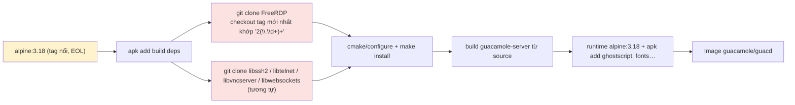

# 05 — Mã độc và chuỗi cung ứng

**Kết luận: KHÔNG phát hiện mã độc, backdoor hay prompt injection** trong các mục đã quét dưới đây (cấp `chuyen-sau`, toàn bộ `malware-supply-chain.md` §2).

"Không phát hiện" chỉ có nghĩa với những mục đã quét. Có một vấn đề chuỗi cung ứng mức Medium (`MAL-01`).

`malwareStatus`: `none`.

## 1. Kết quả quét

| Mục (§ trong reference) | Cách quét (chỉ đọc) | Kết quả |
|---|---|---|
| 2.1 Obfuscation | Tìm dòng > 400 ký tự trong `.c/.h/.java/.js/.sh`; chuỗi base64 ≥ 200 ký tự; tên `_0x…` | Không có |
| 2.2 Thực thi động | `eval(`, `new Function(`, `Runtime.exec`, `ProcessBuilder`, `system/popen/exec*` trong C | Chỉ có `$scope.$eval` (cú pháp AngularJS, đánh giá attribute của template) và `execvp` gọi Ghostscript cho in RDP (`S/protocols/rdp/print-job.c:357`, chức năng có tài liệu, xem `SEC-21`) |
| 2.3 Gọi mạng bất thường | Liệt kê domain trong code | Toàn bộ là link tài liệu: apache.org, microsoft docs, IETF, wikipedia, github, keeper docs, example.net trong test. Không có IP cứng. Domain cũ `guac-dev.org` chỉ xuất hiện trong comment (`DOC-02`) |
| 2.3 Webhook / pastebin / ngrok | regex tổng hợp | Không có |
| 2.4 Backdoor | Mật khẩu master, header bypass, route ẩn | Không có. Toàn bộ REST resource nằm trong `W/rest/**` và được Jersey scan; extension đăng ký resource qua `getResource()`. Admin seed `guacadmin` là chức năng có tài liệu (`SEC-05`, không phải `MAL`) |
| 2.5 Crypto miner | `stratum`, `xmrig`, `coinhive`… | Không có |
| 2.6 Hook khi cài đặt | `package.json` scripts; `hasInstallScript` trong lockfile; git hooks; `.vscode` | `package.json` chỉ có `build: webpack`. Install script nằm trong dependency: `core-js` (postinstall in thông báo funding, đã biết) và `fsevents` (optional, native). Không có `.husky`/`.githooks`/`.vscode` |
| 2.7 File lạ | `git ls-files` tìm `.exe/.dll/.so/.jar/.class/.pyc/.node/.bin` | Không có file nhị phân nào trong cả hai repo |
| 2.8 Unicode ẩn | `rg` tìm bidi U+202A–202E, U+2066–2069, zero-width U+200B–200D, U+2060, U+FEFF | Không có |
| 2.9 Dependency | Lockfile `resolved`; typosquatting; nguồn Maven | 2 lockfile npm v3, **100% `resolved` trỏ `registry.npmjs.org`** (frontend 364, common-js 191 mục). Tên dependency quen thuộc (angular, jquery, lodash, webpack…). Maven: không khai báo `<repository>` ngoài Central; phiên bản ghim cụ thể; không dùng `LATEST`/`RELEASE`/range. npm dùng `^` nhưng build chạy `npm ci` theo lockfile |
| 2.10 CI/CD | Workflow, `pull_request_target`, `${{ github.event.* }}` trong `run:` | Một workflow `pr-build.yml` mỗi repo, trigger `pull_request`, `persist-credentials: false`, chỉ chạy `docker build`. `github.head_ref` chỉ dùng trong `concurrency.group`, không nằm trong `run:` nên không bị chèn lệnh. Action `actions/checkout@v3` không ghim SHA (`OPS-02`) |
| 2.10 Docker | `curl\|bash`, tải không checksum | Không có `curl \| sh`. **Có** tải mã/JAR không kiểm checksum (`MAL-01`) |
| Agent config / prompt injection | `CLAUDE.md`, `AGENTS.md`, `.cursorrules`, copilot; grep "ignore previous", "language model", "as an ai" | Không có file cấu hình agent. Không có câu nào nhắm vào AI |
| Lịch sử git | Commit gần đây của người đóng góp lẻ; commit lớn; file code đã xoá | Commit lớn từ 2025 đều của maintainer (cập nhật dependency, refactor threading, migrate license) hoặc bản dịch. Đã đọc diff các commit một lần của người lạ (ví dụ `801c24a4` "guacd fails to start when guacd.conf doesn't exist", `bf1b62d3` RDP busy-loop, `ef02e1c3` UTF-16 big-endian): đều là sửa lỗi bình thường. Có 524/87 file code từng bị xoá trong lịch sử (client/server); không đọc hết từng file (xem mục 3) |
| Secret | Regex `password/secret/api_key/token = "…"`; private key/cert; file `.env`, `.pem`, `.jks` hiện tại và trong lịch sử | Không có secret thật. Kết quả khớp chỉ là tên hằng (`PASSWORD_TOKEN = "GUAC_PASSWORD"`). Không có private key (`common-ssh/key.h` chỉ chứa chuỗi header PEM để parse). Mật khẩu mặc định của `guacadmin` là giá trị công khai trong seed SQL (`SEC-05`) |

## 2. Vấn đề chuỗi cung ứng

| Mã | Mức | Tóm tắt |
|---|---|---|
| `MAL-01` | Medium | `autobuild.sh` clone FreeRDP/libssh2/libtelnet/libvncserver/libwebsockets rồi checkout "tag mới nhất khớp regex", không ghim commit, không kiểm chữ ký. `020-download-drivers.sh` dùng `curl -L` (không `-f`, không checksum) để tải MySQL/PostgreSQL/SQL Server JDBC driver vào classpath |
| `OPS-01` | Medium | Base image `alpine:3.18`, `openssl1.1-compat`, Node 16 (EOL) |
| `OPS-02` | Medium | Action không ghim SHA, không khai báo `permissions`; dependency-check chỉ là profile opt-in |

Sơ đồ chuỗi build image guacd và các điểm cần ghim:

Đề xuất: ghim `FROM alpine@sha256:…`, ghim từng dependency theo commit SHA kèm `sha256sum` của tarball, dùng `curl -fsSL` cho JDBC driver kèm checksum (hoặc lấy từ Maven Central).

## 3. Phần chưa quét hết

- Không đọc nội dung từng file code đã bị xoá trong lịch sử (client 524, server 87 đường dẫn). Chỉ thống kê, và kiểm commit của tác giả lạ trong 2 năm gần nhất.
- Không chạy `npm audit`, `osv-scanner`, `gitleaks`, `trufflehog`, vì máy review không cài sẵn. Danh sách CVE của dependency vì vậy là **Chưa đủ dữ liệu**.
- Không kiểm chữ ký các tag git của upstream FreeRDP/libssh2…
