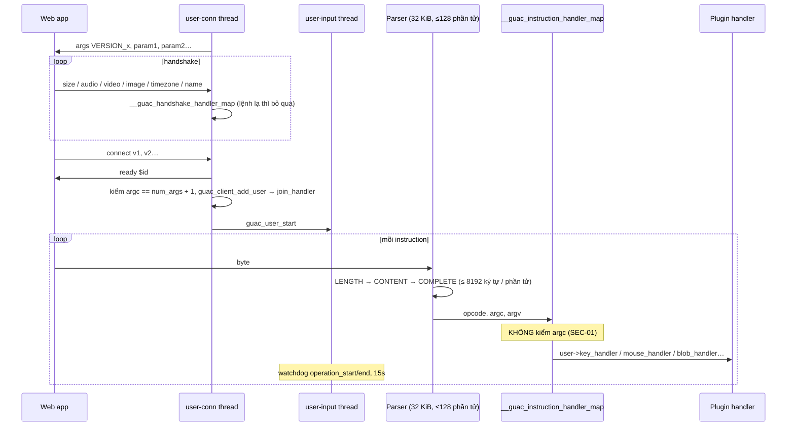
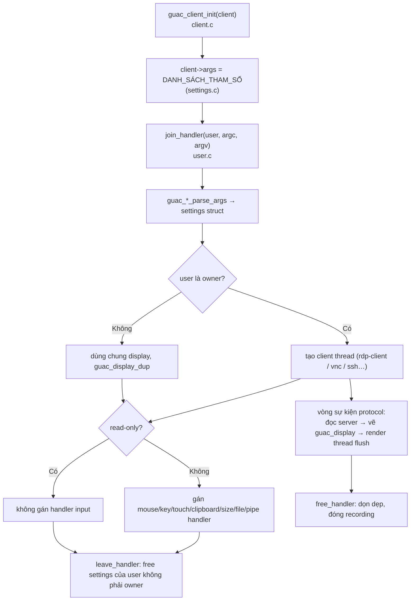

# 06 — Backend: guacd/libguac/plugin (C) và web app Java

"Backend" của Guacamole có hai tầng, viết bằng hai ngôn ngữ:
- **guacamole-server (C99, Autotools)**: dịch giao thức. Khoảng 104k dòng không kể test. Lõi `guacd` + `libguac` khoảng 36,8k dòng, plugin và code dùng chung khoảng 69,3k dòng.
- **guacamole-client (Java 8 target, Maven)**: xác thực, phân quyền, REST, tunnel. Lõi khoảng 55,4k dòng; extension khoảng 56k dòng, riêng JDBC 26,4k.

Reference `backend/common.md` viết cho web framework (FastAPI/Express), nên được **ánh xạ** như sau:

| Khái niệm | Java (Guacamole) | C (guacd) |
|---|---|---|
| Router | Jersey resource `W/rest/**` | bảng `__guac_instruction_handler_map` (`S/libguac/user-handlers.c:38-58`) |
| Service | `AuthenticationService`, `TunnelRequestService`, service của JDBC | handler trong plugin (`S/protocols/*/input.c`, `clipboard.c`…) |
| Schema / validation | `APIConnection`, `APIPatch`, translator | `guac_user_parse_args_*` (`S/libguac/user.c`), `settings.c` |
| DI | Guice (hợp lý: nhiều provider thật) | không có: function pointer, vtable `guac_socket` |
| Config | `guacamole.properties` + env + `_FILE` | `guacd.conf` + CLI |

---

## 1. guacd và libguac

### 1.1 Cấu trúc thư mục thực tế

```text
src/guacd/            daemon.c (main, accept), connection.c (route select/join), proc.c (fork/fexecve, watchdog),
                      proc-child.c (process con), proc-map.c (bảng connection ID → process), move-fd.c (SCM_RIGHTS),
                      conf-file.c / conf-args.c, proc-title.c
src/libguac/          socket*.c (fd, ssl, broadcast, nest, tee, wsa), parser.c, protocol.c (send_* / base64),
                      user.c, user-handshake.c, user-handlers.c, client.c, client-watchdog.c,
                      display*.c (render thread, worker, plan), recording.c, file.c (guac_openat),
                      mem.c (cấp phát có kiểm tràn), thread.c, rwlock.c, flag.c, fifo.c, pool.c, string.c, unicode.c, wol.c
src/libguac/guacamole/  header public (API cho plugin)
src/libguac/tests/      CUnit, 88 hàm test
```

### 1.2 Vòng đời lệnh trong process con



### 1.3 Đánh giá

| Khía cạnh | Hiện trạng | Mã |
|---|---|---|
| Process model | Rất tốt: fork + fexecve, process group, `PR_SET_PDEATHSIG`, `waitid(WNOWAIT)`, watchdog có timeout cho cả teardown, `_exit` | — |
| An toàn bộ nhớ | API `guac_mem_*` kiểm tràn (`ckd_mul`), `free` đặt con trỏ về NULL. Thiếu kiểm `argc`, UTF-8 không được validate | `SEC-01`, `SEC-02`, `CODE-03` |
| Đồng thời | `guac_rwlock` reentrant, `guac_flag`. Lock broadcast duyệt danh sách hai lần, `client->state` không atomic | `CODE-01` |
| Giới hạn tài nguyên | Parser có giới hạn cứng; không giới hạn số kết nối | `SEC-12` |
| TLS | Chỉ load cert/key | `SEC-08` |
| Tín hiệu | Handler chỉ đặt cờ `sig_atomic_t`; ignore SIGPIPE; con ignore SIGCHLD | — |
| Build | `-Werror -Wall -pedantic` cho guacd và libguac | — |
| Cấu hình | `guacd.conf` có 3 section `[server]`, `[daemon]`, `[ssl]`; dòng quá dài bị bỏ qua im lặng | `ERR-06` |

## 2. Protocol plugin

### 2.1 Khung chung (mẫu "template method")



### 2.2 So sánh các plugin

| Plugin | Thư viện | Dòng | Tính năng chính | Rủi ro nổi bật |
|---|---|---|---|---|
| RDP | FreeRDP 2/3 | 22,8k | NLA/TLS, gateway, RemoteApp (RAIL), drive (RDPDR), printer (Ghostscript), audio in/out, clipboard, multi-touch, display update, WOL, SFTP | `SEC-03`, `SEC-07`, `SEC-21`, `SEC-22`, `VAL-01`, `CODE-04` |
| VNC | libvncclient | 4,5k | password, reverse connect, clipboard nhiều encoding, PulseAudio, SFTP | `SEC-17` (reverse) |
| SSH | libssh2 | 3,3k + common-ssh 3,3k | password/key/passphrase, host key, SFTP, typescript, terminal | `SEC-17`, `ERR-01`, `ERR-02`, `CODE-02` |
| Telnet | libtelnet | 2,7k | tự đăng nhập bằng regex trên output | — |
| Kubernetes | libwebsockets | 3,5k | attach/exec pod, TLS client cert | `SEC-17` (`use-ssl` mặc định false), `ERR-10` |
| Terminal (dùng chung) | — | 14,3k | VT100/xterm, scrollback, selection, OSC riêng (upload/download/pipe), font Pango | `SEC-02` (title), `SEC-28`, `ERR-04` |

### 2.3 Điểm tốt về kỹ thuật (có bằng chứng)

- **Kiểm độ dài PDU** bằng `Stream_GetRemainingLength` ở rdpdr, rdpsnd, guacai.
- **Hạn chế hàm chuỗi nguy hiểm:** 0 `strcat`/`alloca`; 5 `strcpy` đều với hằng chuỗi; 16 `guac_strlcpy`; 20 `guac_mem_ckd_mul`.
- **`normalize_path` có unit test** (`S/protocols/rdp/tests/fs/normalize_path.c`, `S/common-ssh/tests/sftp/normalize_path.c`).
- **Terminal phòng thủ tốt:** `fit_to_range`, `MAX_COLUMNS = 1024`, scrollback có giới hạn.

## 3. Web app Java

### 3.1 Cấu trúc thư mục thực tế (`W/`)

```text
W/
├── GuacamoleServletContextListener, GuacamoleSession, *Module.java   ← khởi động, Guice
├── auth/file/          ← FileAuthenticationProvider (user-mapping.xml)
├── extension/          ← ExtensionModule, Extension, ExtensionClassLoader, manifest, LanguageResourceService
├── rest/               ← Jersey resource theo nghiệp vụ
│   ├── auth/           ← TokenRESTService, AuthenticationService, HashTokenSessionMap, token generator
│   ├── session/ connection/ connectiongroup/ user/ usergroup/ sharingprofile/ activeconnection/
│   ├── permission/ history/ directory/ identifier/ patch/ schema/ language/ tunnel/
│   └── RESTExceptionMapper, APIError, RequestSizeFilter
├── tunnel/             ← TunnelRequestService, TunnelRequest, StreamInterceptingTunnel, http/, websocket/{jsr356,jetty8,jetty9,tomcat}
├── event/              ← EventLoggingListener, RemoteAddress
└── log/                ← ContextAwareLogger, LogModule
```

Đối chiếu với `architecture-modular.md`:
- Module theo nghiệp vụ, mỗi nhóm resource một thư mục.
- `directory/` cung cấp lớp generic `DirectoryResource<…>` để CRUD dùng lại cho mọi loại object. Đây là trừu tượng **có lý do**: 6 loại object dùng chung một mẫu.
- Không thấy chuỗi DI thừa.

### 3.2 Đánh giá theo `backend/common.md`

| Hạng mục | Hiện trạng | Mã |
|---|---|---|
| Hợp đồng API | REST JSON nhất quán: `APIError` có `type`, `expected`, `translatableMessage`; PATCH theo kiểu JSON-Patch đơn giản (`op`, `path`, `value`) | — |
| Validation ở biên | `RequestSizeFilter` 2 MiB; parser protocol có giới hạn. Thiếu kiểm khoảng width/height/dpi; patch quyền sai trả 500 | `VAL-01`, `VAL-03` |
| Xử lý lỗi | `RESTExceptionMapper` map theo status, lỗi lạ thành "Unexpected internal error". Lộ message của `GuacamoleServerException`; bắt cả `Error` | `SEC-24`, `ERR-05` |
| Config và secret | `GUACAMOLE_HOME`, env, `_FILE` (Docker secret). Tốt | — |
| Auth | Token 256 bit, header; chuỗi provider; MFA qua insufficient credentials | `SEC-09`, `SEC-11`, `SEC-26` |
| Phân quyền | Ủy cho provider; REST tự kiểm một số điểm (tham số connection, đổi mật khẩu) | `SEC-20`, `VAL-02` |
| Vận hành | Logback, log theo context extension, `EventLoggingListener`. Thiếu audit cho quyền | `OPS-03` |
| Lifecycle tunnel | Veto không đóng tunnel; thread raw | `BE-01`, `PERF-01` |

### 3.3 Hiện trạng và mục tiêu (không viết lại)

Cấu trúc hiện tại phù hợp với quy mô: khoảng 210 file webapp, 14 extension. **Không đề xuất** tách microservice hay đổi framework backend. Các thay đổi đề xuất đều cục bộ:

```text
W/
├── rest/directory/DirectoryResource.java     ← tách patchObjects thành 3 method add/replace/remove (ARCH-04)
├── rest/permission/PermissionSetResource.java← validate input → 400, phát PermissionChangeEvent (VAL-03, OPS-03)
├── rest/user/UserResource.java               ← đổi mật khẩu qua AuthenticationService, chỉ cho self (SEC-20)
├── tunnel/TunnelRequestService.java          ← đóng tunnel khi veto, validate size/dpi (BE-01, VAL-01)
└── security/SecurityHeadersFilter.java       ← MỚI: CSP, XFO, nosniff, Referrer-Policy (SEC-10)
```

## 4. Extension (tóm tắt, chi tiết DB ở `08-DATABASE.md`)

| Extension | Dòng Java | Test | Nhận xét chính |
|---|---|---|---|
| auth-jdbc | 26.406 | 0 | Mô hình quyền tốt, SQL được tham số hoá; hash yếu (`SEC-04`); lặp 3 DB (`ARCH-02`) |
| auth-sso (openid/saml/cas/ssl) | 6.273 | 4 | Validate tốt; implicit flow, CAS any proxy (`SEC-16`) |
| vault (KSM) | 5.291 | 1 | Decorate mọi provider để chèn secret qua token |
| auth-ldap | 5.205 | 0 | Không có injection; referral hạ cấp mã hoá (`SEC-16`) |
| auth-restrict | 2.855 | 0 | Lỗi ngày qua nửa đêm (`ERR-07`) |
| auth-totp | 2.368 | 3 | Chống replay tốt; fail-open (`SEC-13`) |
| auth-json | 2.237 | 3 | Crypto tự thiết kế (`SEC-15`) |
| auth-radius | 1.637 | 0 | Blast-RADIUS chưa rõ (`SEC-30`) |
| auth-quickconnect | 1.050 | 1 | Mặc định cho mọi tham số (`SEC-06`) |
| auth-duo | 846 | 0 | Universal Prompt, fail-closed (tốt) |
| history-recording-storage | 741 | 0 | Tìm file theo UUID (tốt) |
| auth-ban | 646 | 0 | Chỉ theo IP (`SEC-20`) |
| auth-header | 413 | 0 | Tin header vô điều kiện (`SEC-18`) |
| display-statistics | (JS 111 dòng) | 0 | — |
