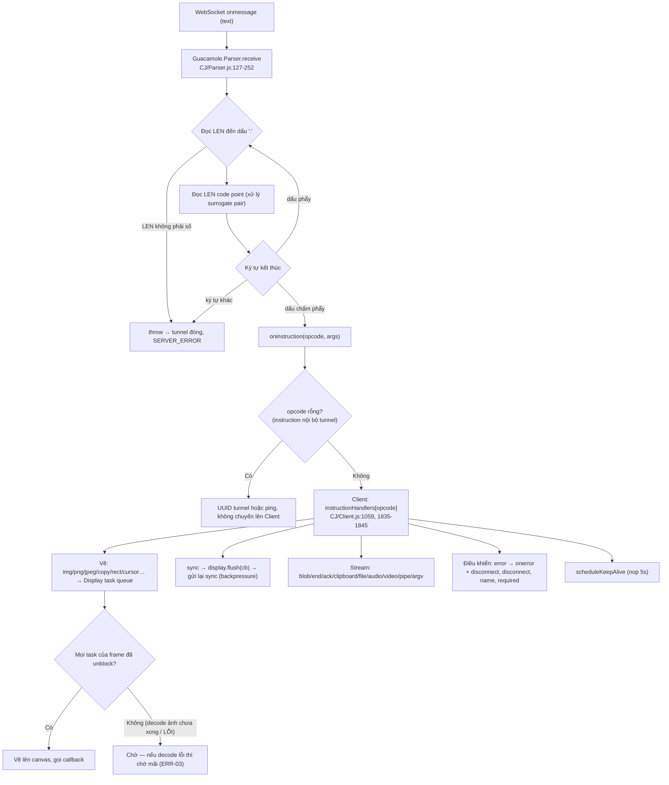

# 07 — Frontend: guacamole-common-js và ứng dụng AngularJS

## 1. Hai lớp frontend

| Lớp | Đường dẫn | Dòng thô | Dòng code thực | Vai trò |
|---|---|---|---|---|
| `guacamole-common-js` | `guacamole-common-js/src/main/webapp/modules/` (35 file) | 17.872 | 5.387 (54% là JSDoc) | Thư viện **độc lập framework**: Client, Tunnel, Parser, Display/Layer, Keyboard, Mouse/Touch, Audio/Video, SessionRecording, OnScreenKeyboard |
| SPA AngularJS | `guacamole/src/main/frontend/src/app/` (223 file JS, 90 template, 16 bản dịch) | 40.715 | 12.896 | UI: login, home, client, manage, settings, import, player, notification |

Stack:
- AngularJS **1.8.3 (EOL)**, angular-route, angular-translate 2.19.1 + messageformat 1.0.2.
- jQuery 3.7.1, lodash 4.18.1.
- webpack 5.108.4, Terser.
- Node 24.13.0 cho build frontend, Node 16.19.1 cho test common-js.
- Lockfile npm v3; build dùng `npm ci`.

Đánh giá tách lớp: **đây là quyết định kiến trúc rất tốt.** Toàn bộ "động cơ" remote desktop nằm trong `guacamole-common-js`, không phụ thuộc AngularJS. Vì vậy việc thay framework UI (ADR-05) không đụng tới phần khó nhất.

## 2. Cấu trúc module SPA

```text
FE/
├── index/        ← bootstrap, route config (indexRouteConfig.js), indexController (keyboard, clipboard, kiểm session 15s)
├── auth/         ← authenticationService (token, login, re-auth), AuthenticationResult
├── rest/         ← service gọi REST: connectionGroupService, tunnelService, permissionService… + types/
├── client/       ← clientController, ManagedClient, ManagedClientGroup, guacClient directive, file transfer, notification
├── home/ manage/ settings/ import/ player/ history/   ← màn hình theo nghiệp vụ
├── form/ list/ element/ touch/ osk/ textInput/ navigation/ notification/ storage/ locale/   ← dùng chung
└── translations/ ← en.json, …
```

So với `frontend/common.md`:

| Tiêu chí | Hiện trạng | Đánh giá |
|---|---|---|
| Tổ chức theo feature | Có (`client/`, `manage/`, `settings/`…), mỗi feature gồm controllers/directives/services/templates/types | Tốt |
| Tầng gọi API một nơi | `FE/rest/services/*` + `authenticationService.request` gắn header `Guacamole-Token` | Tốt |
| Types tập trung | `FE/rest/types/*.js` (class JS, không TypeScript) | Chấp nhận được |
| Phân vai state | Kết hợp service singleton, `$rootScope.$broadcast` và `ManagedClient` | Phụ thuộc broadcast, khó lần theo |
| Bảo mật | Không dùng `ng-bind-html`/`$sce.trustAsHtml`/`eval`; translate escape; token trong localStorage; thiếu CSP | `SEC-10`, `SEC-11` |
| Kích thước | `ManagedClient.js` 1147 dòng, `clientController` 880, `importConnectionsController` 922 (thô) | Chấp nhận được |
| Test | 0 | `TEST-02` |
| Lint | Không có | `OPS-02` |

## 3. Luồng xử lý instruction trong trình duyệt



## 4. Các vấn đề frontend (tham chiếu)

| Mã | Mức | Tóm tắt |
|---|---|---|
| `SEC-09` | Medium | Token trong query string của WebSocket, download và upload |
| `SEC-10` | Medium | Không có CSP; token trong localStorage; JS của extension nạp ở phạm vi global |
| `SEC-11` | Medium | `$location.search()` ghi đè token đã lưu |
| `OPS-01` | Medium | AngularJS 1.8.3 EOL. Các CVE ReDoS/sanitize đã biết của 1.8.x chưa được tra lại trong phiên này. Mức phơi nhiễm thấp vì không dùng `ng-srcset`/`$resource`/ngSanitize |
| `ERR-03` | Medium | `ImageDecoder.decode()` / `createImageBitmap()` không có `.catch` |
| `ERR-05` | Low | `ChainedTunnel.onerror` truyền sai kiểu tham số |
| `CODE-05` | Low | Tra opcode/username trên object có prototype |
| `PERF-01` | Low | Parser JS không giới hạn độ dài; không có trần số stream inbound |
| `SEC-29` | Low | Clipboard lan sang mọi connection đang mở |
| `NAME-02` | Low | Trộn snake_case/camelCase, ES5/ES6 |
| `OPS-04` | Low | WAR chứa source map và source chưa bundle |
| `TEST-02` | High | Frontend 0 test, common-js 3 spec |

## 5. Điểm mạnh (có bằng chứng)

- **ChainedTunnel:** thử WebSocket trước, lỗi trước khi mở được thì fallback sang HTTP; `UPSTREAM_TIMEOUT` thì dừng (`CJ/Tunnel.js:1108-1222`).
- **HTTP tunnel:**
  - dữ liệu connect nằm trong POST body (`:718-722`);
  - mỗi tunnel có token riêng truyền qua header `Guacamole-Tunnel-Token` (`:331, 662-663, 695-703`).
- **Parser chặt:** throw khi sai định dạng; đếm code point đúng với surrogate pair; `ParserSpec` có 10 nhóm test.
- **Download an toàn:** tên file được sanitize (`FE/rest/services/tunnelService.js:173-174, 217`); server ép `attachment`.
- **Thông báo lỗi dịch theo status code** (`FE/client/directives/guacClientNotification.js:220-238`), không render text do server gửi. Tự reconnect cho các mã tạm thời (`:73-94`).
- **Cơ chế chịu lỗi mạng:**
  - keep-alive được lịch lại theo hoạt động mạng;
  - trạng thái UNSTABLE ở 1,5 s;
  - giới hạn 512 outbound stream;
  - kiểm session định kỳ 15 s.

## 6. Lộ trình frontend (không viết lại ngay)

1. **Ngay:** sửa `ERR-03`, `ERR-05`; không cho URL ghi đè token (`SEC-11`); upload dùng header (`SEC-09`).
2. **Trước khi dùng ở production:** thêm CSP qua filter hoặc proxy (`SEC-10`); thêm ESLint tối thiểu; viết test common-js cho Tunnel/Display.
3. **Phiên bản sau:** ADR-05. Chuyển dần UI khỏi AngularJS theo từng màn hình (login → home → settings → client), giữ `guacamole-common-js` nguyên vẹn. Cách này cũng giải quyết `NAME-02` khi chạm vào file.
4. **Không nên làm:** viết lại `guacamole-common-js` bằng framework, vì nó đang độc lập framework và chạy ổn định.
