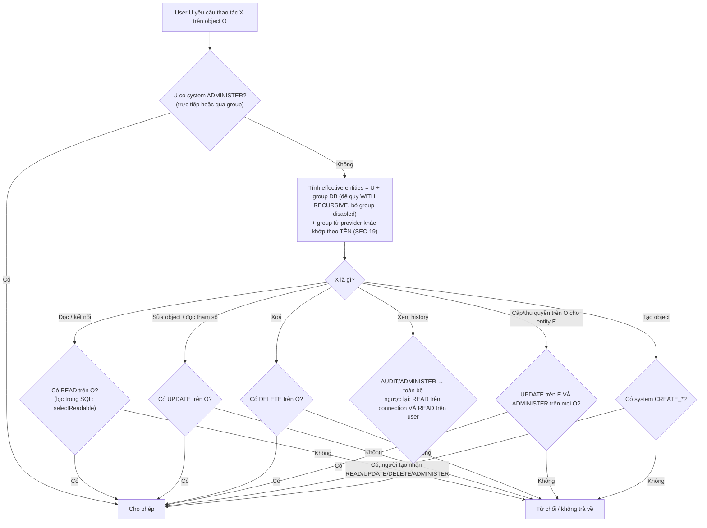

# 08 — Database (guacamole-auth-jdbc)

> Ký hiệu: `J/` = `extensions/guacamole-auth-jdbc/modules/guacamole-auth-jdbc-base/src/main/java/org/apache/guacamole/auth/jdbc/` · `MX/` = `extensions/guacamole-auth-jdbc/modules/guacamole-auth-jdbc-mysql/src/main/resources/org/apache/guacamole/auth/jdbc/`

## 1. Tổng quan

| Mục | Giá trị |
|---|---|
| Hệ quản trị hỗ trợ | MySQL/MariaDB, PostgreSQL, SQL Server |
| ORM / mapper | MyBatis + mybatis-guice, mapper XML riêng cho từng DB (21 file × 3) |
| Migration | Script SQL đánh số: `schema/001-create-schema.sql`, `002-create-admin-user.sql`, `schema/upgrade/upgrade-pre-X.Y.Z.sql` (MySQL 11, PostgreSQL 9, SQL Server 2). Không có bảng version, không có công cụ migration tự động |
| Khởi tạo | Thủ công. Image Docker có `initdb.sh` để in ra script; "Guacamole will not automatically create its own tables" (`guacamole-docker/README.md`) |
| Transaction | `@Transactional` của mybatis-guice ở tầng service |

## 2. Mô hình dữ liệu (ER rút gọn)

```mermaid
erDiagram
    guacamole_entity ||--o| guacamole_user : "type USER"
    guacamole_entity ||--o| guacamole_user_group : "type USER_GROUP"
    guacamole_user_group ||--o{ guacamole_user_group_member : "chứa"
    guacamole_entity ||--o{ guacamole_user_group_member : "là thành viên"
    guacamole_connection_group ||--o{ guacamole_connection_group : "parent"
    guacamole_connection_group ||--o{ guacamole_connection : "chứa"
    guacamole_connection ||--o{ guacamole_connection_parameter : "tham số"
    guacamole_connection ||--o{ guacamole_sharing_profile : "primary"
    guacamole_sharing_profile ||--o{ guacamole_sharing_profile_parameter : "tham số"
    guacamole_entity ||--o{ guacamole_system_permission : "được cấp"
    guacamole_entity ||--o{ guacamole_connection_permission : "được cấp"
    guacamole_connection ||--o{ guacamole_connection_permission : "đối tượng"
    guacamole_entity ||--o{ guacamole_connection_group_permission : "được cấp"
    guacamole_entity ||--o{ guacamole_sharing_profile_permission : "được cấp"
    guacamole_entity ||--o{ guacamole_user_permission : "được cấp"
    guacamole_user ||--o{ guacamole_user_permission : "affected_user"
    guacamole_entity ||--o{ guacamole_user_group_permission : "được cấp"
    guacamole_user ||--o{ guacamole_connection_history : "SET NULL"
    guacamole_connection ||--o{ guacamole_connection_history : "SET NULL"
    guacamole_user ||--o{ guacamole_user_history : "SET NULL"
    guacamole_user ||--o{ guacamole_user_password_history : "CASCADE"
    guacamole_user ||--o{ guacamole_user_attribute : "thuộc tính"

    guacamole_entity {
        int entity_id PK
        varchar name
        enum type "USER hoặc USER_GROUP, UNIQUE(type,name)"
    }
    guacamole_user {
        int user_id PK
        int entity_id FK "UNIQUE"
        binary password_hash "32 byte SHA-256"
        binary password_salt "32 byte, NULL được"
        datetime password_date
        boolean disabled
        boolean expired
        time access_window_start
        time access_window_end
        date valid_from
        date valid_until
        varchar timezone
    }
    guacamole_user_group {
        int user_group_id PK
        int entity_id FK
        boolean disabled
    }
    guacamole_user_group_member {
        int user_group_id PK
        int member_entity_id PK
    }
    guacamole_connection_group {
        int connection_group_id PK
        int parent_id FK
        varchar connection_group_name
        enum type "ORGANIZATIONAL hoặc BALANCING"
        int max_connections
        int max_connections_per_user
        boolean enable_session_affinity
    }
    guacamole_connection {
        int connection_id PK
        int parent_id FK
        varchar connection_name
        varchar protocol
        varchar proxy_hostname
        int proxy_port
        int max_connections
        int max_connections_per_user
        int connection_weight
        boolean failover_only
    }
    guacamole_connection_parameter {
        int connection_id PK
        varchar parameter_name PK
        varchar parameter_value "4096, PLAINTEXT kể cả password"
    }
    guacamole_sharing_profile {
        int sharing_profile_id PK
        int primary_connection_id FK
    }
    guacamole_sharing_profile_parameter {
        int sharing_profile_id PK
        varchar parameter_name PK
        varchar parameter_value
    }
    guacamole_system_permission {
        int entity_id PK
        enum permission PK "CREATE_*, AUDIT, ADMINISTER"
    }
    guacamole_connection_permission {
        int entity_id PK
        int connection_id PK
        enum permission PK "READ, UPDATE, DELETE, ADMINISTER"
    }
    guacamole_connection_group_permission {
        int entity_id PK
        int connection_group_id PK
        enum permission PK
    }
    guacamole_sharing_profile_permission {
        int entity_id PK
        int sharing_profile_id PK
        enum permission PK
    }
    guacamole_user_permission {
        int entity_id PK
        int affected_user_id PK
        enum permission PK
    }
    guacamole_user_group_permission {
        int entity_id PK
        int affected_user_group_id PK
        enum permission PK
    }
    guacamole_connection_history {
        int history_id PK
        int user_id FK
        varchar username
        varchar remote_host
        int connection_id FK
        varchar connection_name
        int sharing_profile_id
        datetime start_date
        datetime end_date "NULL khi đang chạy hoặc mồ côi"
    }
    guacamole_user_history {
        int history_id PK
        int user_id FK
        datetime start_date
        datetime end_date
    }
    guacamole_user_password_history {
        int password_history_id PK
        int user_id FK
        binary password_hash
        binary password_salt
        datetime password_date
    }
    guacamole_user_attribute {
        int user_id PK
        varchar attribute_name PK
        varchar attribute_value "kể cả TOTP secret"
    }
```

**Điểm thiết kế đáng chú ý:**
- **`guacamole_entity` gộp user và group** để bảng quyền chỉ cần một khóa `entity_id`. Nhờ vậy quyền cấp cho group và cho user dùng chung truy vấn. Đây là thiết kế tốt.
- **History dùng `ON DELETE SET NULL`** và lưu kèm `username`/`connection_name`, nên vẫn giữ được audit khi object bị xoá.
- **Mọi bảng quyền có khóa chính tổng hợp** và FK `CASCADE`, nên không có quyền mồ côi.

## 3. Quyết định quyền

Bằng chứng:
- `J/base/ModeledPermissions.java:148-151, 231-233`
- `J/base/ModeledDirectoryObjectService.java:68-73, 281, 309, 334, 416-450`
- `J/permission/ModeledObjectPermissionService.java:94-124`
- `J/permission/SystemPermissionService.java:126-130`
- `J/connection/ConnectionService.java:386-407, 495, 537-546`
- `MX/user/UserMapper.xml:80-91`
- `MX/connection/ConnectionRecordMapper.xml:190-205`

## 4. Đánh giá theo `database.md`

| Hạng mục | Hiện trạng | Mã |
|---|---|---|
| Ràng buộc | PK, FK `CASCADE`/`SET NULL`, `UNIQUE(type,name)`, `UNIQUE(name,parent)` đầy đủ | Tốt |
| Truy vấn an toàn | Mọi giá trị đi qua `#{}`; `${}` chỉ là property tĩnh của `<include>`; sort dùng `<choose>` trên enum | Tốt |
| N+1 / phân trang | Có `selectReadable(ids)` theo lô; history có `LIMIT` | Tốt |
| Transaction | Có `@Transactional`, nhưng bọc cả I/O mạng tới guacd | `DB-04` |
| Kết nối | Pool của MyBatis; SSL mặc định opportunistic | `DB-01` |
| Migration | Script thủ công, có upgrade theo phiên bản; không ghi version trong DB; số script lệch giữa 3 DB | `ARCH-02` |
| Charset | MySQL `utf8` (utf8mb3) | `DB-02` |
| Dữ liệu nhạy cảm | Mật khẩu máy đích, TOTP secret ở plaintext; hash user yếu | `SEC-14`, `SEC-04` |
| Retention | Không dọn history, không có job xử lý phiên mồ côi | `DB-03` |
| Seed | Admin mặc định; JOIN sai alias trong seed | `SEC-05`, `DB-05` |
| Concurrency | Giới hạn số phiên nằm trong RAM (CAS), không ghi DB | `ARCH-03` |

## 5. Đề xuất (theo thứ tự an toàn)

1. **Trước khi đổi gì:** viết test tích hợp (Testcontainers) cho `selectReadable`, cấp quyền, login, history trên cả 3 DB (`TEST-01`).
2. **Upgrade script mới** (cùng một version cho cả 3 DB):
   - thêm `password_hash_algorithm`;
   - đặt `expired = 1` cho `guacadmin` nếu vẫn dùng hash mặc định;
   - chuyển MySQL sang `utf8mb4`.
3. **Mã hoá cấp ứng dụng** cho `parameter_value` thuộc nhóm nhạy cảm và cho `guac-totp-key-secret` (`SEC-14`). Dùng envelope key từ `guacamole.properties` hoặc `_FILE`.
4. **Job khởi động** đóng các history `end_date IS NULL` cũ hơn uptime (`DB-03`).
5. **Không nên làm:** đổi sang ORM khác (JPA/Hibernate) để giảm lặp mapper. Chi phí và rủi ro lớn hơn lợi ích; dùng `<sql>`/`<include>` là đủ (`ARCH-02`).
