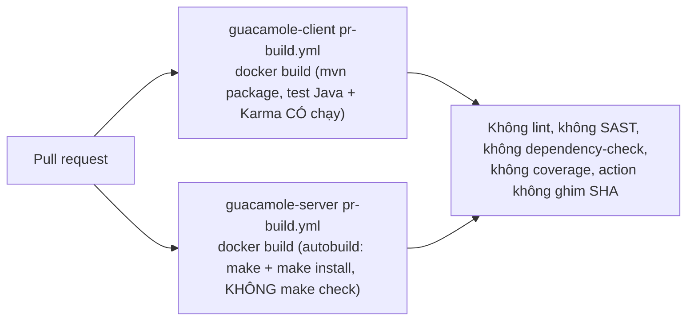

# 10 — Kiểm thử, tài liệu, vận hành

## 1. Kiểm thử

**Phân loại hiện trạng: "Có thật nhưng thiếu".** Test hiện có là test thật, có assert ý nghĩa và không có test giả. Nhưng chúng tập trung ở các hàm thuần (parser, mem, string, normalize path). Gần như mọi luồng rủi ro cao đều trống.

| Phần | Framework | Số lượng | Phủ gì | Thiếu gì |
|---|---|---|---|---|
| libguac | CUnit (`configure.ac:157`, runner sinh bằng `util/generate-test-runner.pl`) | 39 file, 88 hàm | client pool, fifo, file, flag, id, mem, parser (ca đúng), pool, protocol base64/version, rect, socket fd/nested, string, thread, unicode | parser ca lỗi/biên; `user-handlers`; broadcast socket |
| guacd | — | **0** | — | toàn bộ: route, proc, move-fd, conf |
| Plugin / common | CUnit | 18 file, 45 hàm | rdp fs basename/normalize, k8s url, common rect/iconv/string, sftp normalize, terminal selection | PDU RDPDR/rdpsnd/cliprdr, escape terminal, VNC/SSH/Telnet, recording |
| guacamole-common (Java) | JUnit 4.13.2 | 7 file | Parser, Reader, FilteredReader/Writer, Instruction, ProtocolVersion, Status | tunnel servlet, websocket, ConfiguredGuacamoleSocket |
| guacamole-ext | JUnit 4 | 6 file | Directory, EnumProperty, TimeZoneProperty, TokenFilter (grammar, name) | permission, decorating context |
| guacamole (webapp) | JUnit 4 | 1 file | GuacamoleVersion | **AuthenticationService, HashTokenSessionMap, REST, TunnelRequestService, ExtensionModule** |
| Extensions | JUnit 4 | 5 file / 12 `@Test` | json RequestValidation, quickconnect QCParser, cas LDAPGroupParser, totp generator, vault WindowsUsername | **jdbc (0), ldap (0), restrict (0), ban (0), header (0), duo (0)** |
| guacamole-common-js | Jasmine + Karma 6.4.4 (Firefox headless) | 3 spec, ~29 `it` | Parser, Event, SessionRecording | Tunnel, Client, Display, Keyboard |
| Frontend SPA | — | **0** | — | toàn bộ |

**Bản đồ ưu tiên viết test (theo rủi ro):**
1. **Phân quyền JDBC** (Testcontainers, 3 DB): `selectReadable`, cấp/thu quyền cần ADMINISTER, group lồng nhau, group disabled, history theo quyền.
2. **Auth:** `AuthenticationService` (thứ tự provider, insufficient credentials, re-auth), `HashTokenSessionMap` (hết hạn), TOTP (replay, fail-open), JSON auth (expires, chữ ký).
3. **Fuzz C:** `guac_parser_append`, `__guac_user_call_opcode_handler` với `argc` thiếu, `guac_utf8_strlen` với UTF-8 lỗi, `guac_terminal_write`, PDU rdpdr.
4. **Logic:** `DailyRestriction` qua nửa đêm, `TokenFilter` với hai token liên tiếp.
5. **JS:** `ChainedTunnel` fallback/timeout, `Display` với decode lỗi, `authenticationService` (không ghi đè token).

## 2. CI/CD

| Hạng mục | Hiện trạng | Mã |
|---|---|---|
| Trigger | `pull_request`, `persist-credentials: false`, `concurrency` hủy build cũ | Tốt |
| Test trong CI | Client: có, qua `-DskipTests=false` trong Dockerfile. Server: không | `TEST-04` |
| Kiểm tra chất lượng | `apache-rat` (license); `enforcer` | Thiếu lint/SAST (`OPS-02`) |
| Dependency | Dependabot alerts bật, PR tự động tắt (`.asf.yaml`); OWASP dependency-check 8.3.1 chỉ khi bật profile | `OPS-02` |
| Release / publish image | Không có trong repo (do quy trình release của ASF) | Chưa đủ dữ liệu |

## 3. Docker và triển khai

| Image | Base | Chạy bằng user | Điểm tốt | Vấn đề |
|---|---|---|---|---|
| `guacamole/guacd` | `alpine:3.18` (multi-stage) | `guacd` (UID 1000) | build FreeRDP với bộ option tối thiểu; `HEALTHCHECK nc -z`; `list-dependencies.sh` chỉ cài lib runtime cần thiết | bind `0.0.0.0` (`SEC-08`); Alpine/OpenSSL 1.1 EOL (`OPS-01`); dependency không ghim (`MAL-01`) |
| `guacamole/guacamole` | `tomcat:9-jdk21` (builder `maven:3-eclipse-temurin-21`) | `guacamole` (UID 1001) | biến môi trường ánh xạ sang property; hỗ trợ `_FILE` cho Docker secret; `BAN_ENABLED=true` mặc định; `CATALINA_BASE` tạm mỗi lần chạy | JDBC driver tải không checksum (`MAL-01`); builder cài Firefox từ PPA cho test Karma (image builder to) |

**Đối chiếu file env (bắt buộc):** cả hai repo **không có** cặp file env mẫu/thật nào (`.env`, `.env.example`, `.env.sample`…). Cấu hình lấy từ `guacamole.properties`, `guacd.conf` và biến môi trường của Docker (tài liệu ở `guacamole-docker/README.md` và thư mục `environment/`). Vì vậy quy tắc đồng bộ env **không áp dụng** và không có biến nào chờ điền.

## 4. Logging và giám sát

| Hạng mục | Hiện trạng |
|---|---|
| Web app | Logback, logger theo context của từng extension (`ContextAwareLogger`), `log-level` cấu hình được, `EventLoggingListener` ghi auth và thay đổi object |
| guacd | syslog + stderr, `-L` level, process title cho thấy protocol/host (`SEC-24`) |
| Audit | History kết nối và đăng nhập trong DB; **thiếu** audit thay đổi quyền (`OPS-03`) |
| Metrics / health | guacd: `HEALTHCHECK` TCP; web app: không có endpoint health/metrics riêng |
| Log nhạy cảm | Token đầy đủ ở mức DEBUG (`SEC-09`); connection ID ở mức INFO (`SEC-24`) |

## 5. Tài liệu

| Tài liệu | Có trong repo? | Đánh giá |
|---|---|---|
| README build | Có (text, ngắn) | Đủ cho người build từ source; dạng cũ (`DOC-02`) |
| README Docker | Có, chi tiết (`guacamole-docker/README.md`) | Tốt |
| Unit test guide | `guacamole-server/README-unit-testing.md` | Tốt |
| Manual người dùng/quản trị | **Không**, nằm ở repo `apache/guacamole-manual` (ngoài phạm vi) | Chưa đủ dữ liệu |
| Tài liệu API | Javadoc, JSDoc (`jsdoc-conf.json`), header C có doc comment | Tốt |
| Mô hình bảo mật / ranh giới tin cậy | Không có trong repo | `DOC-01` |
| CONTRIBUTING, LICENSE, NOTICE | Có | Tốt |
| Ví dụ | `doc/guacamole-example`, `guacamole-playback-example`, `guacamole-branding-example` | Tốt |
